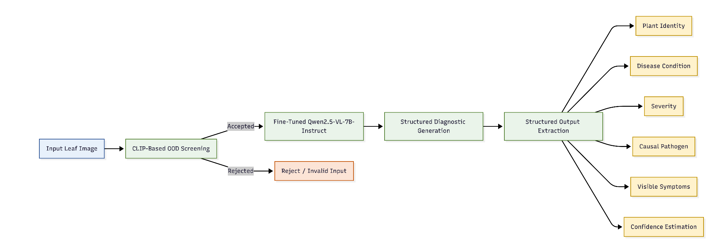
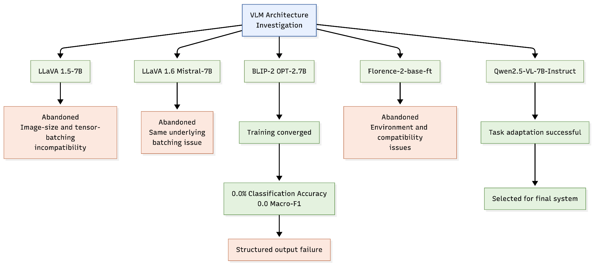

<!-- Text and figures extracted from `VLM_Structured_Diagnosis_OOD_draft_2026-08-31_v2.docx` so it can be read on GitHub; the original file is next to this one. -->

A Vision-Language Framework for Structured Plant Disease Diagnosis with Out-of-Distribution Detection

Aakash Trimbak Jawle

Computer Engineering

Pimpri Chinchwad College of Engineering

Pune, India

aakashjawle101@gmail.com

Kamaaksha Rajendra Kharul

Computer Engineering

Pimpri Chinchwad College of Engineering

Pune, India

kharulkamaaksha@gmail.com

Dr. Santwana Gudadhe

Assistant Professor

Pimpri Chinchwad College of Engineering

Pune, India

santwana.gudadhe@pccoepune.org

Abstract- Plant disease identification is sometimes formulated as an image classification problem, where a leaf picture is classified into one of the established disease categories. This approach is useful to recognize sickness but class labels alone do not give much valuable information for the purpose of diagnosis. In this article we explore the potential of Vision-Language Models (VLMs) to directly infer structured plant disease diagnoses from leaf photos. The diagnostic structure we propose includes plant, disease, severity, causing organism and visual observable symptoms. For this objective, we have tested many multimodal architectures such as LLaVA 1.5-7B, LLaVA 1.6 Mistral-7B, BLIP-2 OPT-2.7B, Florence-2-base-ft, and Qwen2.5-VL-7B-Instruct. In our experiments we met and addressed real issues with image resolution, tensor batching and robust development of structured outputs. Based on this comparative evaluation, Qwen2.5-VL-7B-Instruct was chosen for parameter-efficient fine-tuning. It also included an OOD screening stage using CLIP to find images outside the target domain before diagnosis. The fine-tuned Qwen2.5-VL model scored 98.50% accuracy and 0.9827 Macro-F1 on the final test set, with precision and recall of 0.9836 and 0.9823, respectively. The BLEU-1, BLEU-4 and ROUGE-L scores of the diagnostic descriptions generated by the model were 0.6047, 0.4556 and 0.5869 respectively. We conclude that the model could provide replies commensurate with the predicted diagnostic descriptions. Besides disease identification and diagnosis generation, the model also achieved a good performance in severity assessment with R² of 0.9654 and MAE of 0.025. Overall, the results reveal the potential of fine-tuned VLMs to push plant disease analysis beyond classical classification, toward organized and more useful visual diagnosis.

Keywords- Plant disease identification, Vision-Language Models, Qwen2.5-VL, multimodal learning, structured diagnosis, out-of-distribution detection, CLIP, severity estimation, parameter-efficient fine-tuning

### I. INTRODUCTION

### A. Background and Motivation

Plant diseases can adversely affect agricultural production, making timely identification of disease symptoms important for effective crop management. Conventional computer vision approaches for automated plant disease diagnosis primarily formulate the problem as image classification, where a leaf image is mapped to one of a predefined set of disease categories. Although classification-based systems can achieve strong recognition performance under controlled conditions, a disease label alone provides limited information about the observed condition.

Vision-Language Models (VLMs) offer an alternative philosophy by combining the ability to understand what you see with the ability to create language. A VLM can make a textual response describing what it sees given an image and task-specific instructions. It's not limited to making a single categorical forecast. This capability is particularly useful for diagnostic applications in which multiple attributes must be communicated within a single response.

The system investigated in this work, PlantDx, uses this multimodal capability to generate structured diagnostic information from leaf images. The diagnostic representation includes plant identity, disease condition, severity, causal pathogen, and visible symptoms, thereby extending the task beyond conventional disease classification.

However, the use of a general-purpose VLM does not by itself guarantee reliable performance for fine-grained plant disease diagnosis. Different multimodal architectures employ different mechanisms for visual representation and multimodal fusion, and their behavior can vary considerably for specialized visual tasks. Consequently, this work investigates multiple VLM architectures as part of the model-development process rather than assuming that a single architecture is inherently suitable for the diagnostic task.

### B. Problem Statement

A structured plant disease diagnosis system must address multiple requirements simultaneously. The model must distinguish between visually similar disease conditions, generate the required diagnostic attributes in a consistent format, and operate within a pipeline capable of handling unsuitable inputs.

During the development of PlantDx, several challenges were observed while investigating different multimodal architectures. LLaVA 1.5-7B and LLaVA 1.6 Mistral-7B encountered image-size and tensor-collation incompatibilities during batch construction. BLIP-2 OPT-2.7B completed training but did not reliably maintain the structured diagnostic format required for downstream extraction. Florence-2-base-ft was also investigated but was discontinued because of environment and compatibility issues.

These observations motivate the investigation of a multimodal architecture that can be adapted to the structured diagnostic task while supporting reliable downstream processing. In addition, an input-domain screening mechanism is required to reduce the likelihood of passing unsuitable images directly to the diagnostic model. The resulting approach therefore combines VLM-based diagnosis with structured output processing and CLIP-based OOD screening.

### C. Contributions

The main contributions of this work are as follows:

A VLM-based framework is developed for structured plant disease diagnosis, generating plant identity, disease condition, severity, causal pathogen, and visible symptom information from leaf images.

A systematic investigation of multiple VLM architectures is presented, including LLaVA, BLIP-2, Florence-2, and Qwen2.5-VL, with the observed implementation and architectural limitations documented.

Qwen2.5-VL-7B-Instruct is adapted for the diagnostic task using parameter-efficient fine-tuning and evaluated for disease classification, diagnostic text generation, and severity estimation.

A CLIP-based OOD screening stage is incorporated before VLM inference to provide input-domain validation.

The final adapted model achieves 98.50% classification accuracy and 0.9827 Macro-F1, while severity estimation achieves an R² of 0.9654 and MAE of 0.025 on the reported evaluation set.

A modular inference pipeline is developed that integrates OOD screening, VLM inference, confidence estimation, and structured diagnostic-field extraction.

II. METHODOLOGY

#### A. System Overview

Using a Vision-Language Model (VLM), the suggested PlantDx framework is meant to do structured disease diagnosis on a single leaf image. The framework creates a structured diagnostic response with five attributes: plant identity, disease condition, severity, causal pathogen, and visible symptoms. This is different from other image-classification systems that only produce a disease label.

The final inference pipeline consists of an input-domain screening stage followed by multimodal diagnosis and structured output processing. The input image is first evaluated using a CLIP-based out-of-distribution (OOD) screening mechanism. Images that satisfy the target-domain criterion are forwarded to the fine-tuned Qwen2.5-VL-7B-Instruct model, while unsuitable inputs can be rejected before diagnostic inference. The generated response is subsequently processed to extract the predefined diagnostic fields and associated confidence information.

Fig. 1 illustrates the overall architecture of the proposed PlantDx framework. The complete inference workflow can be represented as:

Input Leaf Image -> CLIP-Based OOD Screening -> Fine-Tuned Qwen2.5-VL-7B-Instruct -> Structured Diagnostic Generation -> Structured Output Extraction

The extracted diagnostic information consists of plant identity, disease condition, severity, causal pathogen, and visible symptoms. Confidence estimation is additionally performed as part of the inference process.

The implementation is organized into modular training and inference components. The training component handles dataset preparation, model optimization, checkpoint management, and experiment tracking, while the inference component integrates OOD screening, VLM inference, confidence estimation, and structured-field extraction. This modular design allows the model-development

Fig. 1. Overall architecture of the proposed PlantDx framework for structured plant disease diagnosis

experiments and the final diagnostic inference workflow to be handled independently.

#### B. Dataset Preparation

The primary dataset used in the model-development experiments is the PlantVillage dataset. The data were organized according to disease classes and converted into multimodal training examples consisting of an input leaf image, an instruction, and a corresponding structured diagnostic target.

A fixed validation set was maintained throughout the experiments to provide a consistent basis for model comparison. The validation data were not augmented, allowing the different architectures to be evaluated under the same validation conditions.

The dataset-processing stage prepares the image-label information required by the multimodal training pipeline. Rather than using the disease label alone as the training target, the label information is incorporated into a structured diagnostic response containing the attributes required by the task.

#### C. Structured Diagnostic Caption Construction

The training task was formulated as structured diagnostic text generation rather than conventional single-label classification. Each training example associates a leaf image with a diagnostic response containing plant identity, disease condition, severity, causal pathogen, and visible symptoms.

Predefined templates were used to construct the diagnostic targets from disease-class information. Multiple templates were associated with the disease categories to introduce variation in the generated training responses while preserving the required diagnostic information. The resulting responses provide a consistent textual representation that can be learned by the VLM and subsequently processed into individual diagnostic fields during inference.

This approach allows the same model to perform disease recognition and diagnostic-text generation within a unified multimodal task.

#### D. VLM Architecture Investigation

Multiple VLM architectures were investigated during system development to determine their suitability for structured plant disease diagnosis. The investigated architectures included LLaVA 1.5-7B, LLaVA 1.6 Mistral-7B, BLIP-2 OPT-2.7B, Florence-2-base-ft, and Qwen2.5-VL-7B-Instruct.

The investigation considered both the ability of each architecture to support the training pipeline and its ability to generate the structured diagnostic response required by the system. The architecture-specific outcomes are presented later in Section IV.

The purpose of this investigation was therefore not simply to compare classification accuracy, but to determine whether a multimodal architecture could support the complete structured-diagnosis workflow under the available computational and software environment.

#### E. Qwen2.5-VL Fine-Tuning

Qwen2.5-VL-7B-Instruct was selected as the final architecture for task adaptation. Low-Rank Adaptation (LoRA) was used to change the pre-trained model. This lets task-specific factors be learned without having to update the whole pre-trained model.

The final training setup had three epochs, four-step gradient buildup, and a batch size of four.  Automatic mixed precision using bfloat16 computation was employed to reduce GPU memory requirements. The training implementation also incorporated checkpoint management and validation monitoring.

During development, the label-masking implementation was corrected so that padding tokens were masked while the diagnostic response tokens remained available to the training objective. This ensured that the model received supervised learning signals from the intended output sequence.

#### F. CLIP-Based Out-of-Distribution Detection

An input-domain screening mechanism based on CLIP ViT-B/32 was incorporated into the inference pipeline. Its purpose is to determine whether an input image sufficiently corresponds to the target plant domain before performing disease diagnosis.

The OOD detector computes image-text similarity using predefined plant-related textual prompts. The maximum normalized similarity is compared with an experimentally calibrated threshold of 0.22. Inputs satisfying the screening criterion are forwarded to the Qwen2.5-VL model, while inputs that fail the criterion can be rejected before diagnostic inference.

The OOD stage therefore operates as an input-validation mechanism rather than as part of the disease-classification model itself.

#### G. Inference and Structured Output Extraction

During inference, an input image is first processed by the CLIP-based OOD screening stage. An accepted image is then passed to the fine-tuned Qwen2.5-VL-7B-Instruct model together with the diagnostic instruction.

The generated response is processed by the inference pipeline to extract the predefined diagnostic fields. These fields correspond to the structured representation used during training and include the predicted plant, disease, severity, pathogen, and symptoms. Confidence information is also computed as part of the inference process.

The modular inference implementation combines OOD screening, multimodal inference, confidence estimation, and structured-field extraction into a single diagnostic workflow.

III. EXPERIMENTAL SETUP

#### A. Dataset

The experiments were conducted using the tomato subset of the PlantVillage dataset. The dataset contains leaf images belonging to multiple tomato disease categories and healthy leaves. The images were organized according to their respective disease classes and converted into the image-instruction-response format required by the multimodal training pipeline.

A fixed validation set of 2,064 images was maintained throughout the model-development experiments. The same validation set was used for early stopping and model evaluation, and no augmentation was applied to the validation data. This ensured consistent evaluation conditions across the investigated VLM architectures.

The training data were converted into structured multimodal examples consisting of a leaf image, a diagnostic instruction, and a corresponding structured response. The response contained the diagnostic attributes defined for the task.

#### B. Experimental Configuration

The experiments were conducted sequentially to investigate the suitability of different VLM architectures for structured plant disease diagnosis. The evaluated architectures included LLaVA 1.5-7B, LLaVA 1.6 Mistral-7B, BLIP-2 OPT-2.7B, Florence-2-base-ft, and Qwen2.5-VL-7B-Instruct.

The initial LLaVA experiments were used to evaluate the feasibility of the corresponding multimodal training pipeline. BLIP-2 and Florence-2 were subsequently investigated as alternative architectures, followed by Qwen2.5-VL-7B-Instruct as the final model. Detailed outcomes of these experiments are presented in Section IV.

For Qwen2.5-VL-7B-Instruct, parameter-efficient fine-tuning was performed for three epochs with a batch size of four and gradient accumulation over four steps, resulting in an effective batch size of 16. LoRA was configured with a rank of 32 and an alpha value of 64. Automatic mixed-precision computation using bfloat16 was used during training. The training pipeline also incorporated checkpoint management and validation monitoring.

#### C. Training and Implementation Environment

The training trials were done with Python 3.10.8, PyTorch 2.x, CUDA 12.1, Hugging Face Transformers, PEFT Fine-tuning was performed on an NVIDIA RTX 4500 Ada Generation GPU with 24GB of VRAM.

The implementation was divided into modular components for dataset processing, model training, and inference. The training component managed dataset generation, optimization, gradient buildup, checkpointing, and experiment tracking. The inference module, in contrast, included OOD screening, VLM inference, confidence calculation, and structured diagnostic-field extraction.

The zero-shot VLM tests were performed in an Apple Silicon environment with the MLX-VLM framework, apart from the fine-tuning studies. This separation enabled the evaluation of general-purpose multimodal models without the need for task-specific customization.

D. Metrics for Evaluation

The final system was evaluated on three important aspects including disease categorization, production of diagnosis text and severity estimation.

For the illness classification, accuracy, precision, recall and Macro-F1 were used to check whether the projected disease groupings were correct. Macro-F1 was used to assign equal importance to each class in the assessment.

BLEU-1, BLEU-4, ROUGE-L and CLIP text cosine similarity were used to compare the similarity of the generated diagnostic replies with the corresponding reference responses to generate diagnostic text. BLEU measures overlap of n-grams, ROUGE-L measures overlap of sequences at the level of the longest common subsequence and CLIP text cosine similarity measures similarity between two text representations in terms of their meaning.

The severity estimation performance was measured by the coefficient of determination (R2) and mean absolute error (MAE). R 2 is a statistic that tells us how much of the variance can be explained by the projected severity values. In contrast, MAE indicates the average absolute difference between the predicted and target severity levels.

The OOD part employed the CLIP similarity level as a judgment criterion for sending an input to the diagnostic model or not. We determined the threshold using the PlantVillage validation data at 0.22.

IV. RESULTS

#### A. Architecture Investigation

The architecture study investigated several Vision-Language Models (VLMs) to determine the best suited for structured plant disease diagnosis. The models were evaluated in terms of their compliance with the multimodal training pipeline and their capability to deliver the structured diagnostic output that the proposed framework requires. The evolution of the experiment is depicted in Fig. 2.

The first study examined LLaVA 1.5-7B and LLaVA 1.6 Mistral-7B. Both models had incompatibilities on image size and tensor-batching during batch building, which did not let the relevant tests to go further effectively. We encountered the identical batching issue for both variants of LLaVA.

We then tested BLIP-2 OPT-2.7B and fine-tuned it successfully. Its validation loss fell from 0.0359 to 0.0325 and ultimately to 0.0311 across the epochs reported showing convergence. However, the model was not able to reliably extract illness condition and severity values since it could not always provide the needed structured diagnostic fields, resulting in a classification accuracy of 0.0% and a Macro-F1 of 0.0. However the model did generate measurable caption-generation scores like BLEU-1 of 0.2081 and ROUGE-L of 0.3017.

Subsequently, Florence-2-base-ft was explored as an alternate multimodal choice but was discarded due to a number of environment and compatibility difficulties.

We selected Qwen2.5-VL-7B-Instruct for the final task adaption after these studies. The model proposed an appropriate multimodal architecture to process the image and the command together and generate the required diagnostic response. It was then fine-tuned with a parameter-efficient approach and its quantitative classification, diagnostic text-generation and severity-estimation findings are described in Section IV-B.

The investigation therefore established Qwen2.5-VL-7B-Instruct as the most suitable architecture among the evaluated models for the subsequent structured diagnosis experiments.

Fig. 2. Experimental investigation of vision-language model architectures for structured plant disease diagnosis.

TABLE I
 SUMMARY OF VLM ARCHITECTURE INVESTIGATION

| Model / Experiment | Status | Primary Outcome |
|---|---|---|
| LLaVA 1.5-7B | Abandoned | Image-size and tensor-collation incompatibility |
| LLaVA 1.6 Mistral-7B | Abandoned | Same batching incompatibility |
| BLIP-2 OPT-2.7B | Completed | Training converged, but structured diagnosis was unreliable |
| Florence-2-base-ft | Abandoned | Multiple environment and compatibility issues |
| Qwen2.5-VL-7B-Instruct | Completed | Selected as final model for task adaptation |

TABLE II
 FINAL QWEN2.5-VL-7B-INSTRUCT EVALUATION RESULTS

| Category | Metric | Result |
|---|---|---|
| Classification | Accuracy | 98.50% |
| Classification | Macro-F1 | 0.9827 |
| Classification | Precision | 0.9836 |
| Classification | Recall | 0.9823 |
| Caption Generation | BLEU-1 | 0.6047 |
| Caption Generation | BLEU-4 | 0.4556 |
| Caption Generation | ROUGE-L | 0.5869 |
| Caption Generation | CLIP Text Cosine | 0.3136 |
| Severity Estimation | R² | 0.9654 |
| Severity Estimation | MAE | 0.025 |

TABLE III
 PER-CLASS F1 SCORES OF QWEN2.5-VL-7B-INSTRUCT

| Disease Class | F1 Score |
|---|---|
| Late Blight | 1 |
| Leaf Mold | 1 |
| Mosaic Virus | 1 |
| Septoria Leaf Spot | 1 |
| Spider Mite Damage | 1 |
| Yellow Leaf Curl Virus | 1 |
| Healthy | 0.9846 |
| Bacterial Spot | 0.9825 |
| Early Blight | 0.963 |
| Target Spot | 0.8966 |

#### B. Qwen2.5-VL-7B-Instruct Results

The fine-tuned Qwen2.5-VL-7B-Instruct model performed well on the three main evaluation aspects, including disease classification, diagnostic text creation, and severity estimation. The model attained an accuracy of 98.50% and a Macro-F1 score of 0.9827 on the reported evaluation set. The precision was 0.9836, and the recall was 0.9823.

For generating diagnostic text, the model achieved a BLEU-1 score of 0.6047, a BLEU-4 score of 0.4556, and a ROUGE-L score of 0.5869. The cosine similarity of the CLIP text was 0.3136. For the severity estimation the model achieved R² of 0.9654 with MAE of 0.025 .

The results indicate that the adapted Qwen2.5-VL model was able to perform disease classification while simultaneously generating structured diagnostic information and estimating disease severity. The classification metrics indicate strong recognition performance on the evaluated data, while the text-generation metrics demonstrate measurable correspondence between the generated diagnostic responses and the reference responses.

#### C. Per-Class Classification Performance

The per-class evaluation provides a more detailed view of the classification performance of the fine-tuned Qwen2.5-VL model. For six of the ten classes evaluated, namely Late Blight, Leaf Mold, Mosaic Virus, Septoria Leaf Spot, Spider Mite Damage and Yellow Leaf Curl Virus, a perfect F1 score of 1.0000 was attained.

The F1 score for Healthy and Bacterial Spot classes were 0.9846 and 0.9825 respectively whereas Early Blight had a score of 0.9630. The lowest F1 score of 0.8966 was from Target Spot.

The comparatively lower performance for Target Spot was associated with visual similarities between Target Spot and Early Blight, particularly the presence of concentric-ring patterns in affected leaves.

The per-class results show that the model maintained high performance across all evaluated categories, although visually similar disease classes remained comparatively more challenging.

#### D. Zero-Shot VLM Analysis

A separate zero-shot evaluation was conducted to investigate the behavior of general-purpose VLMs without task-specific fine-tuning. The benchmark used 30 tomato leaf images from six disease classes, with five images selected per class. The models received the leaf image and a fixed diagnostic instruction without being provided with the class labels during inference.

The evaluated models included Qwen2.5-VL-7B-Instruct, Qwen3-VL-8B-Instruct, Gemma-3-12B-it, InternVL3-8B, LLaMA-3.2-11B-Vision, Molmo-7B-D-0924, and DeepSeek-VL2-Small. The benchmark was used to examine zero-shot diagnostic behavior and identify failure patterns before task-specific adaptation.

The zero-shot evaluation complements the fine-tuned results by demonstrating the difference between general-purpose multimodal reasoning and task-specific adaptation. Rather than treating the pretrained VLM as a directly deployable classifier, the experiment establishes the need to evaluate and adapt the selected architecture for the structured diagnostic task.

#### E. Out-of-Distribution Detection

The CLIP-based OOD component was evaluated as an input-screening mechanism within the final inference pipeline. The detector uses CLIP ViT-B/32 and computes similarity between an input image and predefined plant-related text prompts. The maximum normalized similarity is compared with a threshold of 0.22.

The threshold was calibrated using the PlantVillage validation data and incorporated into the final inference workflow. An input satisfying the screening criterion is forwarded to Qwen2.5-VL for diagnosis, whereas an input failing the criterion can be rejected before multimodal inference.

The OOD component therefore provides a separate input-validation stage around the diagnostic VLM. Its role is to reduce the possibility of directly applying the disease-diagnosis model to inputs that do not correspond sufficiently to the target plant domain.

## V. DISCUSSION

These experiments demonstrate that the ability of the vision-language model to identify plant diseases depends on both understanding visual information and responding consistently and in an organized manner. The architectural analysis showed that the models considered were substantially distinct from one another. LLaVA-based tests were hindered by issues in picture processing and batching. BLIP-2 ended training but was not able to consistently produce the diagnostic fields needed by the proposed framework. These data suggest that effective multimodal training does not guaranty that it will work for a structured diagnostic application.

The resulting model of Qwen2.5-VL-7B-Instruct achieves 98.50% accuracy and 0.9827 Macro-F1 on the provided evaluation set. The disease class prediction is also consistent with the high values of precision and recall, 0.9836 and 0.9823 respectively. But the results suggest that success is not the same for different sorts of disorders. 6 classes achieved an F1 score of 1000 while Target Spot obtained the weakest score of only 0.8966. The poor results for Target Spot are consistent with the similarity of Target Spot and Early Blight. This indicates that it is still hard to distinguish fine-grained disorders when different diseases have close visual patterns.

The model also shown its ability to generate medical information beyond the name of the condition. The scores of BLEU-1, BLEU-4 and ROUGE-L are 0.6047, 0.4556 and 0.5869 correspondingly, which indicate that the generated replies are highly similar to the reference diagnostic descriptions. The severity estimation results suggest that the model is able to interpret the severity information in the training targets, with an R2 of 0.9654 and an MAE of 0.025. The results indicate that structured multimodal generation can be utilized as an addition to the conventional approach for classification of plant diseases.

The zero-shot experiments offer another perspective on the model’s behavior. General-purpose VLMs were tested without being adapted to a particular task. This allowed us to test how well they worked with numerous modes of input before changing anything. This experiment shows the stark contrast between general visual-language awareness and specialist diagnostic abilities. Task-specific adaptation is thus an integral feature of the suggested workflow when consistent diagnostic outcomes are desired.

The CLIP-based OOD screening step serves as an additional input check for the deployed system. The system separates the task of determining whether an input goes to the correct visual domain from the effort of diagnosing a condition by examining an image before VLM inference. This concept is very beneficial in real life, as the inputs could not always be of the same type as the leaf images in the training data.

Overall results suggest that the proposed framework performs better when architecture selection, parameter-efficient model adaption, structured output generation and input-domain screening are employed all together. Furthermore, the results reveal that high performance on a controlled dataset does not easily cope with diseases that appear the same or inputs that are not in the training area.

### VI. CONCLUSION

In this work, we proposed a structured plant disease detection system based on the Vision-Language Model from leaf photos. The suggested method is different from typical classification algorithms that provide simply a disease label as the output. It generates many diagnostic parameters such as plant identity, disease condition, severity, causing pathogen, and visual symptoms.

We systematically studied several VLM designs to establish an appropriate model for the task. The experiments showed practical constraints of numerous architectures and led to the selection of Qwen2.5-VL-7B-Instruct for task-specific adaptation. The fine-tuned model obtained a classification accuracy of 98.50% and a Macro-F1 score of 0.9827 . The diagnostic text generation acquired BLEU-4 and ROUGE-L scores of 0.4556 and 0.5869, respectively . The severity estimation achieved R^2 of 0.9654 with MAE of 0.025.

We also go beyond model inference by adding a CLIP based OOD screening stage to provide a way to validate the input domain before diagnosis. Overall, the experimental results confirm the feasibility of a fine-tuned VLM for structured plant disease detection and emphasize the significance of model architecture, output consistency and input validation in building viable multimodal diagnostic systems.

#### VII. FUTURE WORK

Future work will focus on evaluating the framework under less controlled conditions and extending its robustness beyond the current experimental setting. Evaluation using field-collected images with variations in illumination, background, leaf orientation, and image quality would provide a stronger assessment of real-world applicability.

The OOD component can also be evaluated using a larger and more diverse collection of non-target images to quantitatively characterize its rejection performance. Further investigation of visually similar disease categories, particularly those exhibiting overlapping symptom patterns, may improve fine-grained diagnostic performance.

Additional work can explore broader crop coverage, improved severity annotations, human evaluation of generated diagnostic descriptions, and lightweight deployment for resource-constrained environments. These extensions would help determine the suitability of the proposed VLM-based framework for practical agricultural diagnostic applications.

### REFERENCES

[1] D. P. Hughes and M. Salathé, “An open access repository of images on plant health to enable the development of mobile disease diagnostics,” arXiv preprint arXiv:1511.08060, 2015.

[2] S. P. Mohanty, D. P. Hughes, and M. Salathé, “Using deep learning for image-based plant disease detection,” Front. Plant Sci., vol. 7, Art. no. 1419, 2016, doi: 10.3389/fpls.2016.01419.

[3] A. Krizhevsky, I. Sutskever, and G. E. Hinton, “ImageNet classification with deep convolutional neural networks,” in Proc. Adv. Neural Inf. Process. Syst. (NeurIPS), vol. 25, 2012, pp. 1097–1105.

[4] K. He, X. Zhang, S. Ren, and J. Sun, “Deep residual learning for image recognition,” in Proc. IEEE Conf. Comput. Vis. Pattern Recognit. (CVPR), 2016, pp. 770–778.

[5] M. Sandler, A. Howard, M. Zhu, A. Zhmoginov, and L.-C. Chen, “MobileNetV2: Inverted residuals and linear bottlenecks,” in Proc. IEEE/CVF Conf. Comput. Vis. Pattern Recognit. (CVPR), 2018, pp. 4510–4520, doi: 10.1109/CVPR.2018.00474.

[6] M. Tan and Q. Le, “EfficientNet: Rethinking model scaling for convolutional neural networks,” in Proc. 36th Int. Conf. Mach. Learn. (ICML), 2019, pp. 6105–6114.

[7] A. Dosovitskiy et al., “An image is worth 16×16 words: Transformers for image recognition at scale,” in Proc. Int. Conf. Learn. Representations (ICLR), 2021.

[8] Z. Liu et al., “Swin Transformer: Hierarchical vision Transformer using shifted windows,” in Proc. IEEE/CVF Int. Conf. Comput. Vis. (ICCV), 2021, pp. 10012–10022.

[9] A. Radford et al., “Learning transferable visual models from natural language supervision,” in Proc. Int. Conf. Mach. Learn. (ICML), 2021, pp. 8748–8763.

[10] H. Liu, C. Li, Q. Wu, and Y. J. Lee, “Visual instruction tuning,” in Proc. Adv. Neural Inf. Process. Syst. (NeurIPS), vol. 36, 2023.

[11] J. Li, D. Li, S. Savarese, and S. Hoi, “BLIP-2: Bootstrapping language-image pre-training with frozen image encoders and large language models,” in Proc. 40th Int. Conf. Mach. Learn. (ICML), 2023, vol. 202, pp. 19730–19742.

[12] B. Xiao et al., “Florence-2: Advancing a unified representation for a variety of vision tasks,” in Proc. IEEE/CVF Conf. Comput. Vis. Pattern Recognit. (CVPR), 2024, pp. 4818–4829.

[13] Z. Chen et al., “InternVL: Scaling up vision foundation models and aligning for generic visual-linguistic tasks,” in Proc. IEEE/CVF Conf. Comput. Vis. Pattern Recognit. (CVPR), 2024, pp. 24185–24198.

[14] S. Bai et al., “Qwen2.5-VL technical report,” arXiv preprint arXiv:2502.13923, 2025.

[15] E. J. Hu, Y. Shen, P. Wallis, Z. Allen-Zhu, Y. Li, S. Wang, L. Wang, and W. Chen, “LoRA: Low-rank adaptation of large language models,” in Proc. Int. Conf. Learn. Representations (ICLR), 2022.

[16] S. Banerjee and A. Lavie, “METEOR: An automatic metric for MT evaluation with improved correlation with human judgments,” in Proc. ACL Workshop on Intrinsic and Extrinsic Evaluation Measures for Machine Translation and/or Summarization, 2005, pp. 65–72.

[17] K. Papineni, S. Roukos, T. Ward, and W.-J. Zhu, “BLEU: A method for automatic evaluation of machine translation,” in Proc. 40th Annu. Meeting Assoc. Comput. Linguistics (ACL), 2002, pp. 311–318.

[18] C.-Y. Lin, “ROUGE: A package for automatic evaluation of summaries,” in Text Summarization Branches Out, 2004, pp. 74–81.

[19] R. Vedantam, C. L. Zitnick, and D. Parikh, “CIDEr: Consensus-based image description evaluation,” in Proc. IEEE Conf. Comput. Vis. Pattern Recognit. (CVPR), 2015, pp. 4566–4575.

[20] T. Zhang, V. Kishore, F. Wu, K. Q. Weinberger, and Y. Artzi, “BERTScore: Evaluating text generation with BERT,” in Proc. Int. Conf. Learn. Representations (ICLR), 2020.

[21] D. Hendrycks and K. Gimpel, “A baseline for detecting misclassified and out-of-distribution examples in neural networks,” in Proc. Int. Conf. Learn. Representations (ICLR), 2017.

[22] W. Liu, X. Wang, J. Owens, and Y. Li, “Energy-based out-of-distribution detection,” in Proc. Adv. Neural Inf. Process. Syst. (NeurIPS), vol. 33, 2020.

[23] W. Chen et al., “A comprehensive survey on out-of-distribution detection,” arXiv preprint arXiv:2209.06026, 2022.

[24] A. Dosovitskiy et al., “An image is worth 16×16 words: Transformers for image recognition at scale,” in Proc. Int. Conf. Learn. Representations (ICLR), 2021.

[25] T. Yu et al., “A survey of vision-language models,” arXiv preprint, 2024.
