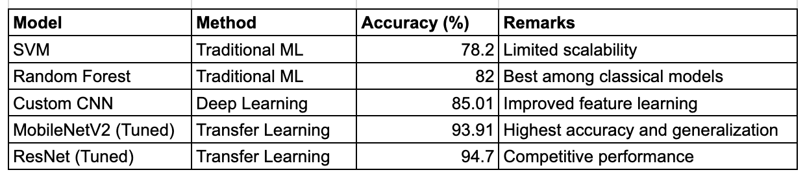

<!-- Text and figures extracted from `Chanakya_Proposal_Presentation_2025-10.pptx` so it can be read on GitHub; the original file is next to this one. -->

## Slide 1

- Image-based Disease Detection leveraging Machine Learning Approaches for the crops  (Cotton, Maize)

- Name of Faculty: Dr. Santwana Gudadhe
- Name of Students with year
- Ms. Kamaaksha Rajendra Kharul TY
- Mr. Aakash Trimbak Jawle TY
- Name of the Department: Computer Engineering
- Name of the College: Pimpri Chinchwad College of Engineering, Pune

## Slide 2

- Cotton Crop Disease Predictor

- Objectives:
- To develop an efficient and accurate model for cotton crop disease detection and classification.
- To enhance model accuracy through transfer learning models like MobileNetV2 and ResNet and advanced data augmentation techniques.
- To support farmers through explainable AI by providing transparent, data-driven recommendations for pest and disease management.
- Methodology for Data collection, curation, annotation:
- Images of healthy and diseased cotton leaves were collected from open agricultural datasets for training and from field sources for testing. The testing images were cleaned, resized, and standardized for consistency, with duplicates and low-quality samples removed. Each image was then manually labeled according to its disease class, such as bacterial blight, boll rot, or healthy.
- Methodology for ML Development:
- Initially, handcrafted features like color histograms and LBP were used with SVM and Random Forest models. Random Forest performed best with 82% accuracy.
- To achieve better results, a custom CNN was developed, followed by transfer learning using MobileNetV2 and ResNet. With data augmentation and fine-tuning, MobileNetV2 achieved 93.91% accuracy, showing significant improvement over traditional methods.

## Slide 3

- Cotton Crop Disease Predictor

- Results:
- Funding:
- The project is self-funded and carried out under the Department of Computer Engineering, PCCOE, Pune.
- Copyright:
- Filed copyright for innovation.
- Title - AgriGuard: Cotton Crop Disease Predictor
- Contributors - Kamaaksha Rajendra Kharul, Aakash Trimbak Jawle
- Diary number - 4238/2025-CO/L

## Slide 4

- Relevant Experience in Image Analysis

- List of projects guided by faculty in the domain of Image analysis
- ○ Intracranial hemorrhage detection in CT scans
- ○ Radiomics for Parkinson’s disease classification
- ○ Stroke prediction using wrapper-based feature selection methods
- ○ Traffic sign detection for autonomous vehicles and object/lane detection systems
- ○ Surveillance video summaries using Scalable image compression
- List of projects performed by students in the image analysis domain
- ○ Cotton crop disease predictor
- List of patents/ publications/copyrights (by faculty/ students) in the image analysis domain
- ○ Performance Analysis of Deep Learning Classifiers for Unilateral Facial Paralysis Health Detection
- ○ A Novel Weighted Average 2D-CNN Ensemble for Intracranial Hemorrhage CT Image Classification
- ○ Differential Evolution Wrapper-Based Feature Selection Method for Stroke Prediction
- ○ Scalable image compression mechanism for surveillance video summary
- ○ Radiomics for Parkinson's disease classification using advanced texture-based biomarkers
- ○ Multivariate analysis of ischaemic lesions using Computed Tomography and CT Perfusion Imaging: Critical review
- ○ A novel machine learning-based feature extraction method for classifying intracranial hemorrhage computed tomography images
- ○ Classification of intracranial hemorrhage CT images based on texture analysis using ensemble-based machine learning algorithms: A comparative study
- ○ Insights of deep convolutional neural network for traffic sign detection in autonomous vehicle
- ○ Noval Machine Learning Approach for Classifying Clinically Actionable Genetic Mutations in Cancer Patients

