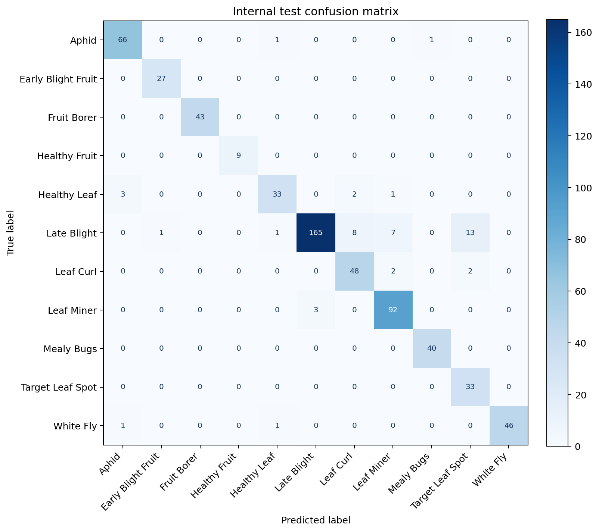
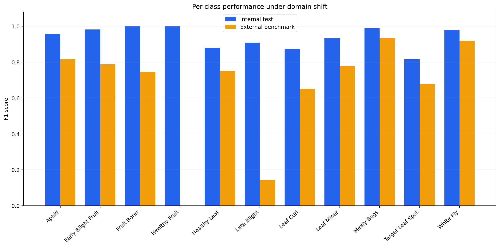
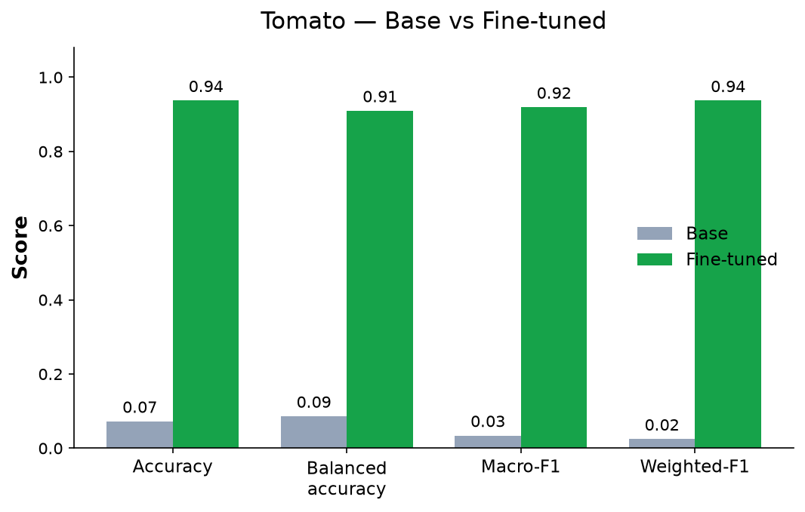
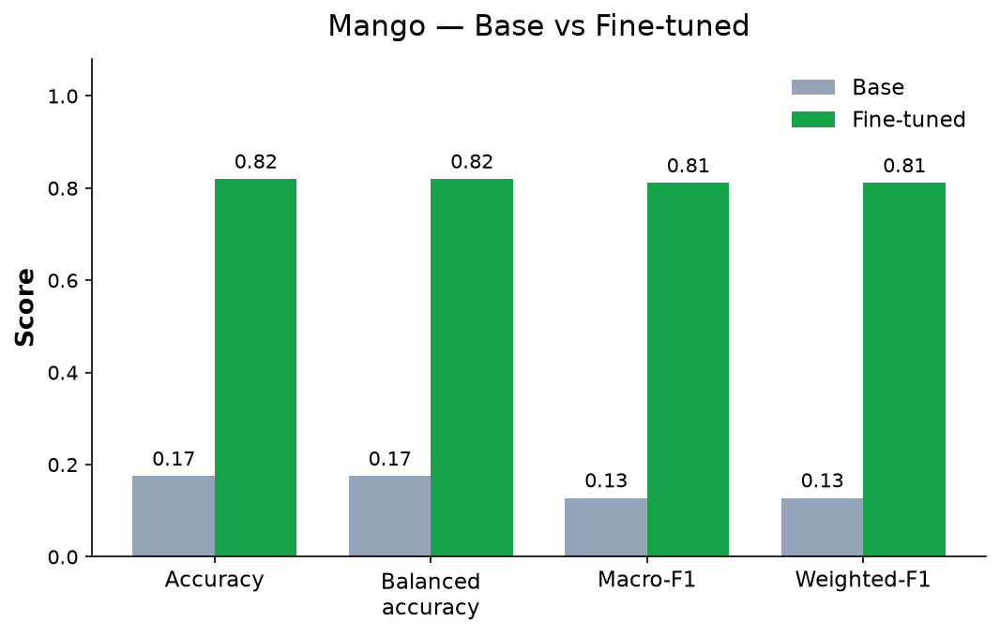
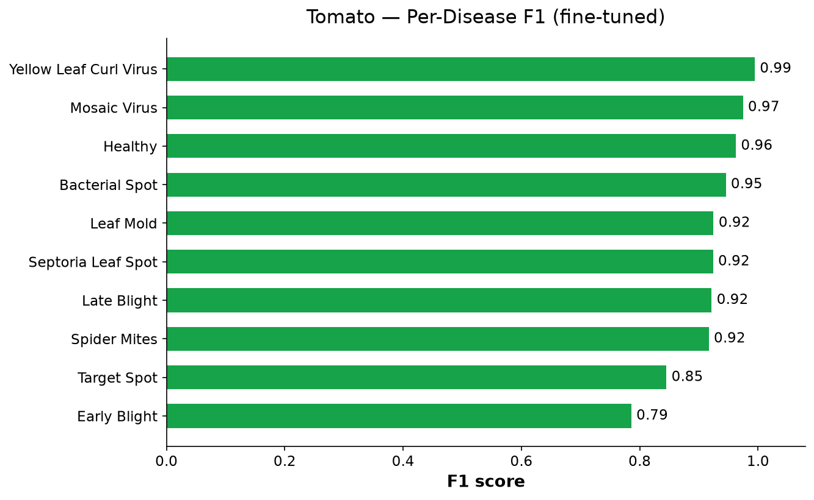
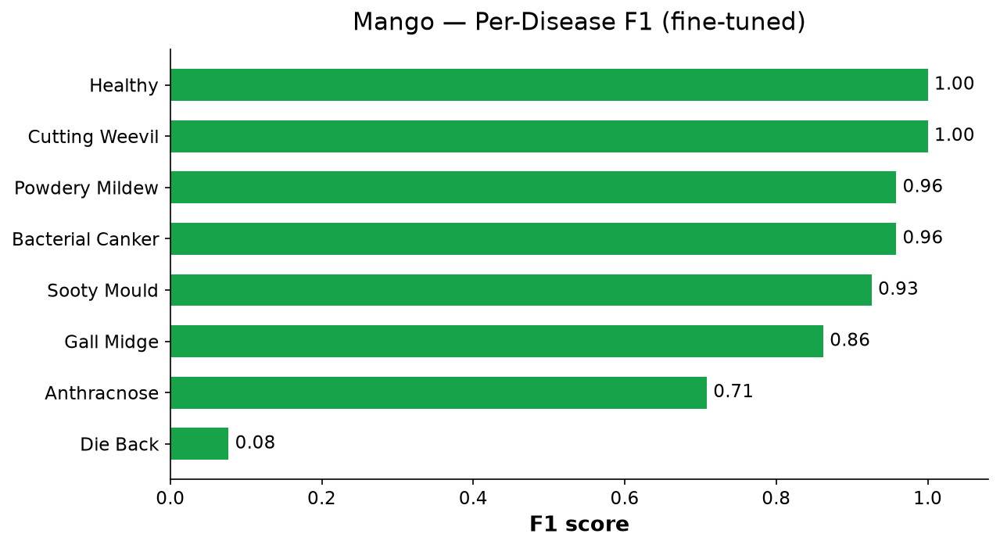

<!-- Text and figures extracted from `Final_Project_Completion_Report.docx` so it can be read on GitHub; the original file is next to this one. -->

TIH IIT Bombay  |  CHANAKYA Fellowship

Project Completion Report

Vision-Language Model Based Plant Disease Diagnosis for Tomato and Mango

Submitted by

Kamaaksha Rajendra Kharul

Aakash Trimbak Jawle

CHANAKYA Fellows

Mentor

Dr. Santwana Gudadhe

Pimpri Chinchwad College of Engineering, Pune

| Kamaaksha Rajendra Kharul | kamaaksha.kharul23@pccoepune.org |  |
|---|---|---|
| Aakash Trimbak Jawle | aakash.jawle23@pccoepune.org |  |
| Dr. Santwana Gudadhe | santwana.gudadhe@pccoepune.org |  |

Project Duration: 1 December 2025 – 30 September 2026

Date of Submission: October 2026

|  |  |  |
|---|---|---|

| TIH reserves all rights in this document and in the information contained therein. Reproduction, use or disclosure to third parties without express authority is strictly forbidden. | Version 1.0 14-July-2021 TIH |
|---|---|

Contents

Cover Sheet	3

Part A - Summary Report	3

1. Project Objectives	3

2. Deliverables	4

a) Nature of Output:	5

b) Performance specifications:	5

c) Details of engineering designs/ drawings and prototype	12

3. Specific Benefits/Outcome (Please give details)	14

a) Patents filed during the Review Period	14

b) Paper publication/submission in Journal/Symposia/Conferences during the Review Period	14

c) Journal Details with Impact Factors	15

d) Details of the Project Staff working on the project	15

e) Manpower trained (Give details)	16

f) Awareness, training camps, etc. organized	16

g) Summary of significant S&T Achievements	16

h) Project Budget (Final)	17

Part B – Comprehensive Report	17

1. Project Title	17

2. Process as an outcome of the Project, identify Beneficiaries	17

3. Scientific Description of the Process, give Specifications/ Standards for the same	18

3.1 Background and problem statement	18

3.2 Related technical context	18

3.3 Datasets	18

3.4 Model architecture	19

3.5 Specifications and standards adopted	19

4. Methodology adopted for Development of the Product/Process (State briefly in 300 words)	19

5. Scientific /Technological Formulation giving underlying Basis (Provide sufficient details)	20

5.1 Low-rank adaptation over a 4-bit quantised model	20

5.2 Imbalance-aware sampling	20

5.3 Answer-only supervision	20

5.4 Checkpoint selection and evaluation protocol	21

5.5 Evaluation metrics	21

5.6 Cross-domain analysis	21

5.7 Knowledge-grounded caption generation (PlantDx)	21

5.8 Limitations	21

6. Further Work required, if any, to get full Benefits or enhance Utilization.	22

7. Recommendations for Utilization of the Product/Process. Give Concrete Steps.	22

Conclusion	22

Acknowledgements	23

References	23

Annexures	23

## Cover Sheet

| Sr. No. | Name | Details |
|---|---|---|
| 1 | Project Grant Number | [To be inserted — grant number not available in the source documents] |
| 2 | Project Title | Vision-Language Model Based Plant Disease Diagnosis for Tomato and Mango |
| 3 | Principal Investigator (PI) / Faculty Mentor |  |
|  | Name | Dr. Santwana Gudadhe (Faculty Mentor) |
|  | Organization | Pimpri Chinchwad College of Engineering, Pune |
| 4 | Co-Principal Investigators (co-PI) |  |
|  | Name | Not applicable |
|  | Organization | Not applicable |
| 5 | Collaborating Organizations |  |
|  | Name | Pimpri Chinchwad College of Engineering, Pune (host institute) Technology Innovation Hub for IoT and IoE (TIH-IoT), IIT Bombay (fellowship sponsor; provider of the Tomato_12thAug26 dataset) |
|  | Team Members | Kamaaksha Rajendra Kharul (CHANAKYA Fellow) Aakash Trimbak Jawle (CHANAKYA Fellow) |
|  | Activities/Tasks Assigned | Vision-language-model-based tomato and mango disease classification: dataset curation and integrity auditing, QLoRA fine-tuning of Qwen2.5-VL-7B-Instruct, internal and cross-domain evaluation, documentation and research publication (carried out jointly by both fellows). |
| 6 | Date of Project Commencement | 01/12/2025 |
|  | Approved Date of Project Completion | 30/09/2026 |
| 7 | Actual Date of Project Completion | 30/09/2026 |

## Part A - Summary Report

### 1. Project Objectives

| Sr. No. | Objective as per the approved Project | Fully Achieved/Partially Achieved (indicate shortfall) | Reason for Partial Achievement |
|---|---|---|---|
| 1 | Investigation of Vision-Language Models (VLMs) for image-based disease and pest diagnosis in tomato and mango. | Fully Achieved | — |
| 2 | Curation and integrity verification of tomato and mango image datasets for model development and evaluation. | Fully Achieved | — |
| 3 | Parameter-efficient (QLoRA) fine-tuning of Qwen2.5-VL-7B-Instruct for multi-class classification on workstation-class hardware. | Fully Achieved | — |
| 4 | Development and evaluation of tomato disease and pest classification models. | Fully Achieved | — |
| 5 | Development and evaluation of a mango leaf disease classification model. | Fully Achieved | — |
| 6 | Evaluation of model generalisation on independently collected (cross-domain) images. | Partially Achieved — evaluation completed; robustness shortfall identified | External benchmark accuracy was 69.32% against 92.76% on the internal test; Late Blight external F1 was 14.29%. Training data came from a single source; broader, field-acquired data is required. |
| 7 | Development of reproducible, reusable training and evaluation workflows. | Fully Achieved | — |
| 8 | Knowledge-grounded diagnostic description generation using structured disease knowledge, ontology and controlled vocabulary. | Partially Achieved | Disease-level knowledge pipeline and caption corpus were implemented and used for MLX fine-tuning; the image-grounded instruction-dataset builder and multi-model converters (Qwen3-VL, InternVL3, Gemma-3) remain at interface (stub) stage in the repository. |
| 9 | Dissemination of research outcomes through publication. | Fully Achieved | Paper accepted at ICAIN 2026 (Springer LNNS). |

### 2. Deliverables

| Sr. No. | Deliverables as per the approved Project | Fully/Partially/Not Achieved | Reason for Partial/ Non Achievement |
|---|---|---|---|
| 1 | Dataset auditing and integrity-verification workflow (image verification, SHA-256 exact deduplication, contradictory-label removal, deterministic stratified splitting). | Fully Achieved | — |
| 2 | QLoRA fine-tuning pipeline for Qwen2.5-VL-7B-Instruct on NVIDIA CUDA with preflight checks, smoke test and resumable checkpoints. | Fully Achieved | — |
| 3 | MLX-based QLoRA training and evaluation workflow on Apple Silicon (PlantDx research track). | Fully Achieved | — |
| 4 | Tomato disease and pest classification models (TIH 11-class dataset; PlantVillage 10-class tomato subset). | Fully Achieved | — |
| 5 | Mango leaf disease classification model (MangoLeafBD, 8 classes). | Fully Achieved | Die Back remains the weakest class (F1 0.08). |
| 6 | Evaluation and benchmarking framework (zero-shot baselines, base vs. fine-tuned comparison, per-class metrics, latency, confusion matrices). | Fully Achieved | — |
| 7 | Cross-domain evaluation on an independent external benchmark. | Fully Achieved | Evaluation completed; the generalisation gap it revealed is reported in Section 2(b). |
| 8 | Knowledge-grounded caption-generation pipeline (Disease Knowledge Base → ontology → controlled vocabulary → validated caption corpus). | Partially Achieved | Image-grounded instruction-dataset builder and multi-model converters pending. |
| 9 | Streamlit-based inference and demonstration application for the trained adapters. | Fully Achieved | Research prototype; not field-deployed. |
| 10 | Research publication. | Fully Achieved | Accepted at ICAIN 2026. |

#### a) Nature of Output:

The project resulted in software processes (AI/ML research workflows) and a peer-reviewed research publication. No hardware, equipment or pilot-scale plant was developed. The major outputs are:

- Vision-language-model (VLM) based disease and pest classification pipelines for tomato and mango.
- Dataset auditing and curation workflows with integrity verification and leak-free, frozen splits.
- QLoRA fine-tuning workflows for Qwen2.5-VL-7B-Instruct on NVIDIA CUDA and on Apple Silicon (MLX).
- Evaluation and benchmarking tools covering zero-shot baselines, held-out internal testing and independent cross-domain evaluation.
- A knowledge-grounded caption-generation pipeline (PlantDx) built on a cited Disease Knowledge Base.
- Reproducible experimental artefacts: versioned configurations, aggregate metrics, figures and unit/integration tests in the project repository.
- Research output: paper accepted for publication in the Proceedings of ICAIN 2026 – Springer LNNS Series.
#### b) Performance specifications:

The project was carried out in three experiment tracks that use different datasets, hardware and protocols. Their numbers are reported separately and are not directly comparable. The TIH tomato track is the experiment reported in the accepted ICAIN 2026 paper. All technical values below are taken from the project repository iAakash1/experimentation, branch refactor/professional-research-layout (experiments/tih_tomato_qwen and research/), and match the paper.

Table 1. Experiment tracks reported in this document.

| Track | Dataset | Model / adaptation | Hardware | Role |
|---|---|---|---|---|
| A. TIH tomato benchmark (ICAIN 2026 paper) | TIH Tomato_12thAug26 (private); 11 classes | Qwen2.5-VL-7B-Instruct, QLoRA (4-bit NF4), PyTorch/CUDA | NVIDIA RTX 4500 Ada, 24 GB | Final applied benchmark; internal + external evaluation |
| B. PlantDx knowledge-grounded research (MLX) | PlantVillage tomato subset (10 classes); MangoLeafBD (8 classes) | Qwen2.5-VL-7B-Instruct-4bit, QLoRA via mlx-vlm | Apple Silicon, 24 GB unified memory | Tomato and mango research pipeline |
| C. Early VLM exploration | PlantVillage tomato leaf images | Several VLMs screened; Qwen2.5-VL-7B-Instruct selected | — | Model selection only (no numeric results quoted) |

##### 1. TIH Tomato Dataset Integrity Audit and Frozen Splits

The TIH dataset (Tomato_12thAug26 (private, provided by TIH)) contained 7,095 labelled images in 11 class folders covering leaf and fruit diseases, pests and healthy reference classes. The raw dataset was treated as read-only. Every file was checked for a supported extension and decoded as a valid image; raw bytes were hashed with SHA-256. Byte-identical copies with the same label were collapsed to one representative, and any hash group appearing under more than one class label was treated as contradictory and removed entirely. This retained 6,545 unique, non-ambiguous images (92.25%); 550 files were excluded.

The retained images were split 80/10/10 with split seed 20260911. Splitting was class-stratified and deterministic (ordering derived from the seed and image hash, not file-system order), and the split identities were frozen and hash-checked before every run. The frozen split contains 5,247 training, 649 validation and 649 test images. The classes are highly imbalanced: in the internal test split, Late Blight has 195 images and Healthy Fruit only 9.

Table 2. TIH tomato per-class evaluation support (repository per_class_metrics.csv files).

| Class | Internal test images | External benchmark images |
|---|---|---|
| Aphid | 68 | 16 |
| Early Blight Fruit | 27 | 20 |
| Fruit Borer | 43 | 20 |
| Healthy Fruit | 9 | – (absent) |
| Healthy Leaf | 39 | 20 |
| Late Blight | 195 | 20 |
| Leaf Curl | 52 | 20 |
| Leaf Miner | 95 | 20 |
| Mealy Bugs | 40 | 7 |
| Target Leaf Spot | 33 | 20 |
| White Fly | 48 | 13 |
| Total | 649 | 176 |

##### 2. Model and QLoRA Configuration (Final ICAIN Run)

Classification was formulated as constrained image-to-label generation through the VLM's own generative interface (no new classification head). The canonical configuration is configs/train/qwen25vl_tih_tomato_moreaccurate.yaml (run name tih_tomato_moreaccurate).

Table 3. Final QLoRA training configuration (repository configuration file).

| Base model | Qwen/Qwen2.5-VL-7B-Instruct |
|---|---|
| Quantisation | 4-bit NF4 with double quantisation; BF16 compute |
| LoRA targets / rank / alpha / dropout | q_proj, k_proj, v_proj, o_proj (language model only) / 64 / 128 / 0.05 |
| Vision tower | Frozen (excluded from LoRA) |
| Image preprocessing | Aspect-preserving resize, longest side ≤ 532 px, each side rounded to a multiple of 28 px, bicubic |
| Maximum sequence length | 1,024 tokens |
| Optimiser / learning rate | Paged AdamW 8-bit / 4 × 10⁻⁵, cosine schedule, 3% warm-up, weight decay 0 |
| Batch | Micro-batch 1, gradient accumulation 8 (effective batch 8); gradient clipping 1.0; gradient checkpointing |
| Sampling | Inverse-square-root class-balanced sampling (training split only) |
| Supervision | Answer-only loss: prompt tokens masked with ignore index −100 |
| Epochs / seed | 3 planned / 20260911; early stopping on validation loss (patience 1) |
| Checkpoint selection | Validation macro F1, then validation accuracy, then lower validation loss |

##### 3. Training Efficiency

Table 4. Training run summary (results/internal/training_summary.json).

| Parameter | Value |
|---|---|
| Training hardware | Single NVIDIA RTX 4500 Ada Generation GPU, 24 GB |
| Optimizer steps completed | 1,908 |
| Epochs completed | 2.909 of 3 planned (run ended by the 3-hour wall-clock safeguard) |
| Training time | 11,562.6 s (192.7 min) |
| Peak reserved GPU memory | 10.57 GB |
| Trainable LoRA parameters | 40,370,176 (all pretrained model weights frozen) |
| Final logged training loss | 8.12 × 10⁻⁵ (not by itself evidence of generalisation) |

Figure 1. Training dynamics of the final TIH Qwen2.5-VL QLoRA run: step loss, 50-step moving mean, validation loss, learning-rate schedule and peak reserved GPU memory (repository figure).

##### 4. Internal Held-Out Test Performance

The selected adapter was evaluated once on the frozen 649-image internal test split. It classified 602 images correctly. No prediction was unparseable.

Table 5. Aggregate internal test results (results/internal/metrics.json).

| Metric | Accuracy | Macro precision | Macro recall | Macro F1 | Weighted F1 | Latency |
|---|---|---|---|---|---|---|
| Internal test (649 images, 11 classes) | 92.76% | 92.71% | 95.57% | 93.78% | 92.86% | 0.327 s/image |

Table 6. Per-class internal test metrics and external F1 (%).

| Class | Support | Precision | Recall | Internal F1 | External F1 |
|---|---|---|---|---|---|
| Aphid | 68 | 94.29 | 97.06 | 95.65 | 81.48 |
| Early Blight Fruit | 27 | 96.43 | 100.00 | 98.18 | 78.79 |
| Fruit Borer | 43 | 100.00 | 100.00 | 100.00 | 74.42 |
| Healthy Fruit | 9 | 100.00 | 100.00 | 100.00 | – (absent) |
| Healthy Leaf | 39 | 91.67 | 84.62 | 88.00 | 75.00 |
| Late Blight | 195 | 98.21 | 84.62 | 90.91 | 14.29 |
| Leaf Curl | 52 | 82.76 | 92.31 | 87.27 | 65.00 |
| Leaf Miner | 95 | 90.20 | 96.84 | 93.40 | 77.78 |
| Mealy Bugs | 40 | 97.56 | 100.00 | 98.77 | 93.33 |
| Target Leaf Spot | 33 | 68.75 | 100.00 | 81.48 | 67.80 |
| White Fly | 48 | 100.00 | 95.83 | 97.87 | 91.67 |

Class-wise internal F1 ranged from 81.48% (Target Leaf Spot) to 100% (Fruit Borer and Healthy Fruit). Late Blight, the largest class, reached 90.91% F1 with 84.62% recall; its dominant errors were predictions of Target Leaf Spot (13 images), Leaf Curl (8) and Leaf Miner (7). Target Leaf Spot showed 100% recall but 68.75% precision. The nine-image Healthy Fruit support is small and should not be read as perfect real-world recognition.

Figure 2. Confusion matrix on the frozen internal TIH test split (649 images).

##### 5. Independent External (Cross-Domain) Benchmark

After final-adapter selection, the model was evaluated in inference-only mode on an independently stored, labelled set of 176 images across 10 classes (Healthy Fruit is absent; the external “Healthy” folder was mapped to Healthy Leaf). No external image was used for training or checkpoint selection. The adapter classified 122 images correctly.

Table 7. Internal versus external benchmark (repository metrics files).

| Metric | Internal test | External benchmark | Difference |
|---|---|---|---|
| Images / classes | 649 / 11 | 176 / 10 | — |
| Accuracy | 92.76% | 69.32% | −23.44 pp |
| Macro precision | 92.71% | 76.08% | −16.63 pp |
| Macro recall | 95.57% | 71.84% | −23.73 pp |
| Macro F1 | 93.78% | 71.95% | −21.83 pp |
| Weighted F1 | 92.86% | 69.38% | −23.48 pp |
| Unparseable predictions | 0 | 0 | — |
| Mean latency | 0.327 s/image | 0.373 s/image | — |

The degradation is class dependent. Late Blight was the clearest failure mode: external recall fell to 10% and F1 to 14.29%, with 11 of 20 Late Blight images predicted as Target Leaf Spot. Mealy Bugs (93.33%) and White Fly (91.67%) transferred well. This identifies which visual distinctions are sensitive to changes in image source and is treated as a central research finding rather than a hidden limitation.

Figure 3. Confusion matrix on the external domain-shift benchmark (176 images; Healthy Fruit absent).

Figure 4. Per-class F1 on the internal test versus the external benchmark (repository figure).

##### 6. Experiment Progression on the TIH Dataset

The TIH configuration was improved iteratively. All three configurations use the same dataset profile, frozen split and model family; only training hyper-parameters and image resolution changed.

Table 8. TIH tomato configuration progression.

| Configuration (repository) | LoRA r / α | Max image side | Learning rate | Internal test result | Source of result |
|---|---|---|---|---|---|
| qwen25vl_tih_tomato.yaml (initial) | 16 / 32 | 448 px | — | Not reported | — |
| qwen25vl_tih_tomato_strong.yaml | 32 / 64 | 392 px | 5 × 10⁻⁵ | Not reported in the repository | — |
| qwen25vl_tih_tomato_moreaccurate.yaml (final, ICAIN) | 64 / 128 | 532 px | 4 × 10⁻⁵ | 92.76% accuracy, 93.78% macro F1 | Repository results (experiments/tih_tomato_qwen) |

##### 7. PlantDx Knowledge-Grounded Research Track — Tomato and Mango (MLX)

In this separate track, Qwen2.5-VL-7B-Instruct-4bit was fine-tuned with QLoRA (rank 16, alpha 32, vision tower frozen) on Apple Silicon (24 GB unified memory) using the mlx-vlm backend. Supervision came from a deterministic, knowledge-grounded caption corpus (Section 2(c)). Splits were image-grouped and disease-stratified (90/5/5). Results below are read from research/mlx_pipeline/results/benchmark_summary.csv and RESULTS.md (the tomato split has 16,201 training and 910 test images per docs/EVALUATION.md); they are in-distribution scores on public datasets and are not comparable with the TIH results.

Table 9. PlantDx MLX track: classification results on frozen held-out test splits.

| Crop | Dataset | Classes | Test images | Zero-shot accuracy | Fine-tuned accuracy | Macro F1 | Weighted F1 |
|---|---|---|---|---|---|---|---|
| Tomato | PlantVillage (tomato subset) | 10 | 910 | 7.3% | 93.7% | 0.919 | 0.937 |
| Mango | MangoLeafBD | 8 | 200 | 17.5% | 82.0% | 0.811 | 0.811 |

Per the repository's per-disease F1 figures, the weakest tomato classes were Early Blight (F1 0.79) and Target Spot (0.85); for mango, Die Back was the weakest class (F1 0.08), followed by Anthracnose (0.71).

|  |  |
|---|---|

Figure 5. PlantDx MLX track — base versus fine-tuned Qwen2.5-VL-7B: (left) tomato, n = 910; (right) mango, n = 200 (repository figures).

|  |  |
|---|---|

Figure 6. PlantDx MLX track — per-disease F1 after fine-tuning: (left) tomato; (right) mango.

##### 8. Early-Stage VLM Exploration and Model Selection

Before the final pipelines, several VLM architectures were evaluated for structured tomato diagnosis on PlantVillage images, as documented in the fellowship research reports. Qwen2.5-VL-7B-Instruct was selected as the backbone for all subsequent work.

Table 10. Early VLM screening outcomes (fellowship research reports, June–July 2026).

| Model / stage | Outcome |
|---|---|
| LLaVA 1.5-7B; LLaVA 1.6 Mistral-7B | Discontinued — batch-collation incompatibility reproduced on both versions |
| BLIP-2 OPT-2.7B | Training converged, but structured diagnostic output was unreliable |
| Florence-2-base-ft | Discontinued — repeated environment incompatibilities |
| Qwen2.5-VL-7B-Instruct | Selected as the backbone; produced reliable structured diagnostic output |
| Zero-shot benchmark (multiple VLMs) | Qwen2.5-VL-7B, Qwen3-VL-8B, Gemma-3-12B, InternVL3-8B, LLaMA-3.2-11B-Vision, Molmo-7B-D, DeepSeek-VL2-Small; showed that successful inference does not imply valid output (Qwen3-VL-8B produced degenerate outputs) |
| CLIP-based out-of-distribution screening | Explored as an input-screening step |

This exploratory stage is reported only to document model selection. Its results are not part of the project repository and are therefore not quoted; they are not compared with Tracks A or B.

#### c) Details of engineering designs/ drawings and prototype

The project produced software-based AI/ML systems and therefore involves no mechanical drawings. The following system designs were developed; Figures 7–10 are editable diagrams recreated from the repository implementation.

- End-to-end TIH tomato fine-tuning and evaluation pipeline (Figure 7).
- Dataset integrity audit and frozen-split workflow (Figure 8).
- Knowledge-grounded PlantDx caption and training pipeline (Figure 9).
- Two-stage evaluation protocol: frozen internal test and inference-only external benchmark (Figure 10).
- Streamlit inference/demonstration application for the trained adapters (prototype).

| 1. Raw TIH dataset 7,095 images | ► | 2. Integrity audit decode + SHA-256 | ► | 3. Deduplication contradictions removed | ► | 4. Frozen splits 5,247/649/649 | ► | 5. Prompt + label answer-only target |
|---|---|---|---|---|---|---|---|---|
|  |  |  |  |  |  |  |  | ▼ |
| 10. External benchmark 176 images | ◄ | 9. Internal test 649 images, once | ◄ | 8. Checkpoint selection macro F1 first | ◄ | 7. Epoch validation loss + macro F1 | ◄ | 6. QLoRA fine-tuning Qwen2.5-VL-7B |

Figure 7. End-to-end TIH tomato fine-tuning and evaluation pipeline (read 1–5 left to right, 6–10 right to left).

| Raw dataset: 7,095 labelled files in 11 class folders read-only |  |
|---|---|
| ▼ |  |
| Image verification supported extension + decodable image | corrupt/unsupported files reported |
| ▼ |  |
| SHA-256 exact deduplication same-class copies collapsed to one |  |
| ▼ |  |
| Contradictory cross-class duplicates removed whole hash group excluded | label conflicts never forced |
| ▼ |  |
| 6,545 unique, non-ambiguous images (92.25%) 550 files excluded | test split: Late Blight 195 vs Healthy Fruit 9 |
| ▼ |  |
| Deterministic class-stratified 80/10/10 split (seed 20260911) Train 5,247 \| Validation 649 \| Test 649 — split hashes frozen | checked by preflight before training |

Figure 8. Dataset integrity audit and frozen-split workflow for the TIH tomato dataset.

| Disease Knowledge Base 18 conditions, cited | ► | Ontology compiler typed graph | ► | Vocabulary + lexicon controlled terms | ► | Concepts + templates V-CON / V-TPL | ► | Caption corpus generated + validated |
|---|---|---|---|---|---|---|---|---|
|  |  |  |  |  |  |  |  | ▼ |
| Raw datasets PlantVillage, MangoLeafBD | ► | Audit counts, duplicates | ► | Normalisation canonical classes | ► | Dataset builder image × caption | ► | QLoRA (MLX) → Evaluation → Demo base vs fine-tuned |

Figure 9. Knowledge-grounded PlantDx pipeline: the knowledge lane (top) produces the caption corpus that is joined with audited images (bottom) for QLoRA fine-tuning and evaluation.

| Training split 5,247 images; class-balanced sampling | ► | Validation split 649 images; monitoring + checkpoint selection | ► | Final adapter best validation macro F1 |
|---|---|---|---|---|
|  |  |  |  | ▼ |
| Internal test (frozen) 649 images, 11 classes — evaluated once | ◄ | Final adapter evaluated on both | ◄ | External benchmark 176 images, 10 classes — inference only |

Figure 10. Two-stage evaluation protocol separating in-domain testing from cross-domain evaluation.

### 3. Specific Benefits/Outcome (Please give details)

- Research contribution: a reproducible protocol for adapting a 7B-parameter VLM to an 11-class tomato disease and pest task, accepted for publication at ICAIN 2026.
- Parameter-efficient adaptation: only 40,370,176 LoRA parameters were trained while all pretrained weights stayed frozen, with 10.57 GB peak reserved memory on a single 24 GB GPU — no multi-GPU infrastructure required.
- Dataset quality improvement: the integrity audit removed 550 duplicate or contradictory files and guaranteed that no image can appear in two splits.
- Reusable workflows: configuration-driven training, evaluation and auditing code with unit and integration tests, reusable for other crops and datasets.
- Honest robustness assessment: separating the internal test from an independent external benchmark quantified a 23.44-percentage-point accuracy gap and located it at class level (e.g., Late Blight).
- AgriTech relevance: the results indicate what additional data (field-acquired, multi-source) is needed before VLM-based diagnosis can be considered for farmer-facing use; no field deployment or commercial impact is claimed.
#### a) Patents filed during the Review Period

| Sr. No | Title | Inventors | Date of Filing |
|---|---|---|---|
| 1 | NA | NA | NA |

No patent/IP filing was made during the project period.

#### b) Paper publication/submission in Journal/Symposia/Conferences during the Review Period

| Title of the paper | Journal/Symposium/Conference | Date of conference | Authors |
|---|---|---|---|
| Efficient QLoRA Fine-Tuning of Qwen2.5-VL for Multi-Class Tomato Disease Classification and Cross-Domain Evaluation | ICAIN 2026 Proceedings of ICAIN 2026 – Springer LNNS Series Status: Accepted for publication | Not stated in the acceptance notification (registration due by 10 October 2026) | Aakash Trimbak Jawle Kamaaksha Rajendra Kharul Santwana Gudadhe Harish Lokawad Rutuja Chavan |

Table 11. Publication details (accepted paper and ICAIN 2026 acceptance notification).

| Paper title | Efficient QLoRA Fine-Tuning of Qwen2.5-VL for Multi-Class Tomato Disease Classification and Cross-Domain Evaluation |
|---|---|
| Conference | ICAIN 2026 |
| Publication | Accepted for publication in the Proceedings of ICAIN 2026 – Springer LNNS Series |
| Submission ID | 953 |
| Status | Accepted for publication |
| Authors | Aakash Trimbak Jawle, Kamaaksha Rajendra Kharul, Santwana Gudadhe, Harish Lokawad, Rutuja Chavan (corresponding author: Kamaaksha Rajendra Kharul) |
| Acceptance note | The acceptance notification states that the paper is among the top 20% of the papers received/reviewed. |
| Indexing | zbMATH, Scopus and DBLP — as stated in the acceptance notification |
| Registration | To be completed before 10 October 2026, as required by the notification |
| DOI / volume / pages | Not yet assigned (paper not yet published) |

#### c) Journal Details with Impact Factors

| Sr. No. | Article Sci Name | Article Sci If | Article Sci Citation | Article Scopus Name | Article Scopus If |
|---|---|---|---|---|---|
| 1 | NA (conference proceedings, not an SCI journal) | NA | NA (not yet published) | Proceedings of ICAIN 2026 – Springer LNNS Series (Scopus indexing as stated in the notification) | NA |

A copy of the accepted manuscript and the ICAIN 2026 acceptance notification are to be attached as Annexure A and Annexure B.

#### d) Details of the Project Staff working on the project

| Sr. No. | Name | Designation | Qualification / Department | Date of joining |
|---|---|---|---|---|
| 1 | Kamaaksha Rajendra Kharul | CHANAKYA Fellow | Department of Computer Engineering, PCCOE, Pune | 01/12/2025 |
| 2 | Aakash Trimbak Jawle | CHANAKYA Fellow | Department of Computer Engineering, PCCOE, Pune | 01/12/2025 |
| 3 | Dr. Santwana Gudadhe | Faculty Mentor | Department of Computer Science and Engineering (AI & ML), PCCOE, Pune | — |

Table 12. Project team, contact details and major contributions.

| Name | Role | Email / Phone | Major contribution |
|---|---|---|---|
| Kamaaksha Rajendra Kharul | CHANAKYA Fellow | kamaaksha.kharul23@pccoepune.org | Joint execution of the project's technical work (as documented in the fellowship research reports); co-author and corresponding author of the ICAIN 2026 paper. |
| Aakash Trimbak Jawle | CHANAKYA Fellow | aakash.jawle23@pccoepune.org | Joint execution of the project's technical work (as documented in the fellowship research reports); first-listed author of the ICAIN 2026 paper; owner of the iAakash1/experimentation repository. |
| Dr. Santwana Gudadhe | Faculty Mentor | santwana.gudadhe@pccoepune.org | Guidance and supervision throughout the project; co-author of the ICAIN 2026 paper. |

Harish Lokawad and Rutuja Chavan (TIH-IoT, IIT Bombay) are co-authors of the ICAIN 2026 paper and guided the work as TIH mentors.

#### e) Manpower trained (Give details)

|  | Name | Date of joining |
|---|---|---|
| Research Scientists/ Research Associates | NA | NA |
| No. of Ph.D. (s) produced | NA | NA |
| Other Technical Personnel trained | Two CHANAKYA fellows (Kamaaksha Rajendra Kharul, Aakash Trimbak Jawle) gained hands-on training in VLM fine-tuning (LoRA/QLoRA), dataset auditing, reproducible evaluation and research writing. | 01/12/2025 |

#### f) Awareness, training camps, etc. organized

No awareness programmes or training camps were organised under this project during the review period.

#### g) Summary of significant S&T Achievements

- Fine-tuned Qwen2.5-VL-7B-Instruct with QLoRA (4-bit NF4, LoRA r 64/α 128, frozen vision tower) on a single 24 GB GPU, reaching 92.76% accuracy, 93.78% macro F1 and 95.57% macro recall on the frozen 649-image TIH internal test at 0.327 s/image.
- Established a reproducible dataset-integrity protocol: image verification, SHA-256 exact deduplication, rejection of contradictory cross-class duplicates, deterministic stratified splitting and frozen split identities (7,095 → 6,545 images).
- Implemented imbalance-aware training (inverse-square-root sampling), answer-only supervision and validation-macro-F1 checkpoint selection, producing zero unparseable predictions.
- Quantified cross-domain robustness on an independent 176-image benchmark (69.32% accuracy, 71.95% macro F1), identifying Late Blight as the main failure mode.
- Built the knowledge-grounded PlantDx pipeline (cited Disease Knowledge Base for 18 conditions → ontology → controlled vocabulary → validated caption corpus) and fine-tuned Qwen2.5-VL with QLoRA on Apple Silicon: tomato 7.3% → 93.7% and mango 17.5% → 82.0% accuracy.
- Screened multiple VLM families (LLaVA, BLIP-2, Florence-2, Qwen2.5-VL, Qwen3-VL, Gemma-3, InternVL3, LLaMA-3.2-Vision, Molmo, DeepSeek-VL2) before selecting Qwen2.5-VL-7B-Instruct.
- Paper accepted for publication in the Proceedings of ICAIN 2026 – Springer LNNS Series (Submission ID 953).
#### h) Project Budget (Final)

Amounts below distinguish the sanctioned amount, the amount received (disbursed) to date and the balance of the sanction. No head-wise expenditure entries are reported beyond those supported by records.

Table 13. Sanction and disbursement summary (as on the date of this report).

| Item | Aakash Trimbak Jawle | Kamaaksha Rajendra Kharul | Total |
|---|---|---|---|
| Sanctioned allocation | ₹1,20,000 | ₹1,20,000 | ₹2,40,000 |
| Amount received / disbursed to date | ₹96,000 | ₹96,000 | ₹1,92,000 |
| Balance of sanctioned amount (not yet received) | ₹24,000 | ₹24,000 | ₹48,000 |
| Share of sanction received | 80% | 80% | 80% |

Table 14. Budget heads in the TIH format.

| Sr. No. | Budget Head | Funds Sanctioned | Expenditure (actual) | Remarks |
|---|---|---|---|---|
| 1 | Manpower (fellowship stipend) | ₹10,000 per month per fellow | Covered within the ₹1,92,000 received (sanction summary above) | Head-wise split of the amount received is not separately recorded here |
| 2 | Consumables | — | — | No separate head reported |
| 3 | Contingencies | ₹20,000 (overall) | To be reported against receipts | Planned: most of the contingency provision is to be utilised toward expenses associated with the accepted ICAIN 2026 research publication/registration |
| 4 | Travel | — | — | No separate head reported |
| 5 | Others, if any | — | — | — |
| 6 | Overhead expenses | — | — | — |
| 7 | Equipment | — | — | — |
|  | Total | ₹2,40,000 (₹1,20,000 per fellow) | ₹1,92,000 received to date | Balance of sanction: ₹48,000 |

Note: the ₹48,000 balance is the difference between the total sanction (₹2,40,000) and the amount received to date (₹1,92,000). It is reported as the remaining sanctioned amount and not as an outstanding stipend claim. Contingency use is shown as planned, not as incurred, until supported by receipts.

## Part B – Comprehensive Report

### 1. Project Title

Vision-Language Model Based Plant Disease Diagnosis for Tomato and Mango

### 2. Process as an outcome of the Project, identify Beneficiaries

The outcome of the project is a set of software processes for adapting and evaluating vision-language models for crop disease and pest classification: an auditable dataset preparation process, a parameter-efficient (QLoRA) fine-tuning process for Qwen2.5-VL-7B-Instruct, a two-stage evaluation process that separates in-domain testing from cross-domain evaluation, and a knowledge-grounded caption-generation process.

Beneficiaries. Agricultural AI researchers and AgriTech developers who need to adapt large VLMs on limited hardware; dataset curation teams who require leak-free, reproducible splits; and TIH-IoT, whose tomato dataset now has a documented benchmark and robustness baseline. Farmers are the eventual beneficiaries only after the field-validation steps in Section 6 are completed.

### 3. Scientific Description of the Process, give Specifications/ Standards for the same

#### 3.1 Background and problem statement

Image-based plant disease recognition is a major application of deep learning because visually similar symptoms complicate manual diagnosis and can delay intervention. Tomato is particularly challenging: disease and pest symptoms overlap visually, and the TIH dataset mixes leaf and fruit classes with pest damage. Reported accuracy also depends strongly on dataset composition and acquisition conditions; strong performance on one collection does not guarantee robustness on independently collected images.

General-purpose VLMs did not solve the task out of the box: the unadapted Qwen2.5-VL-7B model reached only 7.3% (tomato) and 17.5% (mango) accuracy in our zero-shot baselines. Full fine-tuning of a multi-billion-parameter VLM is, however, expensive.

| Problem statement To adapt a general-purpose vision-language model for accurate multi-class tomato and mango disease and pest classification on workstation-class hardware, using audited and reproducible data pipelines, and to quantify how well the adapted model generalises to independently collected images. |
|---|

#### 3.2 Related technical context

Early CNN studies showed strong disease discrimination from labelled leaf images, and later work moved from ResNet and EfficientNet to Vision Transformers. Vision-language pre-training (CLIP, BLIP-2) connects image representations with natural language, and Qwen2.5-VL provides instruction-following visual recognition. LoRA learns low-rank weight updates while freezing pretrained weights, and QLoRA combines LoRA with 4-bit quantisation to reduce memory. Distribution-shift studies (e.g., ImageNet re-evaluation, WILDS, PlantDoc) show that in-distribution accuracy does not ensure robustness — the motivation for the external benchmark in this project.

#### 3.3 Datasets

Table 15. Datasets used in the project.

| Dataset | Content | Size used | Track |
|---|---|---|---|
| TIH Tomato_12thAug26 (private) | 11 classes: Aphid, Early Blight Fruit, Fruit Borer, Healthy Fruit, Healthy Leaf, Late Blight, Leaf Curl, Leaf Miner, Mealy Bugs, Target Leaf Spot, White Fly | 7,095 raw → 6,545 retained (5,247 / 649 / 649) | A |
| TIH external benchmark (independently stored) | 10 of the 11 classes (Healthy Fruit absent) | 176 labelled images (inference only) | A |
| PlantVillage — tomato subset (public) | 10 classes: healthy, bacterial spot, early blight, late blight, leaf mold, septoria leaf spot, spider mites, target spot, mosaic virus, yellow leaf curl virus | 16,201 train / 910 test images | B |
| MangoLeafBD (public) | 8 classes: healthy, anthracnose, bacterial canker, cutting weevil, die back, gall midge, powdery mildew, sooty mould | 200 test images (image-grouped 90/5/5 split) | B |

#### 3.4 Model architecture

Qwen2.5-VL-7B-Instruct combines a vision encoder, which converts each image into visual tokens from 28-pixel-aligned patches, with a 7B-class language model that generates text conditioned on the visual tokens and the instruction. In this project the vision tower was kept frozen and LoRA adapters were attached only to the language model's attention projections (q, k, v, o). Classification is expressed through generation: the model receives one image and a fixed class-constrained instruction and must return exactly one category name, which is mapped back to the canonical class identifier.

| Fixed instruction used for training and evaluation (TIH track) “Classify this tomato plant image into exactly one of these categories: Aphid, Early Blight Fruit, Fruit Borer, Healthy Fruit, Healthy Leaf, Late Blight, Leaf Curl, Leaf Miner, Mealy Bugs, Target Leaf Spot, White Fly. Return only the category name.” |
|---|

#### 3.5 Specifications and standards adopted

- Metrics: accuracy, macro and weighted precision/recall/F1, per-class metrics, confusion matrices, unparseable-output count and mean latency; macro F1 is the primary metric because of class imbalance.
- Reproducibility: fixed run and split seeds (20260911), hash-frozen splits, preflight checks of environment, class mapping, split counts and hashes, and a QLoRA smoke test before training.
- Data handling: raw datasets are read-only; private data, checkpoints and per-image predictions are excluded from public release; only aggregate metrics and figures are published.
- Software: Python, PyTorch with CUDA, Hugging Face Transformers, PEFT and bitsandbytes (Track A); MLX / mlx-vlm on Apple Silicon (Track B); code released under the Apache License 2.0.
### 4. Methodology adopted for Development of the Product/Process (State briefly in 300 words)

The work followed a dataset-to-model-to-evaluation methodology in four stages.

(i) Model exploration. Several VLM families were screened on PlantVillage tomato images for structured diagnosis and in a zero-shot benchmark. Qwen2.5-VL-7B-Instruct gave the most reliable results and was selected as the common backbone.

(ii) Knowledge-grounded research pipeline (PlantDx). A cited Disease Knowledge Base for 10 tomato and 8 mango conditions was compiled deterministically into an ontology, a controlled vocabulary and a validated caption corpus. Audited and normalised PlantVillage and MangoLeafBD images were paired with this corpus to fine-tune Qwen2.5-VL with QLoRA on Apple Silicon, and base and fine-tuned models were compared on frozen, image-grouped test splits.

(iii) TIH tomato benchmark. The TIH dataset was audited (image verification, SHA-256 deduplication, contradictory-label removal) and split deterministically into frozen train/validation/test sets. Qwen2.5-VL-7B-Instruct was adapted with QLoRA on a single RTX 4500 Ada GPU using class-balanced sampling and answer-only supervision. Validation was run every epoch, and the final adapter was chosen by validation macro F1. Configurations were refined iteratively (LoRA rank 32 → 64; image side 392 → 532 px).

(iv) Evaluation. The selected adapter was evaluated once on the frozen internal test and then, in inference-only mode, on an independent 176-image external benchmark to measure cross-domain generalisation.

In addition, as recorded in the fellowship research reports, the fellows trained a soybean model on the TIH VDI infrastructure using a TIH-provided dataset and training pipeline; this support activity is outside the scope of the present deliverables and no results are claimed here.

### 5. Scientific /Technological Formulation giving underlying Basis (Provide sufficient details)

#### 5.1 Low-rank adaptation over a 4-bit quantised model

For a frozen pretrained weight matrix W₀ ∈ ℝ^(d×k), LoRA learns a low-rank update so that the adapted layer computes:

h = W₀x + (α / r) · B A x,     B ∈ ℝ^(d×r),  A ∈ ℝ^(r×k),  r ≪ min(d, k)

Only A and B are trained. QLoRA stores W₀ in 4-bit NormalFloat (NF4) with double quantisation and performs computation in BF16, which reduced peak reserved memory to 10.57 GB. With r = 64 and α = 128 on the q/k/v/o projections, 40,370,176 parameters were trainable while all pretrained weights remained frozen.

#### 5.2 Imbalance-aware sampling

If class c contains n_c training images, each image of that class receives sampling weight:

w_c = 1 / √n_c

A weighted sampler draws a training epoch of the original length with replacement. The square-root correction reduces majority-class dominance (Late Blight) without the repeated exposure of tiny classes (Healthy Fruit) that full inverse-frequency weighting would cause. Validation and test distributions are not re-weighted.

#### 5.3 Answer-only supervision

The collator tokenises the prompt alone and the prompt-plus-answer sequence, measures their common prefix and assigns the ignore index −100 to all prompt positions. Cross-entropy is therefore computed only over the target class-label tokens, so the model is optimised to answer rather than to reproduce the prompt. Together with the constrained instruction, this produced zero unparseable predictions on both benchmarks.

#### 5.4 Checkpoint selection and evaluation protocol

Validation loss drives early stopping (patience 1), while the final adapter is chosen from validated checkpoints by validation macro F1, then accuracy, then lower validation loss — separating the stopping signal from a class-balanced selection criterion. A three-hour wall-clock safeguard ended the final run at 1,908 steps (2.909 epochs). The internal test identity is bound to the chosen adapter to discourage repeated test-set tuning, and the external benchmark runs with gradients disabled under torch.inference_mode().

#### 5.5 Evaluation metrics

For each class c with precision P_c and recall R_c, F1_c = 2·P_c·R_c / (P_c + R_c). Macro F1 is the unweighted mean of F1_c over classes, so small classes count equally with large ones; weighted F1 weights each class by its support. Macro F1 is the primary aggregate metric.

#### 5.6 Cross-domain analysis

Moving from the internal test to the external benchmark reduced accuracy from 92.76% to 69.32% (−23.44 pp) and macro F1 from 93.78% to 71.95% (−21.83 pp). The shift is class dependent: Late Blight fell from 90.91% to 14.29% F1, mostly towards Target Leaf Spot, while Mealy Bugs and White Fly retained F1 above 91%. This is consistent with evidence that controlled-dataset accuracy does not guarantee robustness to changes in background, illumination, device, symptom severity or field conditions.

#### 5.7 Knowledge-grounded caption generation (PlantDx)

PlantDx removes models from the caption path entirely. A Disease Knowledge Base of 18 condition records (46 fields each), compiled from cited, authoritative plant-pathology sources, is compiled deterministically into a typed ontology, a controlled vocabulary with a bounded symptom lexicon, per-disease concept models and templates. Generated captions pass multi-stage validation (including observability- and severity-honesty rules), no VLM/LLM prediction or image analysis is used, and every record carries provenance sufficient to regenerate it bit-for-bit. The knowledge base itself is kept in a private archive and is not distributed with the public branch.

#### 5.8 Limitations

- The TIH dataset is private and its acquisition protocol is not fully characterised, limiting comparison with public benchmarks.
- Exact-byte deduplication removes identical files but not necessarily near-duplicate photographs.
- The external benchmark is small (176 images), lacks Healthy Fruit and maps a generic Healthy folder to Healthy Leaf.
- Results come from a single training run and seed; hyper-parameters were chosen empirically rather than by a large search.
- The study addresses image-level classification only; it does not localise lesions, estimate severity or recommend treatment.
- PlantDx (Track B) results are in-distribution scores on controlled, single-leaf public images.
### 6. Further Work required, if any, to get full Benefits or enhance Utilization.

- Improve cross-domain generalisation using independently acquired, multi-source and field-condition training data, while keeping the external benchmark untouched for evaluation.
- Increase domain diversity (backgrounds, illumination, devices, symptom severity) and collect more samples for confusable and rare classes such as Late Blight, Target Leaf Spot, Healthy Fruit and mango Die Back.
- Add near-duplicate detection, repeated-seed runs and explicit domain-robustness evaluation.
- Improve reliability through calibrated confidence, uncertainty handling and out-of-distribution rejection.
- Complete the image-grounded instruction-dataset builder and compare additional VLMs (Qwen3-VL, InternVL3, Gemma-3).
- Explore deployment optimisation (quantised inference, latency and memory reduction) and extension to additional crops.
### 7. Recommendations for Utilization of the Product/Process. Give Concrete Steps.

- Use the dataset-integrity workflow (verification, SHA-256 deduplication, contradictory-label removal, frozen splits) as a mandatory step before training on any new agricultural image dataset.
- Reuse the QLoRA configuration as a starting recipe for new crops on a single 24 GB GPU, re-running the preflight and smoke tests first.
- Always report an independent external benchmark alongside the internal test before any deployment decision.
- Prioritise data collection for the classes with the largest internal-to-external drop (Late Blight first).
- Validate models on field-collected images with agronomist verification before any farmer-facing use.
### Conclusion

The project developed and evaluated vision-language-model-based disease classification for tomato and mango. On the TIH tomato dataset, a QLoRA-adapted Qwen2.5-VL-7B-Instruct reached 92.76% accuracy and 93.78% macro F1 on a frozen internal test using a single workstation GPU, while the knowledge-grounded PlantDx track improved tomato and mango accuracy from 7.3% to 93.7% and from 17.5% to 82.0%. The independent external benchmark (69.32% accuracy) showed that robust deployment still requires broader, field-representative training and evaluation data — the main direction for future work. The work has been accepted for publication in the Proceedings of ICAIN 2026 – Springer LNNS Series.

### Acknowledgements

The fellows thank Dr. Santwana Gudadhe (Faculty Mentor, PCCOE, Pune) and the TIH mentors, Harish Lokawad, Rutuja Chavan and Hrishikesh, for their guidance, and TIH-IoT, IIT Bombay for the CHANAKYA Fellowship, computational support and the tomato dataset used in this study.

### References

[1]  A. T. Jawle, K. R. Kharul, S. Gudadhe, H. Lokawad, R. Chavan, “Efficient QLoRA Fine-Tuning of Qwen2.5-VL for Multi-Class Tomato Disease Classification and Cross-Domain Evaluation,” accepted for publication in Proceedings of ICAIN 2026, Springer LNNS Series (Submission ID 953).

[2]  Project repository (TIH benchmark and PlantDx research tracks): https://github.com/iAakash1/experimentation, branch refactor/professional-research-layout (commit 66a40bc).

[3]  S. Bai et al., “Qwen2.5-VL Technical Report,” arXiv:2502.13923, 2025.

[4]  E. J. Hu et al., “LoRA: Low-Rank Adaptation of Large Language Models,” ICLR, 2022.

[5]  T. Dettmers, A. Pagnoni, A. Holtzman, L. Zettlemoyer, “QLoRA: Efficient Finetuning of Quantized LLMs,” NeurIPS 36, 2023.

[6]  S. P. Mohanty, D. P. Hughes, M. Salathé, “Using Deep Learning for Image-Based Plant Disease Detection,” Frontiers in Plant Science 7, 1419, 2016.

[7]  D. Singh et al., “PlantDoc: A Dataset for Visual Plant Disease Detection,” Proc. ACM IKDD CoDS–COMAD, 2020.

[8]  P. W. Koh et al., “WILDS: A Benchmark of in-the-Wild Distribution Shifts,” ICML, 2021.

### Annexures

- Annexure A — Copy of the accepted paper (camera-ready manuscript).
- Annexure B — ICAIN 2026 acceptance notification (Submission ID 953).

| ______________________ | ______________________ | ______________________ |
|---|---|---|
| Signature of Fellow Kamaaksha Rajendra Kharul | Signature of Fellow Aakash Trimbak Jawle | Signature of Mentor Dr. Santwana Gudadhe |
