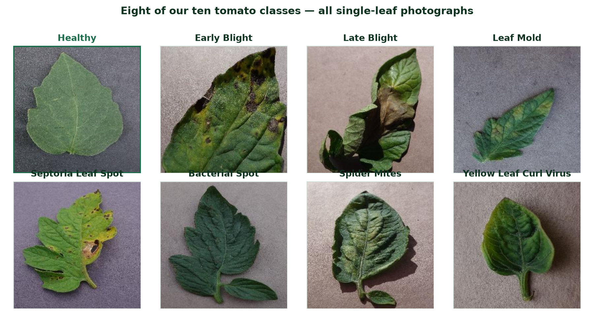
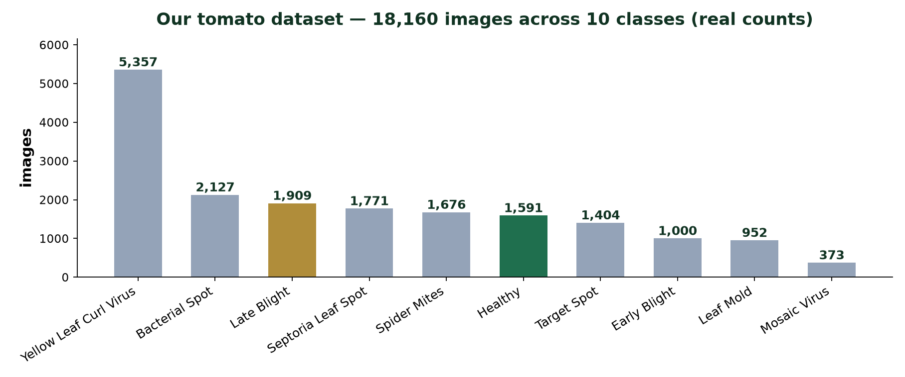
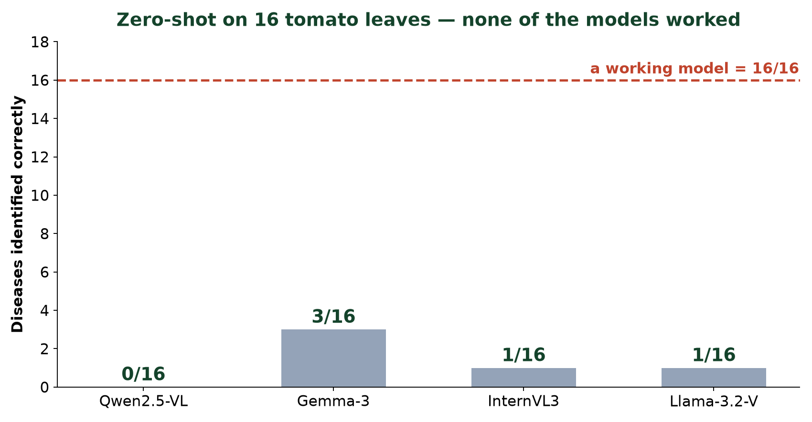
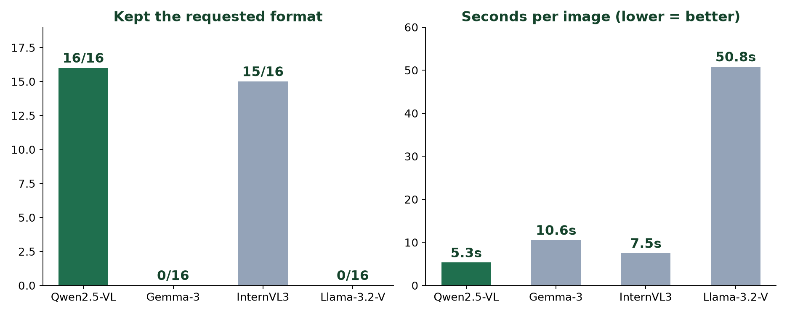
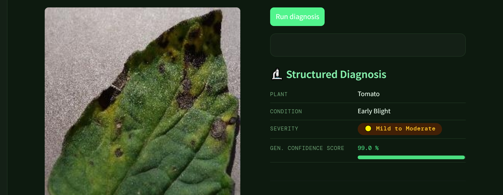
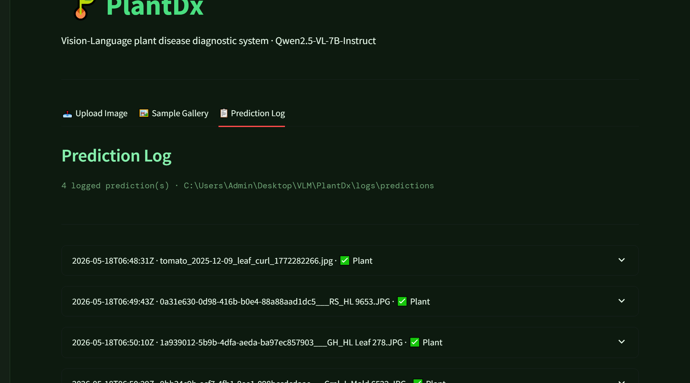
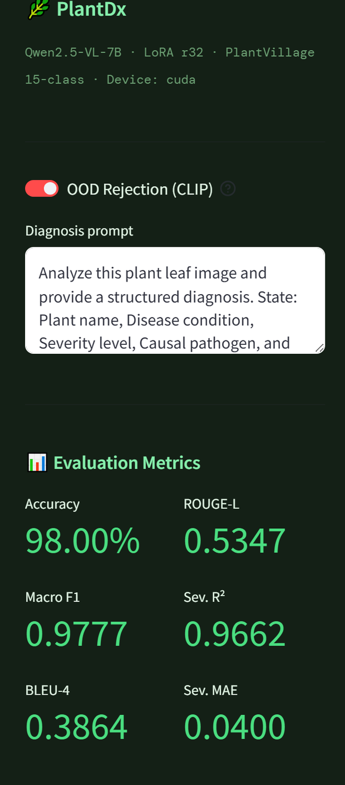

<!-- Text and figures extracted from `VLM_Teaching_Session.pptx` so it can be read on GitHub; the original file is next to this one. -->

## Slide 1

- A TEACHING SESSION

- Vision-Language Models
- From pixels to sentences

- Teaching a model to look at a diseased tomato leaf and describe what it sees —
- including everything that failed along the way.

- Harish   ·   Aakash   ·   Kamaksha

> **Speaker notes:** 🎯 LEARNING OBJECTIVE Set the frame: a class about VLMs, with our project as the worked example. 🗣️ WHAT TO SAY • Introduce all three of you by name. • State the promise: by the end you'll know what a VLM is and how one is built. • Warn them this is interactive — you'll be asking them questions throughout. • Promise honesty: we show what failed, not just what worked. 🚫 WHAT NOT TO SAY ✗ Don't call this a project presentation — it is a lecture. ✗ Don't apologise for the level; assume zero VLM knowledge and say so positively. ❓ LIKELY STUDENT QUESTIONS Q: Do we need prior deep-learning knowledge? A: No — we start from AI and build up. ➡️ TRANSITION Put a real leaf on screen and ask the room a question.

## Slide 2

- A farmer sends you
- this photo.
- What kind of AI could understand it?

- a real image from our benchmark set  ·  tomato, late blight

> **Speaker notes:** 🎯 LEARNING OBJECTIVE Create the question the whole lecture answers, and get the room talking immediately. 🗣️ WHAT TO SAY • Ask it out loud. Wait. Count to five in your head before accepting an answer. • Take 2-3 answers from different parts of the room. Write nothing down; just repeat them back. • Expect: 'a CNN', 'image classification', 'ChatGPT'. All are reasonable starting points. • Say: we'll see exactly where each of those stops working. 🚫 WHAT NOT TO SAY ✗ Do NOT correct any answer yet — that kills participation for the rest of the hour. ✗ Do NOT resolve the question on this slide. ❓ LIKELY STUDENT QUESTIONS Q: Isn't this just image classification? A: That's the most common answer — and the next few slides show precisely why a label isn't enough. ➡️ TRANSITION To answer properly we need vocabulary. Let's build it from the ground up.

## Slide 3

- SECTION 1 · FOUNDATIONS

- Where VLMs come from

- AI

- do smart
things

- ›

- Machine
Learning

- learn from
data

- ›

- Deep
Learning

- learn the
features too

- ›

- Trans-
formers

- attention:
see it all
at once

- ›

- LLMs

- language,
at scale

- ›

- VLMs

- an LLM
that can
also see

- Each step handed the machine one more job it used to be given by hand.

> **Speaker notes:** 🎯 LEARNING OBJECTIVE Give a mental map so nothing later feels like it appeared from nowhere. 🗣️ WHAT TO SAY • Roughly 10 seconds per box. Do not lecture on any single one. • AI = the goal. ML = learn from data. DL = learn the features too. • Transformers (2017) = attention, the unlock that made everything after it possible. • LLM = transformer at scale on text. VLM = that same LLM, given eyes. • Land the last line: a VLM is not built from scratch — it's an LLM plus a vision encoder. 🚫 WHAT NOT TO SAY ✗ Don't explain attention mathematically. One sentence maximum. ✗ Don't give dates and paper names — this is orientation, not history. ❓ LIKELY STUDENT QUESTIONS Q: Do we need the maths of attention? A: Not today — just that it weighs every part of the input against every other part. Q: Is a VLM a different model from an LLM? A: It usually *contains* one. We'll open the box shortly. ➡️ TRANSITION Now the comparison you'll actually use in practice — three kinds of model.

## Slide 4

- SECTION 1 · FOUNDATIONS

- Three kinds of model

- CNN

- Image → one label

- “Tomato___Early_blight”

- No reason. You cannot check it.

- LLM

- Text → text

- “Early blight is caused by
Alternaria solani…”

- Fluent — but it never saw your leaf.

- VLM

- Image + question → sentences

- “Two brown patches with
concentric rings, upper left…”

- An answer with the evidence attached.

- A farmer cannot act on a label. A description can be read, questioned, and checked.

> **Speaker notes:** 🎯 LEARNING OBJECTIVE Make the distinction concrete enough that students can classify any new model themselves. 🗣️ WHAT TO SAY • Walk left to right. The input→output line is the thing to remember. • CNN: brilliant at labels, silent about reasons. • LLM: knows pathology from text, but is blind — it never saw *your* leaf. • VLM: takes image AND question, answers in sentences. • Land the bottom line — 'evidence attached' returns at the end of the session. 🚫 WHAT NOT TO SAY ✗ Don't claim VLMs are more accurate than CNNs — we never trained a CNN baseline. ✗ Don't go into architectures here; that's the next slide. ❓ LIKELY STUDENT QUESTIONS Q: Isn't a CNN more accurate? A: Often yes for pure classification — our argument is about the *form* of the output, not beating a CNN. Q: Could I caption with an LLM? A: No — it has no image input. It would be writing fiction. ➡️ TRANSITION Before we open the box — a quick check that this landed.

## Slide 5

- PAUSE  ·  QUICK QUIZ   ·   #1

- Which model would you use?

- ① Sort 50,000 photos into 10 folders.        ② Answer “why does this leaf look sick?”        ③ Summarise a textbook chapter.

- Hands up — CNN, LLM, or VLM?

> **Speaker notes:** 🎯 LEARNING OBJECTIVE Check that the CNN/LLM/VLM distinction actually landed before building on it. 🗣️ WHAT TO SAY • Read all three scenarios, then take hands for each one in turn. • Answers: ① CNN — cheap, fast, a label is all you need. ② VLM — needs image + explanation. ③ LLM — text in, text out, no image. • For ①, praise anyone who says CNN: 'right — don't use a 7B model where a classifier will do.' • Spend ~45 seconds total. Keep it brisk and light. 🚫 WHAT NOT TO SAY ✗ Don't let a wrong answer hang — correct it warmly and immediately. ✗ Don't turn this into a discussion; it's a temperature check, not a debate. ❓ LIKELY STUDENT QUESTIONS Q: Could a VLM do all three? A: Yes — and that's the trap. It would be slower and more expensive for jobs 1 and 3. Match the tool to the task. ➡️ TRANSITION Good. Now let's open the box and see how a VLM manages to do job ②.

## Slide 6

- SECTION 1 · FOUNDATIONS

- How a VLM works

- Image

- the leaf photo

- →

- Vision
Encoder

- pixels → vectors

- →

- Projector

- vectors → the LLM's
own “word” space

- →

- LLM

- reads image + question,
writes the answer

- Text out
- “brown patches
with rings…”

- The trick: the projector makes an image look like a sentence to the language model.
- Once a picture behaves like words, the LLM just does what it always did — predict the next word.

> **Speaker notes:** 🎯 LEARNING OBJECTIVE Demystify the architecture so fine-tuning makes sense later. 🗣️ WHAT TO SAY • Eye → translator → mouth. Use those words. • Vision encoder = the eye; produces vectors, not words. • Projector = a small trained layer, the unsung hero of the whole design. • LLM = completely unchanged; it just receives extra 'words' that came from an image. • Say clearly: nothing here is magic — it is next-word prediction with a picture prepended. • Mention in passing where this is used: medical reports, robotics, driving, education. 🚫 WHAT NOT TO SAY ✗ Don't discuss ViT patch sizes, embedding dimensions, or cross-attention variants. ✗ Don't say the model 'understands' the image — say it maps it into the same space as words. ❓ LIKELY STUDENT QUESTIONS Q: Is the vision encoder trained from scratch? A: Usually not — pre-trained, and often frozen. Q: How does it know *where* something is? A: The image becomes a grid of vectors, so position survives — that's why it can say 'upper left'. ➡️ TRANSITION That's the machinery. Now let's use it on a real problem — ours.

## Slide 7

- SECTION 2 · OUR DATA

- This is our dataset

- 10 classes · 18,160 images · every one a single tomato leaf on a plain background

> **Speaker notes:** 🎯 LEARNING OBJECTIVE Ground the whole lecture in the real data, so every later concept has the same referent. 🗣️ WHAT TO SAY • These are real images from our dataset — not stock photos. • Ask the room: 'which one looks healthy?' Let them find the green-bordered one. • Then ask: 'could you tell early blight from late blight?' Most cannot — that's the point. This is genuinely hard, even for people. • Note what they all have in common: ONE leaf, plain background, no fruit, no whole plant. • That single-leaf fact decides what a truthful caption may say — it returns later. 🚫 WHAT NOT TO SAY ✗ Don't claim we have fruit images, whitefly, aphids or fruit borer — we do not. Our data is leaves only, 10 tomato classes. ✗ Don't dwell on plant pathology — students are here for the AI, not the biology. ❓ LIKELY STUDENT QUESTIONS Q: Where did these come from? A: PlantVillage-style tomato images; the class is the folder name. Q: Are these real field photos? A: No — controlled captures on a plain background. Real field images would be much harder, and that's a genuine limitation. ➡️ TRANSITION Now — are those classes evenly balanced? Look at the numbers.

## Slide 8

- SECTION 2 · OUR DATA

- Real data is never balanced

- 5,357 yellow-leaf-curl images · 373 mosaic-virus images — a 14× imbalance.
- A model trained naively on this will be good at the common class and poor at the rare one.

> **Speaker notes:** 🎯 LEARNING OBJECTIVE Teach class imbalance using our own numbers — a lesson that transfers to any ML project. 🗣️ WHAT TO SAY • Point at the tallest and shortest bars. 5,357 versus 373. • Ask: 'if you trained on this, which disease would the model be worst at?' — the rare one. • This is one of the first things to check in ANY dataset, before any modelling. • Say what we did about it: we report per-class results, not just overall accuracy, so a good average cannot hide a bad class. 🚫 WHAT NOT TO SAY ✗ Don't go into resampling / class weighting / focal loss — name the problem, not the cures. ✗ Don't pretend we fully solved it. We report per-class scores; that's a mitigation, not a fix. ❓ LIKELY STUDENT QUESTIONS Q: Why not just collect more of the rare class? A: Ideally yes — but you photograph what the season gives you. This is the normal situation in agriculture. Q: Does imbalance explain the benchmark failures? A: No — the benchmark models were never trained on our data at all. This matters for *fine-tuning*, later. ➡️ TRANSITION So this is our data. What do we actually want a model to do with it?

## Slide 9

- SECTION 2 · OUR DATA

- Our goal: describe, don't just classify

- What a classifier gives you
- Tomato___Early_blight
- Correct — and useless on its own.

- What we wanted
- “Circular brown spots with concentric rings and yellow halos, scattered on this leaf.”
- Every claim can be checked against the photo.

- Our data: single-leaf tomato photos. Benchmark set — 16 images, 6 conditions.
- One leaf per photo. So a truthful caption may never mention fruit, stems, or the whole plant.

> **Speaker notes:** 🎯 LEARNING OBJECTIVE Frame the engineering goal precisely and introduce the single-leaf constraint. 🗣️ WHAT TO SAY • Read both boxes aloud — the contrast does the work. • The right-hand text is a real output from our fine-tuned system. • Single-leaf constraint: it decides what a truthful caption may say. It returns in the caption section. • Be exact about scale: 16 images, 6 conditions for the benchmark. 🚫 WHAT NOT TO SAY ✗ Do NOT inflate the dataset size. Never round 16 up to 'a few dozen'. ✗ Don't promise the system diagnoses better than an expert — it doesn't. ❓ LIKELY STUDENT QUESTIONS Q: Why so few images? A: It was a fast qualitative sweep, not a statistical benchmark — and we'll say exactly that when we show the results. Q: Where's the data from? A: PlantVillage-style tomato leaves; labels come from filename codes. ➡️ TRANSITION Goal set. Now the first real engineering question — which model do we even start from?

## Slide 10

- SECTION 3 · BENCHMARKING

- Which model should we even start from?

- 1
- Leaderboards mislead
- They're won on cats and street signs. That says nothing about a diseased leaf.

- 2
- Our constraints are ours
- One laptop, 24 GB shared memory, no cloud budget.

- 3
- We need a fixed format
- Our code must read the answer automatically.

- So we ran our own benchmark — on our own leaves, on our own hardware.

> **Speaker notes:** 🎯 LEARNING OBJECTIVE Justify benchmarking as an engineering necessity rather than a formality. 🗣️ WHAT TO SAY • Ask first: 'if I gave you five models, how would you pick one?' Most say leaderboard. • Then dismantle it: leaderboards measure general images, not your domain, not your hardware. • Point 3 is the one nobody predicts — output format is a hard engineering requirement. • This is one of our strongest contributions. Give it room. 🚫 WHAT NOT TO SAY ✗ Don't dismiss benchmarks as useless — say they answer a *different* question than yours. ❓ LIKELY STUDENT QUESTIONS Q: Why not just take the biggest model? A: Biggest lost. Llama-3.2-11B was 10x slower and ignored our format — you'll see the data. ➡️ TRANSITION Before I show you how we compared them — I want you to design the experiment.

## Slide 11

- PAUSE  ·  THINK · PAIR   ·   #2

- You have 4 models and 16 leaf photos.

- Turn to the person next to you. In 60 seconds:
what would you keep IDENTICAL, and what would you MEASURE?

> **Speaker notes:** 🎯 LEARNING OBJECTIVE Have students derive experimental control themselves — it sticks far better than being told. 🗣️ WHAT TO SAY • Give a genuine 60 seconds. Let the room get noisy; that's the point. • Then harvest 3-4 answers on the board or verbally. • Fish for: same prompt, same images, same settings. Measure: correctness, speed, format, memory. • Praise anyone who says 'the prompt must be identical' — that's the key insight. • Then reveal the next slide as 'here's what we actually did' — they'll recognise their own answers. 🚫 WHAT NOT TO SAY ✗ Don't answer it yourself if the room is quiet — wait. Silence is uncomfortable but productive. ✗ Don't skip this to save time; it is the pedagogical centre of the benchmarking section. ❓ LIKELY STUDENT QUESTIONS Q: Should we measure accuracy only? A: Ask them back: 'what if a model is accurate but takes a minute per image?' Let them arrive at multi-criteria evaluation. ➡️ TRANSITION Let's see how close that is to what we did.

## Slide 12

- SECTION 3 · BENCHMARKING

- Change one thing at a time — the model

- 1

- Zero-shot
- Every model sees each leaf once. No examples, no hints.

- 2

- One identical prompt
- Different prompts would mean comparing prompts, not models.

- 3

- Temperature 0
- No randomness. Run it again, get the same answer.

- 16 images · 6 conditions · 4 models here · 64 runs · 0 failures · ~22 minutes

> **Speaker notes:** 🎯 LEARNING OBJECTIVE Teach experimental control — the transferable skill of this whole section. 🗣️ WHAT TO SAY • Connect explicitly to what they just said: 'several of you said keep the prompt the same — exactly.' • Zero-shot = no examples in the prompt. The honest test of what a model already knows. • Temperature 0 = greedy decoding = reproducible. • Read the bottom line as the true scale of the sweep. 🚫 WHAT NOT TO SAY ✗ Don't oversell the scale — 16 images is small and we say so later. Don't pre-empt that here. ✗ Don't explain sampling/top-p; 'no randomness' is enough. ❓ LIKELY STUDENT QUESTIONS Q: Zero-shot vs one-shot? A: Zero = no examples. One = a single worked example in the prompt. We gave none. Q: Why does temperature matter? A: With sampling, two runs disagree and you can't attribute the difference to the model. ➡️ TRANSITION Here's the actual prompt — there are no tricks in it.

## Slide 13

- SECTION 3 · BENCHMARKING

- The same prompt, for every model

- You are an agricultural expert.
- Analyze this crop image carefully. Return:
- Plant species · Visible symptoms · Leaf color
- Leaf texture · Spots or lesions · Severity
- Most likely disease · Alternative diagnoses
- Confidence (0-100) · Reasoning
- Only describe what is visible.
- If uncertain, explicitly state uncertainty.
- Do not hallucinate diseases.

- Remember these
three lines.
- We explicitly told every model not to invent anything, and to admit doubt.

> **Speaker notes:** 🎯 LEARNING OBJECTIVE Show the real instrument, and plant the trap for the hallucination reveal. 🗣️ WHAT TO SAY • Read the three gold lines aloud, slowly. • Stress: we TOLD every model not to hallucinate and to state uncertainty. • Say 'remember that' — you will call back to it in two slides. • Fixed fields = machine-readable answers, which becomes a selection criterion later. 🚫 WHAT NOT TO SAY ✗ Don't read out all ten fields — it's boring and the detail doesn't matter. ✗ Don't claim this is an optimal prompt; it's a *fair* one. ❓ LIKELY STUDENT QUESTIONS Q: Could a better prompt fix the failures? A: Possibly some — prompt sensitivity is real. But the same prompt was fair to all, and the failures we saw were factual, not formatting. ➡️ TRANSITION Eight models went through this. Here's the bench.

## Slide 14

- SECTION 3 · BENCHMARKING

- Eight open models, two setups

- SETUP A · Apple Silicon, 4-bit

- Qwen2.5-VL-7B

- Alibaba

- Gemma-3-12B

- Google

- InternVL3-8B

- OpenGVLab

- Llama-3.2-11B-Vision

- Meta

- SETUP B · CUDA workstation

- Qwen2.5-VL-7B

- also here

- LLaVA-1.6-Mistral-7B

- LLaVA

- BLIP-2 OPT-2.7B

- Salesforce

- BLIP-2 FLAN-T5-XL

- Salesforce

- Florence-2-base

- Microsoft

- Not one was chosen from a leaderboard. Every one was run on our own leaves.

> **Speaker notes:** 🎯 LEARNING OBJECTIVE State the bench precisely and honestly, including the two-machine split. 🗣️ WHAT TO SAY • Eight distinct models; Qwen appears on both setups. • Setup A is the sweep whose numbers you'll see — that data is fully recorded. • Setup B was our other pipeline; BLIP-2 later lost the output format, Florence-2 needed patching. • Every chart in this deck comes from Setup A. Be precise if asked. 🚫 WHAT NOT TO SAY ✗ Don't blur the two setups together — if challenged, you must be able to separate them. ✗ Don't claim a scored eight-model ranking; we never ran the automated judge. ❓ LIKELY STUDENT QUESTIONS Q: Why 4-bit? A: Quantisation shrinks the model so 7-12B fits in 24 GB of shared memory. Q: Which numbers come from where? A: Every chart here is Setup A, the Apple Silicon sweep. ➡️ TRANSITION Let's look at what came back — one leaf, two models.

## Slide 15

- SECTION 3 · BENCHMARKING

- One leaf. Four models. Four answers.

- TRUTH
- Tomato
Late Blight

- Qwen2.5-VL

- species
- Uncertain
- its diagnosis
- leaf spot
- confidence
- 70%
- ✗  not late blight

- 5.4 s

- InternVL3

- species
- “possibly a legume”
- its diagnosis
- leaf spot disease
- confidence
- 70%
- ✗  not late blight

- 8.4 s

- Gemma-3

- species
- Soybean (likely)
- its diagnosis
- Cercospora leaf blight
- confidence
- 75%
- ✗  not late blight

- 16.8 s

- Llama-3.2-V

- species
- Unknown
- its diagnosis
- “some fungal disease”
- confidence
- 60%
- ✗  not late blight

- 52.4 s

- Four models. Four different answers. All four wrong — and every one of them confident.

> **Speaker notes:** 🎯 LEARNING OBJECTIVE Make hallucination visceral using one image and four real, recorded answers. 🗣️ WHAT TO SAY • Slow right down. This is the emotional centre of the lecture. • Same leaf you saw on slide 2 — we are following ONE image through the whole talk. • Read the four species answers across: Uncertain · a legume · SOYBEAN · Unknown. • Gemma-3 looked at a tomato leaf, said Soybean, then named a soybean disease to match — at 75%. • Call back to the prompt: 'we explicitly told them not to hallucinate and to admit doubt.' • Then the killer line: not one of them said late blight. Four models, four answers, all wrong. 🚫 WHAT NOT TO SAY ✗ Don't mock the models — this is a systemic property, not a funny bug. ✗ Don't imply Qwen 'won' here. It also failed to identify the disease. ✗ Don't skip the confidence row — confident-and-wrong is the whole danger. ❓ LIKELY STUDENT QUESTIONS Q: Why soybean? A: Probably a prior from training data — soybean leaves are common in agricultural datasets. It pattern-matched shape, not species. Q: Would a bigger model fix it? A: Gemma-3-12B was the biggest here, and it hallucinated most. Q: Is 'leaf spot' not close enough? A: No — it's a generic family, not a diagnosis. A farmer cannot act on it. ➡️ TRANSITION That's one leaf. Before I show you all sixteen — I want you to make a prediction.

## Slide 16

- PAUSE  ·  PREDICTION   ·   #3

- Across all 16 leaves,
how many will the BEST model get right?

- Hands up:      16 / 16      ·      12–15      ·      8–11      ·      4–7      ·      fewer than 4

> **Speaker notes:** 🎯 LEARNING OBJECTIVE Create a prediction gap — students remember a result far better when they committed to a guess first. 🗣️ WHAT TO SAY • Read the five bands and take a show of hands for each. Count them out loud. • Most rooms cluster around 8-15. Note that publicly: 'so most of us expect at least half.' • Do NOT hint at the answer with your tone. • Then move to the next slide and let the chart do the work. 🚫 WHAT NOT TO SAY ✗ Don't reveal the answer here, even if someone shouts it out. ✗ Don't say 'you'll be surprised' — that leaks the result. ❓ LIKELY STUDENT QUESTIONS Q: Does 'best' mean best overall or per image? A: Best-performing single model across the 16. ➡️ TRANSITION Let's see. Here is what actually happened.

## Slide 17

- SECTION 3 · BENCHMARKING

- The result we did not want

- None of them
- were reliable.
- Best: 3 of 16.
Qwen: none.
- Zero-shot VLMs cannot diagnose crop disease out of the box.

- This is why the rest of the project exists — and why fine-tuning was not optional.

> **Speaker notes:** 🎯 LEARNING OBJECTIVE Deliver the central empirical finding without spin, and model honest reporting. 🗣️ WHAT TO SAY • Let the chart sit in silence for three seconds before you speak. • Then say it flatly: none of the models were reliable. The best got 3 of 16. • Compare to their predictions: 'most of you said 8 or more. So did we.' • Frame it as valuable: a negative result that redirected the entire project. 🚫 WHAT NOT TO SAY ✗ Do NOT rescue this. Never say 'but Qwen showed promise'. The honesty IS the content. ✗ Don't blame the models or the prompt — state the finding and move on. ❓ LIKELY STUDENT QUESTIONS Q: Then why use VLMs at all? A: Because the failure is fixable by fine-tuning — and we'll show it was. Q: Isn't 16 too few to conclude that? A: For a precise ranking, yes, and we say so. But 0-3 out of 16 across four models is a clear signal. ➡️ TRANSITION So if none of them can diagnose — on what basis do you choose one at all?

## Slide 18

- SECTION 3 · BENCHMARKING

- So we chose the best student, not the best doctor

- Held the format
- 16/16 · others 0/16

- Fastest
- 5.3 s · Llama 50.8 s

- Honest when unsure
- said “Uncertain”

- Not the most accurate — it was the least. But consistent, fast and honest. That is what you want in a model you are about to teach.

> **Speaker notes:** 🎯 LEARNING OBJECTIVE Teach a genuine engineering trade-off and pre-empt the obvious objection. 🗣️ WHAT TO SAY • Say the objection before they do: 'you're thinking Gemma got 3 and Qwen got 0 — correct.' • Answer: 3/16 isn't usable either. Neither is a diagnostician. • So select for trainability: format stability, speed, calibrated doubt. • Supporting evidence from our other setup: BLIP-2 lost the format after fine-tuning; Qwen held it. 🚫 WHAT NOT TO SAY ✗ Don't claim Qwen 'understood agriculture better' — our own data contradicts that. ✗ Don't present this as a scored decision; it was a qualitative judgement plus these measurements. ❓ LIKELY STUDENT QUESTIONS Q: Isn't choosing the least accurate model strange? A: It would be if we shipped it as-is. We were choosing a starting point to teach. Q: Was it formally scored? A: No — we designed an automated judge but never ran it. We're clear about that. ➡️ TRANSITION We have our student. Now — how do you teach it? First, a question for you.

## Slide 19

- PAUSE  ·  DISCUSSION   ·   #4

- We need thousands of example captions.
Where should they come from?

- Ask a VLM to write them?   ·   Write them by hand?   ·   Generate from the labels?

What could go wrong with each?

> **Speaker notes:** 🎯 LEARNING OBJECTIVE Let students discover the circularity trap themselves rather than being told. 🗣️ WHAT TO SAY • Take answers for each option. Most rooms suggest 'ask a model' first — it's the obvious one. • When they do, ask the killer question: 'which model? The one that just got 3 out of 16?' • Let the silence land. That's the lesson. • Then draw out hand-written: accurate but slow. Label-derived: fast but generic. • Tell them there is no clean answer — and that our honest answer is on the next slides. 🚫 WHAT NOT TO SAY ✗ Don't give the answer before they've tried. This slide fails if you rush it. ✗ Don't dismiss 'ask a VLM' as stupid — it's what most of the field does. It's just circular. ❓ LIKELY STUDENT QUESTIONS Q: Couldn't we use a much bigger model like GPT-4o? A: Better, but same problem — you'd inherit its errors, and you can't verify them at scale in a specialist domain. ➡️ TRANSITION Here's what we actually did — and where each approach falls down.

## Slide 20

- SECTION 4 · TEACHING THE MODEL

- Fine-tuning = specialising a generalist

- The base model knows
- a little about everything
- cats · receipts · landmarks · memes

- We need it to know
- a lot about one thing
- early blight vs target spot — said the same way every time

- General
VLM

- →

- + examples from
our domain

- →

- Fine-tuned
specialist

> **Speaker notes:** 🎯 LEARNING OBJECTIVE Motivate fine-tuning as specialisation, using the benchmark failure as the reason. 🗣️ WHAT TO SAY • Analogy: a bright graduate who has read everything and practised nothing. • Fine-tuning is the residency — many examples from one domain. • Tie directly back: this is the fix for the 0-3/16 result. • Second goal, easy to miss: consistency of format, not only correctness. 🚫 WHAT NOT TO SAY ✗ Don't say fine-tuning 'adds facts' — it teaches a behaviour: what to look at and how to say it. ✗ Don't get drawn into RAG vs fine-tuning; park it for Q&A. ❓ LIKELY STUDENT QUESTIONS Q: Why not put the knowledge in the prompt? A: You can, and it helps a bit — but it costs tokens every call and doesn't fix format drift. Q: How much data does it need? A: Hundreds to thousands, not millions. ➡️ TRANSITION To teach by example you need examples. What does one example actually look like?

## Slide 21

- SECTION 4 · TEACHING THE MODEL

- One training example = one flashcard

- FRONT

- +  “Describe this leaf.”

- →

- BACK

- the caption
- “Circular brown spots with concentric rings, scattered across the leaf.”

- It guesses one word at a time while we hold the answer key.
- Each time it wasn't sure enough about the correct next word, it nudges itself. Thousands of nudges = learning.

> **Speaker notes:** 🎯 LEARNING OBJECTIVE Explain supervised learning intuitively — no loss equations. 🗣️ WHAT TO SAY • Flashcards is the entire metaphor. Front = image + question. Back = the caption. • Be precise about the mechanism: it does NOT compare whole sentences. • Word by word, it checks 'how much probability did I give the correct next word?' • That gap is the error; the nudge is the update. Say 'one word at a time' twice. 🚫 WHAT NOT TO SAY ✗ Don't write cross-entropy on the board. Don't say 'loss function' unless asked. ✗ Don't say the model 'remembers' the caption — it adjusts weights. ❓ LIKELY STUDENT QUESTIONS Q: Does it compare its sentence to ours? A: No — per word, how much probability it gave the correct next word. Q: What if two captions are both right? A: Excellent — that's exactly the next problem we hit. ➡️ TRANSITION So where do those answer keys come from? The question you just discussed.

## Slide 22

- SECTION 4 · TEACHING THE MODEL

- Where our captions came from — honestly

- We refused the shortcut: a model that gets 3/16 cannot be trusted to teach.

- Built from labels
- Written from a cited reference of what each disease looks like.
- +  scales, traceable, consistent
- –  describes the DISEASE, not THIS leaf

- Written by hand
- We looked at each leaf and wrote what we saw. Mentor-reviewed.
- +  truly grounded in this image
- –  only 30 images · one annotator

- Neither is perfect. The honest next step is a hybrid.

> **Speaker notes:** 🎯 LEARNING OBJECTIVE Model intellectual honesty — the single most important slide for credibility. 🗣️ WHAT TO SAY • Red bar first: the shortcut we refused, justified by our own benchmark. • Then both approaches — and READ THE MINUS LINES OUT LOUD. • Approach 1's flaw is real: captions grounded in the LABEL, not the pixels. • Approach 2's flaw is real: 30 images is small; one annotator means no agreement statistic. • Close on the hybrid as honest future work — not as something we've already built. 🚫 WHAT NOT TO SAY ✗ Do NOT skip or soften the minus lines. They are the point of the slide. ✗ Don't claim the hybrid is implemented — it isn't. ❓ LIKELY STUDENT QUESTIONS Q: Isn't caption-from-label just classification in disguise? A: Largely fair — it's why our hardest class performs badly, and why the hybrid is next. Q: Which did you finally use? A: Both, in two pipelines. One gave scale, the other grounding. ➡️ TRANSITION One more caption idea worth seeing — why we wrote five per leaf.

## Slide 23

- SECTION 4 · TEACHING THE MODEL

- Five right answers for one leaf

- Tomato · Early Blight

- 1

- Two prominent brown patches stand out against the dark green background…

- 2

- A mix of green tissue and several darker damaged regions…

- 3

- The discoloration is distributed across separate locations…

- 4

- Multiple isolated lesions. Largest mark on the right side…

- 5

- Several damaged sections interrupt an otherwise dark green surface…

- All five are true. The model cannot memorise one — so it has to learn the leaf.

> **Speaker notes:** 🎯 LEARNING OBJECTIVE Explain multi-reference supervision and why it prevents parroting. 🗣️ WHAT TO SAY • These are our real captions, unedited. • Ask the room: 'which one is correct?' Wait. Answer: all five. • If we gave only one, the model would learn that exact sentence — parroting, not seeing. • Five phrasings force it to learn the underlying visual facts. 🚫 WHAT NOT TO SAY ✗ Don't imply five is a magic number — it was a practical choice. ❓ LIKELY STUDENT QUESTIONS Q: Why five? A: A practical balance between annotation effort and variety. Q: Do all five get used? A: Yes — each becomes its own training example for the same image. ➡️ TRANSITION Now the trick that makes training this possible on a laptop.

## Slide 24

- SECTION 4 · TEACHING THE MODEL

- LoRA — add, don't rewrite

- Qwen2.5-VL · frozen
- Everything it already knows stays exactly as it is.

- LoRA
adapter

- LoRA
adapter

- LoRA
adapter

- 0.484%
- of weights trained

- 173 MB
- the whole result

- ~20 min
- one run

- 19.4 / 24 GB
- peak memory

- The textbook stays untouched. We only add sticky notes in the margins.

> **Speaker notes:** 🎯 LEARNING OBJECTIVE Explain parameter-efficient fine-tuning without matrix maths. 🗣️ WHAT TO SAY • Problem: a 7B model's full weights won't fit in 24 GB for training. • LoRA: freeze everything, insert small trainable matrices, train only those. • The four stat boxes are real numbers from our run. • Sticky-notes metaphor is the takeaway — say it twice. • Consequence worth naming: one base model + many small adapters = many crops. 🚫 WHAT NOT TO SAY ✗ Don't show the low-rank decomposition or write W + BA. ✗ Don't claim LoRA is as good as full fine-tuning in general — say 'close enough, and it's the difference between possible and impossible on our hardware.' ❓ LIKELY STUDENT QUESTIONS Q: Does LoRA hurt quality? A: Slightly in theory; very close in practice for tasks like this. Q: What's QLoRA? A: LoRA on top of a 4-bit quantised base — that's what we ran. ➡️ TRANSITION Put it all together and you get a working system. Let's look at it.

## Slide 25

- SECTION 5 · THE SYSTEM

- The system, running

- diagnosis

- prediction log

- metrics

- Upload leaf

- →

- Model reads it

- →

- Structured answer

- →

- Logged

- real screenshots of our own application

> **Speaker notes:** 🎯 LEARNING OBJECTIVE Show that the pipeline became a usable thing, not just a notebook. 🗣️ WHAT TO SAY • These are genuine screenshots of our app, not mock-ups. • Walk it: upload → prediction → structured fields → logged to disk. • Explain the confidence number: the average probability the model gave the words it chose. • Note the logging — every prediction is auditable after the fact. 🚫 WHAT NOT TO SAY ✗ Don't demo live unless you've tested it that morning on that machine. ✗ Don't present the confidence number as a probability of being correct — it isn't. ❓ LIKELY STUDENT QUESTIONS Q: Can we try it? A: Yes — come find us afterwards. Q: What does the confidence mean? A: How sure the model was about the words it produced. Low value = unsure, and we flag it. ➡️ TRANSITION But is it actually better than where we started? Judge for yourself.

## Slide 26

- SECTION 5 · THE SYSTEM

- Before and after fine-tuning

- BASE

- “…appears to have some signs of disease or damage… could indicate fungal infections, bacterial diseases, or physical damage… advisable to consult a plant pathologist for a”
- — hedges across three possibilities
- — unasked-for advice
- — cut off mid-sentence

- FINE-TUNED

- “Plant: Tomato. Condition: Target Spot. Circular brown spots with concentric lighter zones and chlorotic halos are scattered on this leaf surface.”
- — names what it sees
- — same shape every time
- — readable at a glance

- Both are real outputs from our own runs. This shows changed behaviour — not proof of accuracy.

> **Speaker notes:** 🎯 LEARNING OBJECTIVE Show the payoff concretely — and mark the boundary of what it proves. 🗣️ WHAT TO SAY • INTERACTION: show the BASE side first (cover the right half), ask 'what's wrong with this answer?' Take two answers, then reveal the fine-tuned side. • Read a little of the base waffle aloud — the hedging is the point. • Connect back to slide 4: 'an answer with the evidence attached'. • Then the honesty line: this is behaviour change, not an accuracy claim. 🚫 WHAT NOT TO SAY ✗ Do NOT present this as evidence of accuracy — accuracy needs a held-out test set. ✗ Don't cherry-pick language like 'dramatically better' — let them see it. ❓ LIKELY STUDENT QUESTIONS Q: Is the fine-tuned answer always right? A: No. More consistent and specific. Accuracy needs a held-out test set, and some classes remain hard. Q: Why is the base output cut off? A: It hit the token limit mid-sentence — a practical problem with unfocused models. ➡️ TRANSITION Let's check what stuck before we finish.

## Slide 27

- PAUSE  ·  RECAP QUIZ   ·   #5

- Three quick ones.

- ① Name the three parts of a VLM.
② Why couldn't we ask a VLM to write our captions?
③ In LoRA, what percentage of the model do we train?

> **Speaker notes:** 🎯 LEARNING OBJECTIVE Retrieval practice — the strongest single thing you can do for retention. 🗣️ WHAT TO SAY • Take each in turn, hands up, ~20 seconds each. • ① vision encoder → projector → LLM. • ② circularity — it can't diagnose, so it can't teach; our benchmark measured 3/16. • ③ about half a percent — 0.484% in our run. • Praise partial answers. The act of retrieving matters more than being right. 🚫 WHAT NOT TO SAY ✗ Don't let it run long — 60 seconds total. ✗ Don't move on if the room is silent on ②; that's the one that matters most. Prompt them. ❓ LIKELY STUDENT QUESTIONS Q: Was that in the exam scope? A: Deflect warmly — this is about understanding, not assessment. ➡️ TRANSITION Last slide — where we actually stand.

## Slide 28

- WHERE WE ACTUALLY STAND

- What works

- ·  A benchmark of 8 open VLMs

- ·  A pipeline that runs on a laptop

- ·  Consistent, structured descriptions

- ·  A working, logged application

- What doesn't

- ·  16 images is too few to rank

- ·  Label-built captions aren't leaf-specific

- ·  Hand-written set is only 30 images

- ·  No CNN baseline trained

- What's next

- ·  Hybrid captions

- ·  More images, more crops

- ·  Finish the scored benchmark

- ·  Explain *why* it said that

- We'd rather tell you what's unfinished than have you find it in the questions.

- Thank you — questions welcome, including the ones we haven't answered yet.
- Harish  ·  Aakash  ·  Kamaksha

> **Speaker notes:** 🎯 LEARNING OBJECTIVE Model scientific honesty, then close and open the floor. 🗣️ WHAT TO SAY • Read the middle column as confidently as the left one. That is the whole point. • Naming your own limitations first removes their power as attacks. • The CNN admission matters — we used CNN-vs-VLM as an argument but never trained one. • Recap the three takeaways verbally: a VLM is an LLM that can see · benchmark on YOUR data · none worked zero-shot, which is why we fine-tuned. • Invite hard questions explicitly. 🚫 WHAT NOT TO SAY ✗ Don't rush the middle column or mumble it. ✗ Don't end with an apology — end with the invitation. ❓ LIKELY STUDENT QUESTIONS Q: Which limitation worries you most? A: Caption grounding — captions built from labels describe the disease, not this leaf. It changes what the model can learn. Q: What would you do differently? A: Start with a bigger labelled benchmark set and hybrid captions from day one. ➡️ TRANSITION — end of session · open the floor —
