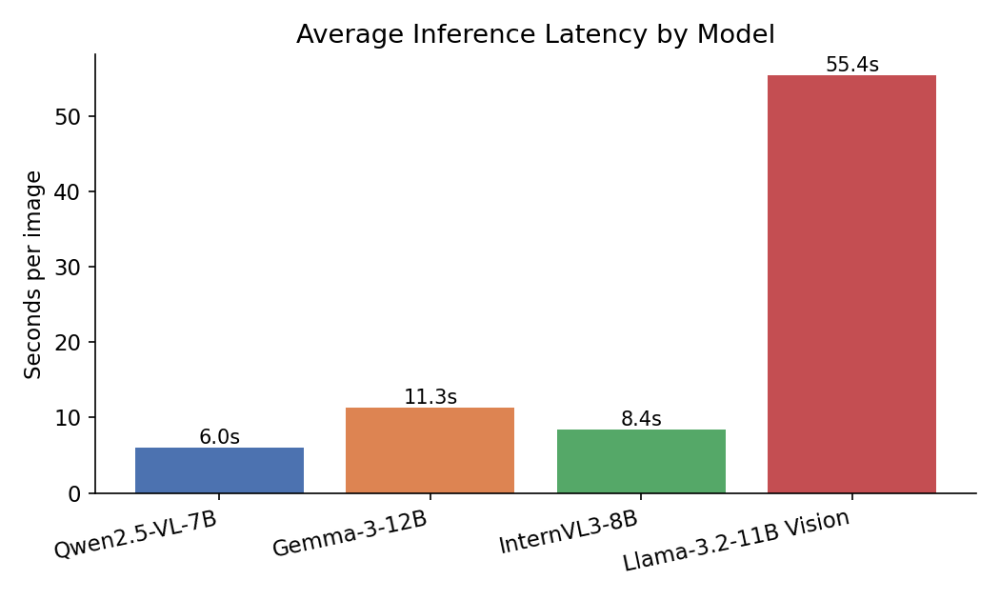
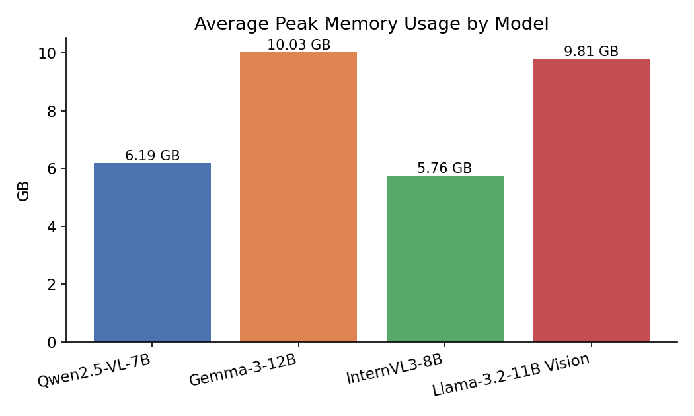
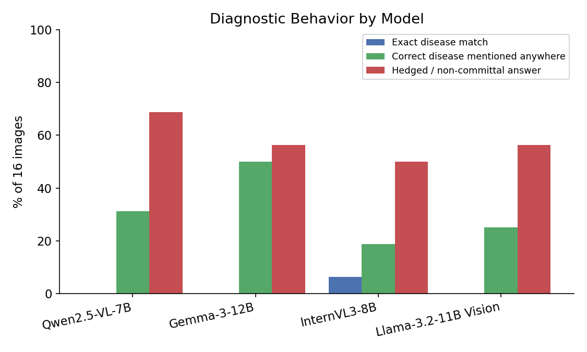
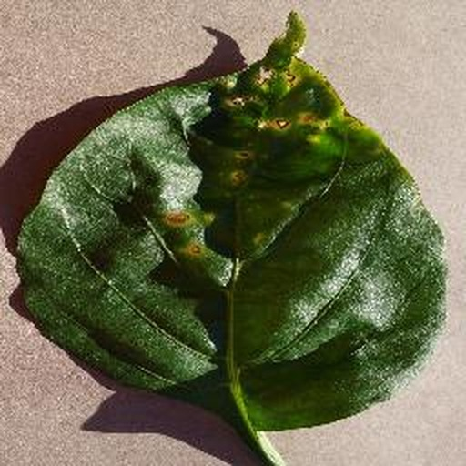
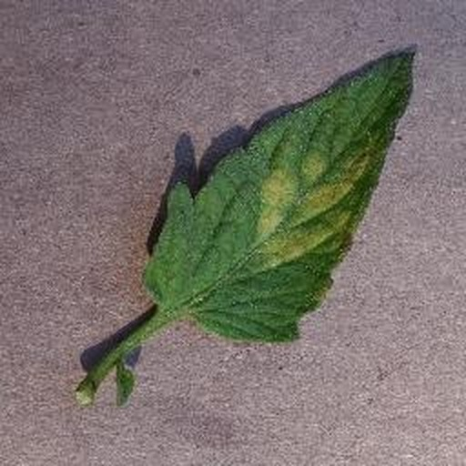
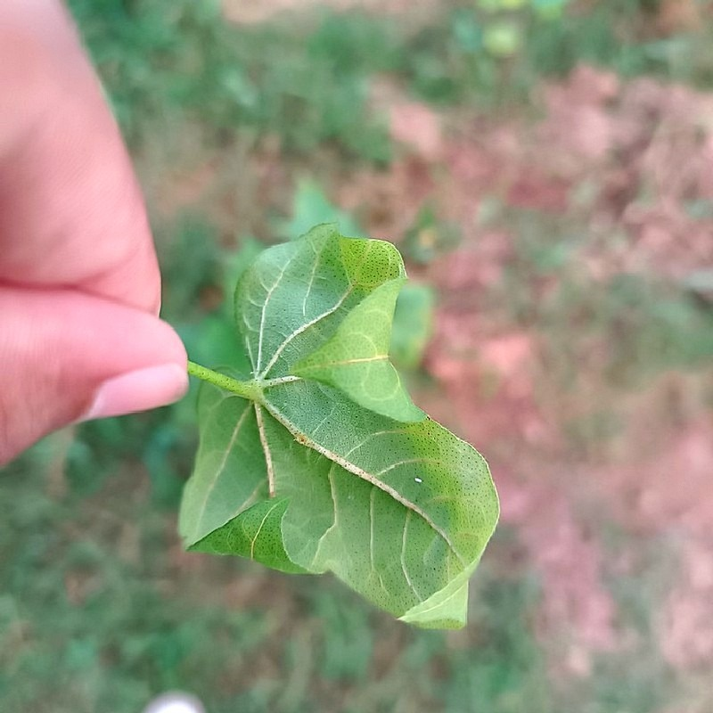
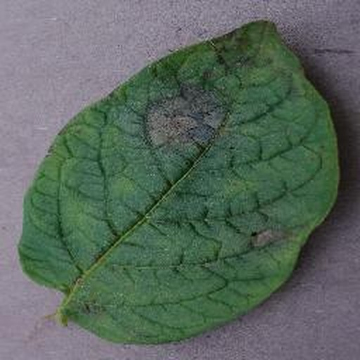

# Crop Disease Vision-Language Model Benchmark Report

**A zero-shot comparison of four open-source Vision-Language Models for crop disease image understanding**

---

## 1. Introduction

Diagnosing crop disease from a leaf photograph is a narrow but high-value visual reasoning task: the visual cues (lesion shape, color, distribution, halo pattern) are often subtle, the space of plausible diseases is large, and a wrong answer has a real agronomic cost. Vision-Language Models (VLMs) are attractive for this problem because they can produce a structured, human-readable diagnosis — species, symptoms, severity, probable disease, reasoning — directly from a single image and a natural-language prompt, without task-specific training. If general-purpose VLMs can do this reliably out of the box, they offer a low-friction path to field-deployable diagnostic assistants, particularly on local hardware where no data leaves the device.

This report benchmarks four such models, run **fully locally** on Apple Silicon via MLX-VLM, in a **zero-shot** setting — no fine-tuning, no in-context examples, identical prompt for every model and every image. The objective is narrow and concrete: given the same 16 crop-disease leaf images, how do these four models compare on diagnostic accuracy, description quality, hallucination tendency, latency, and memory footprint, and what does that imply about their practical readiness for agricultural use today?

## 2. Experimental Setup

**Hardware and software**

| Component | Value |
|---|---|
| Device | MacBook Pro, Apple M4 Pro |
| Memory | 24 GB unified memory |
| Inference framework | MLX-VLM (Apple MLX) |
| Quantization | 4-bit, for every model |
| Images evaluated | 16 |
| Models evaluated | 4 |
| Total inference runs | 64 (16 images × 4 models) |
| Generation failures | 0 / 64 |

**Models evaluated**

| Model | Identifier |
|---|---|
| Qwen2.5-VL-7B | `mlx-community/Qwen2.5-VL-7B-Instruct-4bit` |
| Gemma-3-12B | `mlx-community/gemma-3-12b-it-4bit` |
| InternVL3-8B | `mlx-community/InternVL3-8B-MLX-4bit` |
| Llama-3.2-11B Vision | `mlx-community/Llama-3.2-11B-Vision-Instruct-4bit` |

**Dataset.** 16 leaf images spanning 6 disease/condition labels, inferred from filename metadata (see *Ground truth and parsing methodology* below): Bacterial Spot (4), Leaf Mold (4), Late Blight (3), Leaf Variegation (2), Curl Virus (2), Leaf Redding (1). Eleven images are PlantVillage-style lab photographs (uniform background, single leaf); five (`augmented_*`) are field photographs of cotton leaves with natural backgrounds, taken at closer range and under variable lighting.

**Inference prompt — identical for every model, every image:**

```
You are an agricultural expert.

Analyze this crop image carefully.

Return:

Plant species:
Visible symptoms:
Leaf color:
Leaf texture:
Spots or lesions:
Severity:
Most likely disease:
Alternative diagnoses:
Confidence (0-100):
Reasoning:

Only describe what is visible.
If uncertain, explicitly state uncertainty.
Do not hallucinate diseases.
```

**Ground truth and parsing methodology.**
Ground-truth labels were derived from filename metadata, not re-annotated by hand: PlantVillage-style filenames embed a short site/research code (`RS_LB` → Late Blight, `JR_B.Spot` / `NREC_B.Spot` → Bacterial Spot, `Crnl_L.Mold` → Leaf Mold); the `augmented_*` files carry the label directly in the name (Curl Virus, Leaf Redding, Leaf Variegation). All 16 filenames in this set resolved to a label — none were left unresolved/`Unknown`. Each model's free-text response was parsed into the ten requested fields using the literal field headers from the prompt; a prediction was scored **correct** only if the parsed "Most likely disease" field fuzzy-matched the ground-truth label (substring or ≥0.6 token-sequence similarity after normalization). This is a deliberately strict criterion — credit is not given for a correct term buried inside a longer hedge — so it is reported alongside two softer, equally objective measures (mention rate, hedge rate) in Section 3 to avoid a single strict number misrepresenting model behavior.

One parsing caveat worth stating plainly: not every model used the literal header `Confidence (0-100):` requested in the prompt — Gemma-3 frequently wrote `**Confidence:**` instead. Where the header didn't match exactly, that response's confidence value could not be parsed. This affected 5/16 Qwen2.5-VL, 8/16 Gemma-3, 0/16 InternVL3, and 6/16 Llama-3.2 Vision responses. Average confidence figures below are computed only over parseable responses; this is a measurement gap, not a claim that the unparsed models gave no confidence value.

## 3. Benchmark Results

### 3.1 Performance summary

**Table 1 — Inference performance by model (16 images, MacBook Pro M4 Pro, 24GB)**

| Model | Avg. Latency (s/image) | Tokens / sec | Peak Memory (GB) |
|---|---|---|---|
| Qwen2.5-VL-7B | 6.0 | 56.9 | 6.19 |
| Gemma-3-12B | 11.3 | 32.9 | 10.03 |
| InternVL3-8B | 8.4 | 56.6 | 5.76 |
| Llama-3.2-11B Vision | 55.4 | 4.6 | 9.81 |



*Figure 1 — Average end-to-end inference latency per image, by model. Llama-3.2-11B Vision is 9.2× slower than the fastest model (Qwen2.5-VL-7B) on identical hardware.*



*Figure 2 — Average peak unified-memory usage per inference, by model. All four models fit comfortably within 24GB run one at a time, with InternVL3-8B the lightest and Gemma-3-12B the heaviest, consistent with parameter count.*

Throughput (tokens/sec) separates into two clear tiers: Qwen2.5-VL-7B and InternVL3-8B both generate at roughly 57 tokens/sec, Gemma-3-12B is roughly half that (32.9 tok/s, consistent with its larger 12B parameter count), and Llama-3.2-11B Vision is an outlier at 4.6 tok/s — more than 10× slower than the fastest model despite a comparable parameter count to Gemma-3, suggesting the MLX port of this particular model is not yet as well-optimized for Apple Silicon as the other three.

### 3.2 Diagnostic accuracy

Strict exact-match accuracy — the parsed "Most likely disease" field matching the filename-derived ground truth — was low across all four models on this 16-image set, which is unsurprising given two factors: three of the six labels (Curl Virus, Leaf Redding, Leaf Variegation) are not standard textbook disease names a general-purpose VLM would be expected to produce verbatim, and all four models hedge frequently rather than committing to a single diagnosis. To avoid a single strict number obscuring real differences in model behavior, Table 2 reports three complementary, independently-computed measures.

**Table 2 — Diagnostic behavior by model (16 images)**

| Model | Exact match | Correct disease mentioned anywhere in response | Hedged / non-committal answer |
|---|---|---|---|
| Qwen2.5-VL-7B | 0.0% (0/16) | 31.2% (5/16) | 68.8% (11/16) |
| Gemma-3-12B | 0.0% (0/16) | 50.0% (8/16) | 56.2% (9/16) |
| InternVL3-8B | 6.2% (1/16) | 18.8% (3/16) | 50.0% (8/16) |
| Llama-3.2-11B Vision | 0.0% (0/16) | 25.0% (4/16) | 56.2% (9/16) |



*Figure 3 — Three views of diagnostic behavior per model. "Mentioned anywhere" credits the correct disease appearing anywhere in the response (e.g. in a hedge or alternatives list), not just as the primary answer; "hedged" flags responses using qualifiers like "uncertain," "could be," or "would require further examination" instead of committing to a single diagnosis.*

The only exact match in the entire 64-run benchmark came from InternVL3-8B on a Bacterial Spot image (Section 4, Example 1) — and even there, "bacterial spot" was one of three diseases listed, not a singular commitment. Gemma-3-12B surfaced the correct disease somewhere in its answer most often (50.0%, 8/16) despite never landing on it as the primary diagnosis, while InternVL3-8B did so least often (18.8%) despite stating the highest average confidence (74.7/100, all 16 responses parseable) — a calibration gap discussed further in Section 5.

## 4. Qualitative Analysis

Four images were selected to illustrate distinct, representative patterns observed across the full 64-response dataset: a case of relative model agreement, a case of outright disagreement, a case where one model's species identification clearly outperformed the rest, and a case of confident misidentification.

### 4.1 Example 1 — Relative agreement: Bacterial Spot



*Figure 4 — `NREC_B.Spot 1799.JPG`. Ground truth: Bacterial Spot.*

| Model | Most likely disease (as stated) |
|---|---|
| Qwen2.5-VL-7B | "a fungal or bacterial leaf spot disease, possibly Alternaria" |
| Gemma-3-12B | "Early symptoms of Tomato Yellow Leaf Curl Virus (TYLCV)" |
| InternVL3-8B | "a fungal disease, such as leaf spot or blight... Alternaria, Septoria, or bacterial spot" |
| Llama-3.2-11B Vision | "a fungal disease, such as leaf spot or leaf blight" |

This is the closest the benchmark gets to a consensus: three of four models converge on a fungal/bacterial leaf-spot family diagnosis, and InternVL3-8B's list of candidates happens to include "bacterial spot" verbatim — the single exact match in the entire benchmark. Gemma-3-12B is the outlier, diagnosing a viral disease (TYLCV) instead, illustrating that even on the "easiest" image in this set, model agreement is partial and one model's answer is a different disease category entirely.

### 4.2 Example 2 — Outright disagreement: Leaf Mold



*Figure 5 — `Crnl_L.Mold 6994.JPG`. Ground truth: Leaf Mold.*

| Model | Most likely disease (as stated) |
|---|---|
| Qwen2.5-VL-7B | "Uncertain... nutrient deficiency, fungal infection, or viral infection" |
| Gemma-3-12B | "Possible early stages of Tomato Mosaic Virus (ToMV)" |
| InternVL3-8B | "downy mildew" |
| Llama-3.2-11B Vision | "None, as there are no visible signs of disease" (80% confidence) |

The symptom here is a faint yellow patch — mild enough that the four models produce four materially different conclusions: a three-way hedge, a specific viral diagnosis, a specific fungal diagnosis, and a confident **healthy** call. Llama-3.2 Vision's "no visible signs of disease" at 80% stated confidence is the most concerning of the four: it is not a hedge, it is a confident miss on an image that does have a visible (if subtle) symptom, the kind of false negative that matters most in a real diagnostic tool.

### 4.3 Example 3 — One model clearly outperforms: species identification on Curl Virus



*Figure 6 — `augmented_Curl Virus0033.jpg`. Ground truth: Curl Virus (cotton).*

| Model | Plant species (as stated) |
|---|---|
| Qwen2.5-VL-7B | "Appears to be a cotton plant, based on the leaf shape and texture" |
| Gemma-3-12B | "Likely cotton (based on leaf morphology)" |
| InternVL3-8B | "a grapevine (Vitis spp.)... lobed, palmate shape" |
| Llama-3.2-11B Vision | "a type of leafy green, possibly a variety of spinach or kale" |

Across all five field-photographed cotton images in this set, Qwen2.5-VL-7B correctly and confidently identified the species as cotton in 4 of 5 (hedging on the fifth). Gemma-3-12B did so confidently once and hedged toward "potentially cotton" once more; InternVL3-8B and Llama-3.2 Vision never named cotton at all, confidently guessing fig, grapevine, citrus, squash, and soybean instead. The contrast is sharpest on this image: InternVL3-8B not only misidentifies the species as grapevine but compounds the error by diagnosing "Downy Mildew (caused by *Plasmopara viticola*)" — a real, specific, correctly-spelled grape pathogen that has no bearing on this cotton leaf. The scientific precision of the wrong answer is exactly what makes it a higher-risk failure mode than an honest "uncertain."

### 4.4 Example 4 — Confident misidentification: Late Blight



*Figure 7 — `RS_LB 4079.JPG`. Ground truth: Late Blight.*

| Model | Plant species (as stated) |
|---|---|
| Qwen2.5-VL-7B | "Uncertain" |
| Gemma-3-12B | "Spinach (likely)" |
| InternVL3-8B | "a legume, possibly a soybean or a similar species" |
| Llama-3.2-11B Vision | "Unknown" |

The leaf shown is broad and ovate with pinnate venation — visually inconsistent with spinach's narrow, smooth-margined leaves and inconsistent with soybean's characteristic trifoliate leaflets. Gemma-3-12B's "Spinach (likely)" and InternVL3-8B's "legume... soybean" are both stated as the primary answer, not hedged, and both are wrong for the same reason: the leaf shape doesn't match either claim. Qwen2.5-VL-7B and Llama-3.2 Vision instead answered "Uncertain"/"Unknown" — the less informative answer, but the more honest one given the image alone does not unambiguously identify the species.

## 5. Model-wise Analysis

### 5.1 Qwen2.5-VL-7B
Fastest model in the benchmark (6.0s/image, 56.9 tok/s) at a mid-range memory footprint (6.19 GB). Its standout strength in this benchmark is species identification on the field-photographed cotton images (4/5 correct, the best of the four — Section 4.3), and it produces structurally clean, consistently-formatted responses every time. Its main weakness is hedging: 68.8% of its primary diagnoses (11/16) are non-committal ("uncertain, but could be X or Y"), the highest hedge rate of the four models, which limits its usefulness as a decisive first-pass triage tool even though the hedges themselves are reasonable given the image content. Confidence values, where parseable (11/16), track its caution: it never reported confidence above 70.

### 5.2 Gemma-3-12B
Slowest of the three "normal-speed" models (11.3s/image) and the largest memory footprint (10.03 GB), consistent with its 12B parameter count — the only model in this set that approached the practical limits of comfortable headroom on a 24GB machine. Qualitatively, it is the most willing to commit to a specific, named diagnosis (e.g. "Tomato Yellow Leaf Curl Virus," "Tomato Mosaic Virus," "Cercospora leaf blight") rather than hedge, which is reflected in having the highest mention rate (50.0%) but it is also the model most prone to a specific kind of hallucination seen repeatedly in this set: confidently naming a wrong species ("Spinach (likely)," example 4.4) as a flat assertion rather than a hedge. Its reasoning sections are well-organized and its severity assessments are consistent. On the five cotton images it named the species correctly once and hedged toward it once more — better than InternVL3-8B and Llama-3.2 Vision (which never named cotton), but well behind Qwen2.5-VL-7B's 4 of 5.

### 5.3 InternVL3-8B
Lightest memory footprint of the four (5.76 GB) and a strong throughput figure (56.6 tok/s), at a middling latency (8.4s/image). It produced the only exact disease match in the benchmark and reports the highest average confidence (74.7/100, all 16 responses parseable) — but that confidence is not well-supported by the rest of its behavior: it has the lowest correct-disease-mention rate of the four (18.8%) and produced the most clear-cut hallucination chain observed in this benchmark (grapevine → Downy Mildew on a cotton leaf, Section 4.3). This combination — confident, fluent, specific, and frequently wrong — is the riskiest failure profile of the four for an unsupervised deployment, because a user has no signal in the response itself to distrust it.

### 5.4 Llama-3.2-11B Vision
By far the slowest model tested (55.4s/image, 4.6 tok/s — roughly 9× slower than Qwen2.5-VL-7B despite a similar parameter count to Gemma-3-12B), which on its own makes it impractical for interactive use on this hardware regardless of accuracy. Qualitatively it is the most conservative model: it produced the lowest average confidence of the four (where parseable) and, in two observed cases, explicitly declared 0% or stated it could not determine a diagnosis rather than guessing — an honest failure mode, but one that, combined with the worst-in-class latency, makes it the least practically useful model in this benchmark as currently packaged for Apple Silicon.

## 6. Comparative Discussion

**Accuracy and disease recognition.** None of the four models reliably reproduced the exact ground-truth disease label on this 16-image set; InternVL3-8B's single exact match was a hedge that happened to include the right term. Loosening the criterion to "correct disease mentioned anywhere" shows real, if modest, signal — Gemma-3-12B (8/16) and Qwen2.5-VL-7B (5/16) surface the right disease family noticeably more often than InternVL3-8B (3/16) or Llama-3.2 Vision (4/16). No model is reliable enough to act as a sole diagnostic authority on this dataset.

**Description quality and reasoning.** All four models produce well-structured responses following the requested ten-field format with no parsing failures. Gemma-3-12B and InternVL3-8B write the most detailed, specific reasoning sections (often naming candidate pathogens by genus); Qwen2.5-VL-7B and Llama-3.2 Vision lean more conservative and generic. Specificity and correctness are not the same thing here — the most detailed answers (Section 4.3, 4.4) were also the most confidently wrong.

**Hallucination.** Every model hallucinated at least once in this small set, but the character differs: Gemma-3-12B and InternVL3-8B hallucinate specific, named, scientifically-styled wrong answers (a wrong species with a wrong Latin binomial pathogen attached); Qwen2.5-VL-7B and Llama-3.2 Vision more often hedge into vagueness instead. For a field tool, the former is the more dangerous pattern because it reads as authoritative.

**Latency and memory.** Qwen2.5-VL-7B is fastest and InternVL3-8B is lightest; both are comfortably interactive on this hardware. Gemma-3-12B is markedly slower and heavier, in line with its parameter count. Llama-3.2-11B Vision's latency is an outlier disproportionate to its size, pointing to an MLX-port efficiency gap rather than a fundamental model-size constraint.

**Ease of deployment.** All four models load and run from `mlx-vlm` with the same code path and fit within 24GB unified memory run one at a time; none required any prompt or pipeline special-casing beyond standard loading. The only practical deployment differentiator observed was speed.

**Table 3 — Summary comparison**

| Dimension | Qwen2.5-VL-7B | Gemma-3-12B | InternVL3-8B | Llama-3.2-11B Vision |
|---|---|---|---|---|
| Exact-match accuracy | 0.0% | 0.0% | 6.2% | 0.0% |
| Correct disease mentioned anywhere | 31.2% | 50.0% | 18.8% | 25.0% |
| Hedge rate | 68.8% | 56.2% | 50.0% | 56.2% |
| Hallucination style | Vague hedges | Confident, specific, wrong species | Confident, specific, wrong species+pathogen | Vague hedges / honest "unknown" |
| Avg. latency (s/img) | 6.0 | 11.3 | 8.4 | 55.4 |
| Avg. peak memory (GB) | 6.19 | 10.03 | 5.76 | 9.81 |
| Ease of deployment (MLX-VLM, 24GB Mac) | Straightforward | Straightforward, heavier | Straightforward, lightest | Straightforward, impractically slow |

## 7. Final Ranking

Ranking is necessarily multi-dimensional — no model wins on every axis — so the overall ranking below weighs diagnostic signal (mention rate and hedge rate, since exact-match accuracy was too sparse across all four models to be a discriminating signal on its own) together with practical usability (latency, memory, hallucination severity).

**Table 4 — Overall ranking**

| Rank | Model | Rationale |
|---|---|---|
| 1 | Qwen2.5-VL-7B | Fastest model, second-best correct-disease-mention rate (5/16), best species identification on the field-photo subset (4/5), and its failure mode (hedging) is lower-risk than the other models' confident misses. Best overall balance of speed, usefulness, and failure severity. |
| 2 | Gemma-3-12B | Best correct-disease-mention rate of the four (8/16) and the most detailed reasoning, but the heaviest memory footprint, second-slowest latency, and the most frequent confident wrong-species hallucinations. Useful when paired with human review; risky unsupervised. |
| 3 | InternVL3-8B | Lightest memory footprint and strong throughput, but the lowest correct-disease-mention rate combined with the highest stated confidence and the single most severe hallucination chain observed (wrong species anchoring a wrong, specifically-named pathogen). The confidence/accuracy mismatch is a real calibration concern. |
| 4 | Llama-3.2-11B Vision | Latency roughly an order of magnitude worse than the other three models on identical hardware makes it impractical for interactive use regardless of its comparatively honest hedging behavior. |

**Category recommendations**

| Category | Model | Why |
|---|---|---|
| Best overall | Qwen2.5-VL-7B | Best balance of speed (6.0s), low-risk hedging, and species accuracy |
| Fastest | Qwen2.5-VL-7B | 6.0s/image, 56.9 tok/s |
| Most memory-efficient | InternVL3-8B | 5.76 GB peak |
| Best qualitative reasoning | Gemma-3-12B | Most detailed, best-organized reasoning text; highest correct-disease-mention rate (8/16) |
| Best for practical agricultural use today | Qwen2.5-VL-7B | The only model combining interactive speed with a failure mode (hedging into uncertainty) that a field user is less likely to act on incorrectly than a confident wrong answer |

## 8. Conclusion

On this 16-image, 4-model, zero-shot benchmark, the headline finding is that no general-purpose VLM tested reliably reproduced the exact ground-truth disease label — but that single statistic understates real, measurable differences between the models. Qwen2.5-VL-7B was the fastest and gave the most reliable species identification on field-photographed images; Gemma-3-12B surfaced the correct disease somewhere in its reasoning most often, at the cost of being the most confidently wrong on species identification; InternVL3-8B was the lightest and quickest at the cost of an overconfidence/accuracy mismatch; Llama-3.2-11B Vision's latency on this MLX build makes it impractical for interactive use regardless of accuracy.

**Current limitations of general-purpose VLMs for this task**, as evidenced directly in this data: (1) all four models hedge on 50%+ of images even when a visible symptom is present, limiting their use as decisive triage tools; (2) when models do commit to a specific answer, the most detailed and confident responses were repeatedly the most wrong (Sections 4.3–4.4), a pattern more dangerous than an honest "uncertain" because it offers no signal to distrust it; (3) species misidentification on field-photographed images (non-uniform background, natural lighting) was common in three of the four models, suggesting these general VLMs are more reliable on the clean, single-leaf, uniform-background style of lab photographs (PlantVillage-style) than on realistic field conditions.

**Scope of this finding.** This benchmark covers 16 images across 6 labels and 4 models — large enough to surface clear qualitative patterns and consistent performance differences, too small to support a statistically rigorous accuracy claim for any individual model. Three of the six disease labels (Curl Virus, Leaf Redding, Leaf Variegation) are non-standard names that a general-purpose model would not be expected to produce verbatim even with perfect visual understanding, which is reflected in the mention-rate metric but still depresses strict accuracy figures.

**Future work.** A larger, balanced image set with standard disease nomenclature throughout would let exact-match accuracy become a meaningful metric in its own right. Fine-tuning (as in the companion PlantDx project, which reaches 98.5% accuracy on a fine-tuned Qwen2.5-VL-7B for a related task) is the clear next step if production accuracy is the goal — this benchmark's value is in showing what off-the-shelf, zero-shot models can and cannot do before paying that cost. An LLM-as-a-judge scoring pass and a larger field-photo subset (to further test the lab-photo vs. field-photo gap noted above) are the two most natural extensions of this specific benchmark run.

---

*Report generated from 64 real model responses across 16 images and 4 models. No statistics in this report were estimated, sampled, or invented — every figure above is computed directly from the provided benchmark JSON.*