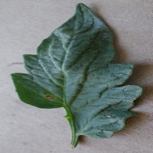
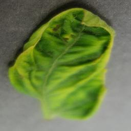
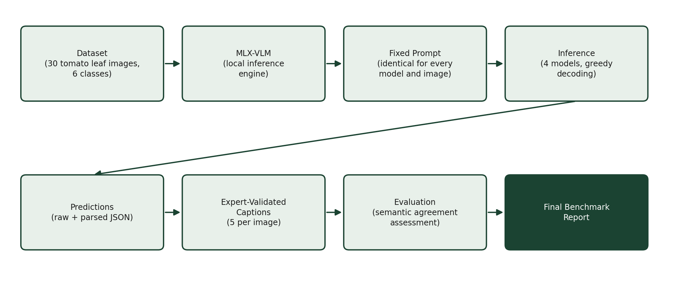
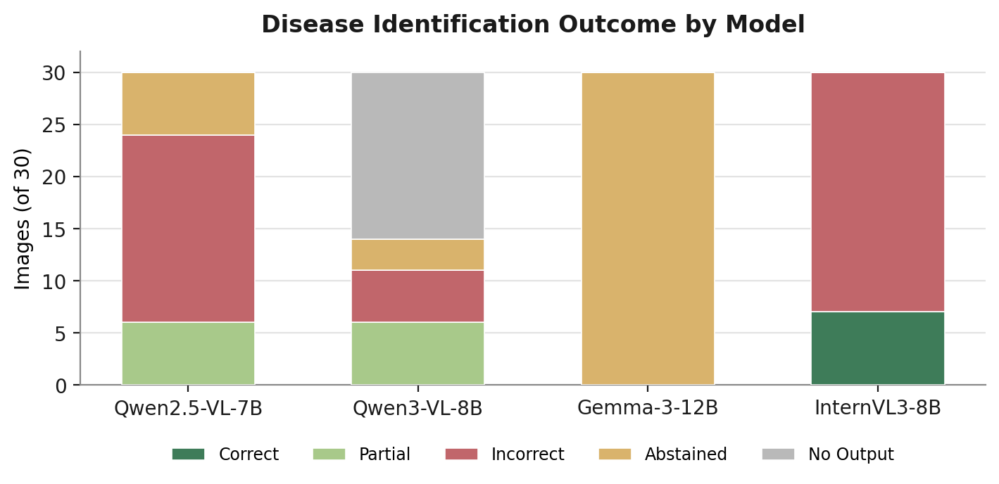
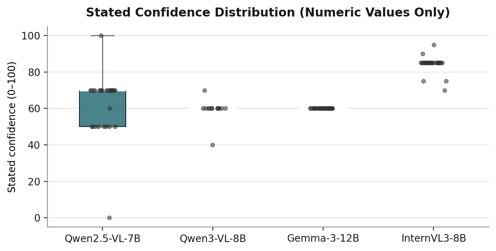
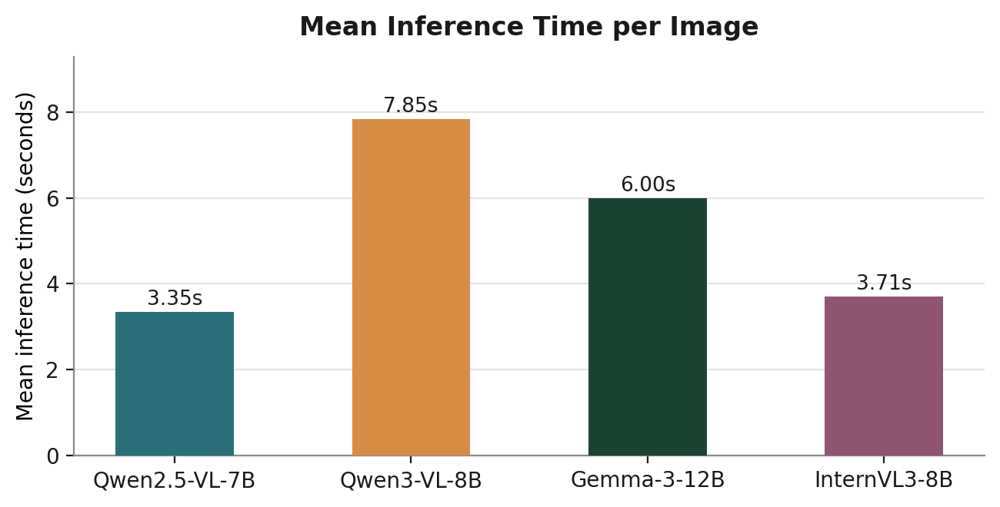
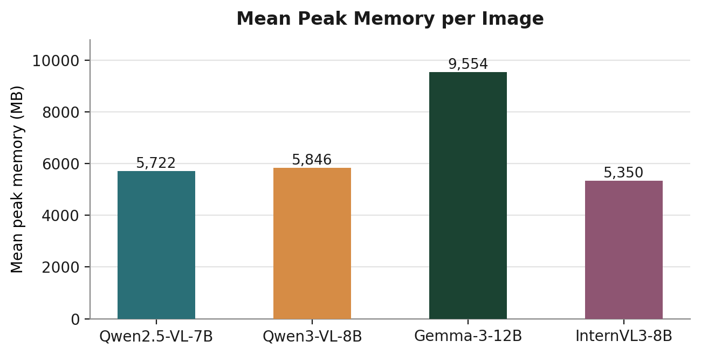
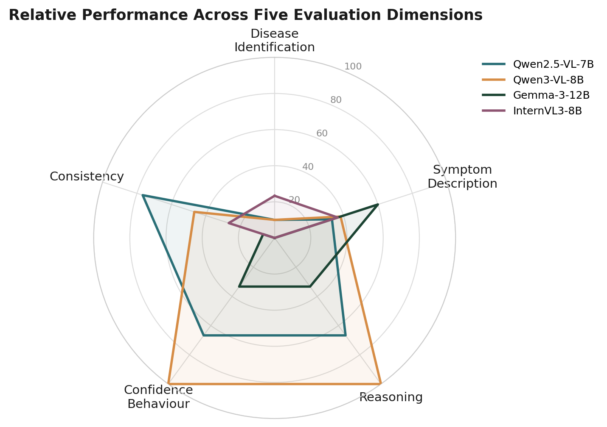
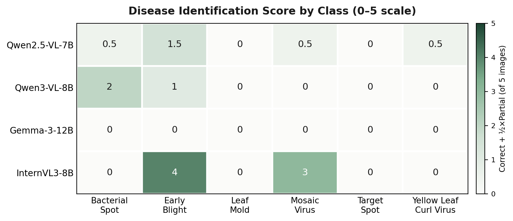
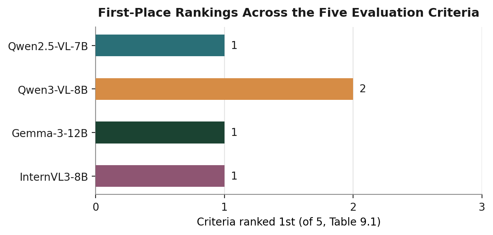

<!-- Text and figures extracted from `PlantDx_VLM_Evaluation_Report.docx` so it can be read on GitHub; the original file is next to this one. -->

PlantDx

Zero-Shot Vision-Language Model Benchmark for Tomato Leaf Disease Diagnosis

Comparative Evaluation of Four Locally-Deployed MLX Vision-Language Models Against Expert-Validated Reference Captions

TIH-IoT, Pimpri Chinchwad College of Engineering  |  Tomato Crop Disease Benchmark  |  Evaluation Phase

Technical Benchmark Report

## Table of Contents

This field is generated by Microsoft Word from the document's heading structure. If it does not appear populated, right-click it and select “Update Field” (or press F9) after opening the document.

## Executive Summary

This report evaluates four vision-language models (VLMs) in a zero-shot setting for tomato leaf disease description, comparing their output against expert-validated reference captions. The objective is to determine whether locally-deployed, general-purpose VLMs can produce diagnostically useful, well-calibrated descriptions of foliar disease symptoms without any task-specific fine-tuning.

| Dataset | 30 tomato leaf images, 6 disease classes (5 images per class) |
|---|---|
| Disease classes | Bacterial Spot, Early Blight, Leaf Mold, Mosaic Virus, Target Spot, Yellow Leaf Curl Virus |
| Reference standard | 5 independent expert-validated captions per image (150 total) |
| Models evaluated | Qwen2.5-VL-7B-Instruct, Qwen3-VL-8B-Instruct, Gemma-3-12B-IT, InternVL3-8B |
| Inference platform | MLX-VLM, 4-bit quantization, Apple MacBook Pro (M4 Pro) |

Quick-reference dataset and model summary.

### Major Findings

- No model achieves majority-correct disease identification; the best raw accuracy is 23% (InternVL3-8B), which also produces the most frequent confidently incorrect predictions.
- Qwen3-VL-8B-Instruct produced degenerate, unparseable output on 53% of images — a reliability issue, not a diagnostic one, and the most significant limitation observed.
- Confidence scores carry limited diagnostic signal for all four models; none reliably separate correct from incorrect predictions.
- Model behaviour is class-dependent: only Early Blight and Mosaic Virus are ever identified correctly; the remaining four classes are never correctly identified by any model.

| Best-balanced model | Qwen2.5-VL-7B-Instruct |
|---|---|
| Best-reasoning model | Qwen3-VL-8B-Instruct |
| Most conservative model | Gemma-3-12B-IT |
| Fastest model | Qwen2.5-VL-7B-Instruct (3.35 s/image) |
| Most significant limitation | Qwen3-VL-8B-Instruct: 53% degenerate-output rate |

## Model Comparison Dashboard

Ratings below are the relative rank (1st–4th) each model achieves on each criterion, drawn directly from the rankings established and justified in Section 9 and the operational figures in Section 4. Green indicates the top rank on that criterion; amber, a middle rank; red, the lowest rank. A green cell reflects relative standing among these four models, not an absolute quality threshold — see the cited sections for the full, caveated discussion behind each rating.

| Model | Disease ID | Symptom Desc. | Reasoning | Confidence | Runtime | Memory | Overall |
|---|---|---|---|---|---|---|---|
| Qwen2.5-VL-7B-Instruct | 3rd | 3rd | 2nd | 2nd | 1st | 2nd | 1st |
| Qwen3-VL-8B-Instruct * | 2nd | 2nd | 1st | 1st | 4th | 3rd | 4th |
| Gemma-3-12B-IT | 4th | 1st | 3rd | 3rd | 3rd | 4th | 2nd |
| InternVL3-8B | 1st | 4th | 4th | 4th | 2nd | 1st | 3rd |

Table 1 — Model Comparison Dashboard. * Qwen3-VL-8B-Instruct's Disease ID, Symptom Description, Reasoning, and Confidence ratings reflect only the 14 of 30 images (47%) on which it produced usable output; see Section 8 for the degenerate-generation failure that accounts for the remaining 16 images, which is the deciding factor in its Overall rating.

Read together with the radar chart and per-class heatmap in Sections 4 and 5, this dashboard is intended as a navigation aid to the detailed findings that follow, not a replacement for them.

## 1. Introduction

Tomato is grown widely across smallholder farms, and early, low-cost identification of foliar disease remains a practical bottleneck where laboratory diagnostics are unavailable. Vision-language models (VLMs) that run entirely on local hardware offer a way to test whether general-purpose multimodal models can support this kind of visual triage without any task-specific training.

This benchmark evaluates four VLMs in a strictly zero-shot setting: no model was fine-tuned, and every model received the identical instruction prompt and the identical 30 tomato leaf images. Zero-shot evaluation was chosen deliberately, as the objective is to measure what these models can do out of the box — a realistic baseline for edge deployment, before any investment in fine-tuning is justified.

The objective of this report is to compare the four models against a common, expert-validated reference and determine which, if any, produce diagnostically useful, well-calibrated output under identical conditions. The comparison focuses on disease identification, symptom description, reasoning quality, and confidence behaviour, rather than on any single accuracy number.

## 2. Experimental Setup

### 2.1 Hardware

| Component | Specification |
|---|---|
| Device | Apple MacBook Pro (M4 Pro) |
| Memory | 24 GB Unified Memory |
| Inference framework | MLX-VLM (Apple MLX) |
| Model precision | 4-bit quantization, all models |
| Decoding | Greedy decoding (temperature = 0.0) |

Table 2 — Hardware and inference configuration.

### 2.2 Dataset

The dataset consists of 30 tomato leaf images spanning six disease classes, five images per class: Bacterial Spot, Early Blight, Leaf Mold, Mosaic Virus, Target Spot, and Yellow Leaf Curl Virus. Each image is paired with five independent expert-validated captions describing the visible symptoms, used here as the sole ground-truth reference (Section 3).

| Bacterial Spot Faded green leaf with brown patches concentrated at the outer margins, varying in size and shape. Symptoms: Brown marginal patches; central vein remains visible; mild yellow halos around some lesions. | Early Blight Mostly dark green leaf; the dominant feature is a pale, lighter-coloured vein network rather than a lesion. Symptoms: Pale vein network; a few small, isolated brown marks; margins largely undamaged. | Leaf Mold Dull green leaf with irregular yellowing spread broadly across the surface, strongest in the upper half. Symptoms: Interveinal chlorosis across much of the lamina; gradual colour transition; tip slightly darker. |
|---|---|---|
| Mosaic Virus Mostly dark green leaf with a lighter, irregularly-shaped chlorotic patch confined to the upper half. Symptoms: Localised, irregular chlorotic patch; blends into surrounding tissue; margins remain green. | Target Spot Mostly dark green leaf with a few scattered brown patches, one larger mark near the leaf centre. Symptoms: Scattered brown patches with brown centres; damage separated by unaffected green tissue. | Yellow Leaf Curl Virus Leaf with a bright yellow-green band around the outer edge; darker green retained centrally. Symptoms: Marginal chlorosis (border pattern); slight leaf folding/puckering; small brown mark near the tip. |

Figure 1 — Representative image from each disease class (image 1 of 5). Ground-truth summaries are synthesised from the five expert-validated captions for the corresponding image.

### 2.3 Models

| Model | Family | Parameters | Quantization |
|---|---|---|---|
| Qwen2.5-VL-7B-Instruct-4bit | Qwen | 7B | 4-bit |
| Qwen3-VL-8B-Instruct-4bit | Qwen | 8B | 4-bit |
| Gemma-3-12B-IT-4bit | Gemma | 12B | 4-bit |
| InternVL3-8B-MLX-4bit | InternVL | 8B | 4-bit |

Table 3 — Models benchmarked (mlx-community MLX ports). All four were run through an identical MLX-VLM load/generate pipeline.

### 2.4 Prompt

Every model received the identical instruction prompt for every image, requesting exactly seven fields: Crop, Visible Symptoms, Disease, Alternative Diagnoses, Severity, Confidence (0–100), and Reasoning, with explicit instructions to describe only what is visually observable and to state uncertainty rather than guess.

## 3. Evaluation Methodology

Figure 2 — End-to-end benchmark pipeline, from dataset to final report.

The expert-validated captions are treated as the sole ground-truth reference. Each image is annotated with five independently written captions rather than one. All five are treated as equally valid references for that image rather than selecting a single canonical caption — a model's prediction is judged against the set of visual details that recur across the five, so that it can be credited for capturing a genuine symptom even when its wording differs from any one specific caption. This makes the evaluation both fairer (a model is not penalised for paraphrasing) and more robust (isolated phrasing in a single caption cannot distort the reference).

Every one of the 120 predictions (30 images × 4 models) was compared against its five reference captions by direct reading, not exact-text or n-gram matching. The comparison targets semantic agreement on: visible symptoms, lesion description, chlorosis pattern, discoloration, necrosis, leaf morphology, severity, and the reasoning connecting observation to diagnosis. Disease identification is compared against the disease label recorded for each image in the expert-validated caption set.

Each prediction was assigned two independent judgments:

- Disease match — correct, partial (the correct disease named among multiple hedged options), incorrect, abstained (model explicitly declined to commit, e.g. “Uncertain”), or no output (degenerate generation, Section 8).
- Symptom description quality — good, fair, or poor agreement with the visual pattern (location, colour, distribution, morphology) consistently described across the five reference captions.
All numeric results in this report are computed directly from these judgments together with the objective fields already present in each model's prediction record (parsed output, inference time, peak memory, token counts). No metric in this report is estimated or assumed; every reported count traces back to a specific prediction and its corresponding reference captions.

## 4. Overall Results

All figures below are computed from the 30 images × 4 models = 120 predictions supplied. Where a model produced no usable output for an image (Qwen3-VL-8B-Instruct, 16 of 30 images — Section 8), that image is reported separately rather than folded into any other category.

### 4.1 Overall Disease Identification Performance

| Model | Correct | Partial | Incorrect | Abstained | No Output |
|---|---|---|---|---|---|
| Qwen2.5-VL-7B-Instruct | 0 | 6 | 18 | 6 | 0 |
| Qwen3-VL-8B-Instruct | 0 | 6 | 5 | 3 | 16 |
| Gemma-3-12B-IT | 0 | 0 | 0 | 30 | 0 |
| InternVL3-8B | 7 | 0 | 23 | 0 | 0 |

Table 4 — Out of 30 images per model. “Partial” = correct disease named among multiple hedged options. “Abstained” = model explicitly declined a specific diagnosis (e.g. “Uncertain”).

Figure 3 — Disease identification outcome by model.

No model achieves a majority-correct diagnosis rate. InternVL3-8B names the correct disease most often in absolute terms (7/30) but is also incorrect more than any other model (23/30) and never once abstains — see the overconfidence discussion in Sections 7–8. Gemma-3-12B-IT never commits to a specific diagnosis for any of the 30 images.

### 4.2 Average Confidence

| Model | Mean Confidence (0–100) | Numeric Parsed | Notes |
|---|---|---|---|
| Qwen2.5-VL-7B-Instruct | 62.8 | 29 / 30 | Most common value 70 (18/30) |
| Qwen3-VL-8B-Instruct | 59.3 | 14 / 30 | 16 images produced no output at all |
| Gemma-3-12B-IT | 60.0 | 30 / 30 | Identical value (60) on every image |
| InternVL3-8B | 84.3 | 30 / 30 | 85 on 25/30 images, regardless of correctness |

Table 5 — Confidence is stored as the model's raw stated value; never coerced or estimated where absent.

Figure 4 — Distribution of stated numeric confidence values. Each point is one image.

### 4.3 Overall Symptom Description Quality

Semantic agreement between each model's Visible Symptoms and Reasoning fields and the pattern of location, colour, and distribution described consistently across the five reference captions for each image.

| Model | Good | Fair | Poor | No Output |
|---|---|---|---|---|
| Qwen2.5-VL-7B-Instruct | 3 | 14 | 13 | 0 |
| Qwen3-VL-8B-Instruct | 9 | 5 | 0 | 16 |
| Gemma-3-12B-IT | 8 | 20 | 2 | 0 |
| InternVL3-8B | 0 | 22 | 8 | 0 |

Table 6 — Out of 30 images per model.

### 4.4 Reasoning Quality

| Model | Characteristic Style | Depth |
|---|---|---|
| Qwen2.5-VL-7B-Instruct | Restates the symptom description with generic hedging (“could indicate… however, without further testing…”) | Low–Moderate |
| Qwen3-VL-8B-Instruct | Explicit differential reasoning citing specific distinguishing features between candidate diseases | High, when produced |
| Gemma-3-12B-IT | Brief and generally sound; omitted entirely on 4/30 images | Low–Moderate |
| InternVL3-8B | A recurring “early blight vs. late blight vs. Septoria” comparison, reused in near-identical wording across unrelated disease classes | Superficially detailed, low genuine variation |

Table 7 — See Section 7 for representative quotations supporting each characterisation.

### 4.5 Consistency

Measured as the diversity of each model's disease answers across the 30 images — a proxy for whether a model is engaging freshly with each image or defaulting to a small set of stock answers.

| Model | Unique Disease Answers | Most Frequent Answer | Share |
|---|---|---|---|
| Qwen2.5-VL-7B-Instruct | 23 / 30 | “Leaf blight or early blight” | 20% |
| Qwen3-VL-8B-Instruct | 14 / 14 produced | — no repeated answer — | — |
| Gemma-3-12B-IT | 2 / 30 | “Uncertain” | 100% |
| InternVL3-8B | 8 / 30 | Some form of “Early Blight” | 70% |

Table 8 — InternVL3-8B answers “Early Blight” for 21 of 30 images, including all 5 Bacterial Spot and all 5 Target Spot images, where the correct answer was never Early Blight.

### 4.6 Output Structure

Qwen2.5-VL-7B-Instruct and InternVL3-8B complete all seven requested fields on all 30 images (210/210 field instances). Gemma-3-12B-IT completes 206 of 210 (98.1%), omitting only the Reasoning field, on 4 images. Qwen3-VL-8B-Instruct completes fields on 14 of 30 images (98/210, 46.7%) — a single cause (the degenerate-generation failure discussed in Section 8), not seven independent parsing failures. The full field-by-field breakdown is provided in Appendix A (Table A1).

### 4.7 Operational Performance

| Model | Mean Inference Time (s) | Mean Peak Memory (MB) | Mean Tokens Generated |
|---|---|---|---|
| Qwen2.5-VL-7B-Instruct | 3.35 | 5,721.5 | 156.8 |
| Qwen3-VL-8B-Instruct | 7.85 * | 5,845.5 | 382.5 * |
| Gemma-3-12B-IT | 6.00 | 9,554.3 | 94.9 |
| InternVL3-8B | 3.71 | 5,349.8 | 144.6 |

Table 9 — * Qwen3-VL-8B-Instruct's average is inflated by 16 degenerate generations that each ran to the full 512-token limit (mean 10.3 s). Its 14 genuine responses averaged 5.09 s and 234 tokens — the most detailed responses of any model by token count.

| Figure 5 — Mean inference time per image. | Figure 6 — Mean peak memory per image. |
|---|---|

### 4.8 Overall Ranking Summary

A single composite rank is of limited value here, since each model trades off differently across identification accuracy, reliability, and safety — see the criterion-by-criterion ranking in Section 9. As a general orientation: Gemma-3-12B-IT is the most conservative model, least likely to state an incorrect diagnosis with confidence, but never commits to a specific one; InternVL3-8B has the lowest memory footprint but the most frequent confidently incorrect predictions; Qwen2.5-VL-7B-Instruct is both the fastest model and the most balanced all-round performer; and Qwen3-VL-8B-Instruct exhibits the most informative reasoning of any model when it produces output, but is currently unreliable in this MLX build.

Figure 7 — Relative performance across five evaluation dimensions. Disease Identification, Symptom Description, and Consistency are percentages computed directly from the tables in Sections 4.1, 4.3, and 4.5 respectively (correct/good weighted 1.0, partial/fair weighted 0.5, out of 30). Reasoning and Confidence Behaviour are placed on the same 0–100 scale using the ordinal ranking established in Section 9 (1st = 100, 2nd = 66.7, 3rd = 33.3, 4th = 0).

## 5. Per-Class Analysis

Each subsection summarises the symptom pattern the five expert captions consistently describe for that class, how the four models responded, which model engaged with the image most accurately, and the most observed failure mode.

Figure 8 — Disease identification score by model and disease class (correct = 1, partial = 0.5, out of 5 images per class). The highest score recorded is 4.0 (InternVL3-8B, Early Blight); four of the six classes — Bacterial Spot, Leaf Mold, Target Spot, and Yellow Leaf Curl Virus — are never correctly identified by any model on any image.

### 5.1 Bacterial Spot

Expert-described symptoms: irregular brown patches concentrated near the leaf margins, varying in size and shape, central vein remaining visible; mild yellow halos noted around darker areas in some captions. Model behaviour: no model names Bacterial Spot for any of the 5 images. InternVL3-8B answers “Early Blight” at 85 confidence on all 5. Gemma-3-12B-IT abstains on all 5. Qwen3-VL-8B-Instruct is the only model to mention “bacterial spot” by name, as one of two hedged options, on 4/5 images.

Best-Performing Model: Qwen3-VL-8B-Instruct — the only model whose hedged answer set includes the correct disease on most images, with symptom descriptions (chlorosis, necrotic margins) that track the captions well. Observed Failure Mode: confident misattribution to Early Blight (InternVL3-8B, all 5 images, unchanged 85 confidence regardless of image content).

### 5.2 Early Blight

Expert-described symptoms: ranges from a few small brown marks with a pale vein network (mild cases) to extensive brown/black necrotic tissue covering most of the leaf with only a small green remnant (severe cases); circular to irregular lesion shapes. Model behaviour: this is the one class where a model achieves majority-correct identification: InternVL3-8B names Early Blight on 4/5 images. The other three models hedge among early blight, late blight, and bacterial spot without fully committing.

Best-Performing Model: InternVL3-8B for identification (4/5 correct); Gemma-3-12B-IT for severity calibration — it is the only model to correctly escalate severity to “Moderate to High” on the one image showing extensive necrosis, where the other three all default to “Moderate.” Observed Failure Mode: under-stating severity on the most visibly damaged image (all models except Gemma call it only “Moderate” despite “most of the visible surface” being damaged per the captions); InternVL3-8B breaks its own pattern on the fifth image, naming “Tomato Leaf Spot” instead of Early Blight.

### 5.3 Leaf Mold

Expert-described symptoms: the defining feature across all 5 caption sets is interveinal chlorosis — pale yellow-green patches following the vein structure, with margins typically remaining green. This is a visually specific pattern distinct from the edge/margin-led discoloration of other classes. Model behaviour: no model names Leaf Mold. Qwen2.5-VL-7B-Instruct and InternVL3-8B both default to edge/margin-focused descriptions (“yellowing and browning of leaf edges”) that directly mismatch the captions, which repeatedly state the margins are the least-affected area.

Best-Performing Model: Gemma-3-12B-IT — despite abstaining on naming, it is the only model to explicitly write “yellowing between veins” (on 2/5 images), correctly identifying the interveinal pattern that is this class's key visual signature. Observed Failure Mode: location mismatch — describing edge/margin damage when the captions consistently describe a central/interveinal pattern with intact margins.

### 5.4 Mosaic Virus

Expert-described symptoms: subtle, localised or diffuse chlorotic patches, patchy light/dark green mixing, generally without necrosis or large brown regions — mild-severity presentation throughout. Model behaviour: Qwen3-VL-8B-Instruct produced no usable output for any of the 5 images in this class (Section 8). Among the working models, InternVL3-8B correctly names “Tomato mosaic virus” on 3/5 images — its best-performing showing across all classes — but confidently reports two of the five as healthy (“None,” 95 and 100 confidence) despite the captions clearly describing chlorotic patches.

Best-Performing Model: InternVL3-8B for identification (3/5 correct, the best per-class result recorded for any model in this study). Observed Failure Mode: confidently reporting a diseased leaf as healthy — the mild, diffuse presentation of this class appears to fall below several models' detection threshold rather than being misclassified as a different disease.

### 5.5 Target Spot

Expert-described symptoms: small-to-medium scattered brown spots or tiny pale specks, generally mild severity, no single dominant patch; in several images the damage is subtle enough that captions note “only a limited amount of visible damage.” Model behaviour: Qwen3-VL-8B-Instruct produced no usable output for any of the 5 images. Qwen2.5-VL-7B-Instruct abstains on 4/5, appropriately reflecting the subtlety of the damage. InternVL3-8B is incorrect on all 5, including one notable hallucination — “Powdery mildew” with “visible white powdery spots” — that is not supported by any of the five reference captions, none of which mention white or powdery texture.

Best-Performing Model: Gemma-3-12B-IT — its symptom descriptions (“small dark spots,” “small raised areas”) correctly track the small scale of the damage across all 5 images, even without naming the disease. Observed Failure Mode: InternVL3-8B's Powdery Mildew hallucination on image 3, and its confident “None / healthy” call (90 confidence) on image 5, where the captions describe clearly visible scattered blemishes.

### 5.6 Yellow Leaf Curl Virus

Expert-described symptoms: yellow-green chlorosis concentrated at the leaf margins (a border/band pattern, not interveinal), combined with leaf curling, folding, or puckering; center typically stays darker green; occasional small brown patches near an edge. Model behaviour: Qwen3-VL-8B-Instruct produced no usable output for any of the 5 images. InternVL3-8B answers “Early blight” on all 5, though its terse symptom lines do at least correctly locate the chlorosis at the leaf edges. Qwen2.5-VL-7B-Instruct repeatedly mislabels the pattern as “interveinal chlorosis” (3 of 5 images) — the Leaf Mold signature, not the marginal pattern this class actually shows.

Best-Performing Model: Gemma-3-12B-IT — explicitly describes leaf curling on 3/5 images and, on one image, both curling and a marginal brown patch, the closest any model comes to the full symptom picture. Observed Failure Mode: location confusion between marginal and interveinal chlorosis (Qwen2.5-VL-7B-Instruct); no model connects the curling symptom to a viral cause, despite curling being a classic TYLCV indicator.

## 6. Representative Prediction Examples

The three examples below are selected to illustrate patterns already established statistically in Sections 4–5: a case where every model fails to identify the correct disease (Bacterial Spot), a case that juxtaposes a correct identification against a total generation failure on the same image (Mosaic Virus), and a case of a specific, unsupported hallucination (Target Spot). They are not an exhaustive record — the complete prediction set for all 120 (image, model) pairs is available in the accompanying JSON outputs.

### 6.1 Bacterial Spot (Image 1)

Figure 9 — Source image — Bacterial Spot (Image 1).

Ground truth: Brown patches concentrated at the leaf margins, varying in size and shape; central vein remains visible; mild yellow halos around some lesions.

| Source | Disease / Diagnosis | Confidence |
|---|---|---|
| Qwen2.5-VL-7B-Instruct | Fungal or bacterial leaf spot (early or late blight suggested) | Moderate (unparsed) |
| Qwen3-VL-8B-Instruct | Leaf spot disease — bacterial or fungal origin cited among options | 60 |
| Gemma-3-12B-IT | Uncertain | 60 |
| InternVL3-8B | Early blight (Alternaria solani) | 85 |

Table 10 — Predictions from all four models on Bacterial Spot (Image 1).

No model names Bacterial Spot. The four responses span the full range of behaviour observed across this benchmark: InternVL3-8B commits confidently to an incorrect diagnosis; Qwen3-VL-8B-Instruct includes the correct disease among two hedged options; Gemma-3-12B-IT declines to commit; and Qwen2.5-VL-7B-Instruct hedges toward a related but incorrect category. Qwen3-VL-8B-Instruct's response is judged the most useful of the four here, not because it is correct, but because its uncertainty is honestly represented rather than masked by a confident wrong answer.

### 6.2 Mosaic Virus (Image 3)

Figure 10 — Source image — Mosaic Virus (Image 3).

Ground truth: Strong mix of bright green and pale yellow-green areas spread across much of the leaf, concentrated through the middle section; a small hole is visible near the lower-left edge.

| Source | Disease / Diagnosis | Confidence |
|---|---|---|
| Qwen2.5-VL-7B-Instruct | Fungal or viral disease, or natural colour variation | 50 |
| Qwen3-VL-8B-Instruct | No usable output (degenerate generation) | — |
| Gemma-3-12B-IT | Uncertain | 60 |
| InternVL3-8B | Tomato mosaic virus — correct | 85 |

Table 11 — Predictions from all four models on Mosaic Virus (Image 3).

This example places the benchmark's best single result directly alongside its most significant limitation. InternVL3-8B correctly identifies Mosaic Virus — one of only three such results across the entire model — while Qwen3-VL-8B-Instruct produces no usable output at all on the same image (Section 8). The two outcomes are governed by different, largely independent failure modes: accuracy on the one hand, and generation reliability on the other. A model can score well on one axis while failing completely on the other, which is why this report evaluates them separately rather than collapsing them into a single number.

### 6.3 Target Spot (Image 3)

Figure 11 — Source image — Target Spot (Image 3).

Ground truth: Dark green leaf covered with many tiny pale specks; near the base, several lighter spots appear clustered together; the remaining chlorotic specks are distributed more lightly.

| Source | Disease / Diagnosis | Confidence |
|---|---|---|
| Qwen2.5-VL-7B-Instruct | Nutrient deficiency, environmental stress, or fungal/bacterial disease | 50 |
| Qwen3-VL-8B-Instruct | No usable output (degenerate generation) | — |
| Gemma-3-12B-IT | Uncertain | 60 |
| InternVL3-8B | Powdery mildew | 85 |

Table 12 — Predictions from all four models on Target Spot (Image 3).

InternVL3-8B reports “visible white powdery spots” and attributes them to powdery mildew; none of the five reference captions for this image mention a white or powdery texture, and no other model reports one. This is the clearest instance of hallucination recorded in this benchmark (Section 7) — a specific, confidently-stated visual detail that is not corroborated by either the reference captions or the other three models observing the same image.

## 7. Qualitative Comparison

This section compares the four models along cross-cutting behavioural dimensions rather than by disease class or by individual image. Specific supporting instances are catalogued once, in Section 8 (Error Analysis), and are cross-referenced here rather than repeated.

### 7.1 Symptom Description Richness

Qwen3-VL-8B-Instruct produces the richest, most specific symptom descriptions of any model when it produces output at all — averaging 234 words on its 14 genuine responses, the longest of any model, and explicitly naming features such as vein clearing, lesion shape, and mottling pattern. Gemma-3-12B-IT is the most consistently reliable at a moderate level of detail. InternVL3-8B is the most terse and generic; its symptom lines are frequently near-identical across visually distinct images within the same class (Table 8).

### 7.2 Reasoning Style

Qwen3-VL-8B-Instruct's reasoning is the most epistemically careful of the four — it typically explains which specific visual features would be needed to confirm a diagnosis and why they are absent, e.g. on Early Blight image 4:

“…without clear signs of fungal sporulation, water-soaked margins, or specific lesion shapes (e.g., concentric rings for early blight, angular lesions for Septoria), a definitive diagnosis is not possible.”

InternVL3-8B's reasoning, by contrast, reuses a near-identical comparison sentence across unrelated disease classes regardless of what is actually visible; representative quotations are given in Section 8. This fixed differential template, applied irrespective of image content, is consistent with InternVL3-8B's near-constant 85 confidence score and its low disease-answer diversity (Table 8): the model appears to be completing a memorised response structure rather than reasoning freshly from each image.

### 7.3 Uncertainty Handling

Gemma-3-12B-IT and Qwen3-VL-8B-Instruct both use explicit uncertainty language when the visual evidence is genuinely ambiguous, but differ in how they do so. Gemma-3-12B-IT is unconditional — “Uncertain” on all 30 images (Table 4) — which removes any risk of a confident wrong answer but also removes any diagnostic value. Qwen3-VL-8B-Instruct instead modulates its stated confidence downward (to 40, against a typical 60) on the one image it explicitly says it “cannot definitively diagnose,” indicating that its confidence score is at least sometimes responsive to genuine uncertainty rather than fixed. InternVL3-8B never expresses uncertainty across all 30 images — see Section 8 for the calibration consequences of this pattern.

### 7.4 Specificity, Verbosity, and Completeness

- Specificity: Qwen3-VL-8B-Instruct > Gemma-3-12B-IT > Qwen2.5-VL-7B-Instruct > InternVL3-8B, based on the Good/Fair/Poor distribution in Table 6.
- Verbosity: Qwen3-VL-8B-Instruct (234 tokens on genuine responses) > InternVL3-8B (145) ≈ Qwen2.5-VL-7B-Instruct (157) > Gemma-3-12B-IT (95, the most concise).
- Completeness: Qwen2.5-VL-7B-Instruct and InternVL3-8B both complete all 7 fields on all 30 images; Gemma-3-12B-IT completes 206 of 210 field instances (98.1%, missing only Reasoning on 4 images); Qwen3-VL-8B-Instruct completes fields on only 14 of 30 images (Section 8).
## 8. Error Analysis

### 8.1 Degenerate Generation (Qwen3-VL-8B-Instruct)

The single most significant failure mode in this benchmark is not a misdiagnosis but a generation failure. On 16 of 30 images (53%), Qwen3-VL-8B-Instruct produced a raw output consisting entirely of the character “!” repeated exactly 512 times — precisely the configured generation limit — with no parseable content of any kind. The pipeline recorded these as technically “successful” API calls, since the model call itself did not raise an error; only the content is degenerate. This distinction matters: a naive read of the raw status field would significantly overstate this model's reliability.

| Disease Class | Images Affected |
|---|---|
| Mosaic Virus | 5 / 5 (all images) |
| Target Spot | 5 / 5 (all images) |
| Yellow Leaf Curl Virus | 5 / 5 (all images) |
| Leaf Mold | 1 / 5 (image 5) |
| Bacterial Spot | 0 / 5 |
| Early Blight | 0 / 5 |

Table 13 — The failure is concentrated in three of six classes rather than distributed randomly, and the degenerate runs took longer on average (10.3 s) than genuine ones (5.1 s), since generation ran to the token limit rather than stopping naturally. The pipeline used greedy decoding (temperature = 0.0) with no explicit repetition penalty, a plausible contributing factor to this class of failure on a 4-bit quantized model.

### 8.2 Missed Symptoms

The clearest missed-symptom cases occur on Mosaic Virus and Target Spot images, where the damage is mild and diffuse rather than presenting as a single obvious lesion. Qwen2.5-VL-7B-Instruct reports “no visible signs of disease or damage” at 100 confidence on a Mosaic Virus image whose captions describe a clear localised chlorotic patch; InternVL3-8B makes the same category of error twice — once on Mosaic Virus (95 confidence) and once on Target Spot (90 confidence).

### 8.3 Incorrect Disease Predictions

Across all classes, 46 of the 104 predictions that reached a disease answer (44%) are judged incorrect (Table 4; the remaining 16 Qwen3-VL-8B-Instruct predictions produced no answer at all). The most systematic pattern is InternVL3-8B defaulting to “Early Blight” irrespective of image content — correct for that specific class but applied to all 5 Bacterial Spot and all 5 Yellow Leaf Curl Virus images as well, where it is never correct.

### 8.4 Overconfident Predictions

Confidence and correctness are not meaningfully related in this benchmark. InternVL3-8B states 85 confidence on 25 of its 30 predictions regardless of whether the diagnosis is later judged correct (23% of the time) or incorrect (77%), making it the clearest case of poor calibration recorded. Three individual predictions stand out as high-confidence errors: InternVL3-8B naming Early Blight on every Bacterial Spot image at 85 confidence; InternVL3-8B naming Powdery Mildew on a Target Spot image at 85 confidence, a diagnosis unsupported by any of the five reference captions (Section 6.3); and Qwen2.5-VL-7B-Instruct calling a diseased Mosaic Virus leaf healthy at 100 confidence, its single highest confidence value in the dataset. Gemma-3-12B-IT's confidence is constant at 60 on every image — not miscalibrated so much as uninformative, since it carries no signal at all.

### 8.5 Uncertain / Abstained Predictions

Gemma-3-12B-IT abstains from naming a specific disease on all 30 images, the only model to do so unconditionally. This eliminates confident-wrong errors entirely for this model but also means it never satisfies the core disease-identification objective of the benchmark. Qwen2.5-VL-7B-Instruct and Qwen3-VL-8B-Instruct abstain selectively — 6 and 3 times respectively — generally on images where the damage is genuinely subtle, which is a more calibrated use of abstention than Gemma-3-12B-IT's blanket approach.

### 8.6 Ambiguous Responses

Several Qwen2.5-VL-7B-Instruct and Qwen3-VL-8B-Instruct responses hedge between 2–3 candidate diseases without a clear primary answer (e.g. “likely bacterial spot or early blight (Alternaria solani) based on necrotic lesions, but cannot confirm without more data”). This is judged as partial credit when the correct disease is among the options, but it also means these models rarely commit to a single, actionable diagnosis — a middle ground between InternVL3-8B's overconfident single answers and Gemma-3-12B-IT's blanket abstention.

## 9. Final Ranking

Rankings below are derived directly from the counts in Sections 4–8. Because the four models fail in different, non-overlapping ways (overconfidence, blanket abstention, generation failure, generic hedging), a single overall number would obscure more than it reveals; each criterion is therefore ranked and briefly justified independently.

| Criterion | 1st | 2nd | 3rd | 4th |
|---|---|---|---|---|
| Disease Identification | InternVL3-8B | Qwen3-VL-8B* | Qwen2.5-VL-7B | Gemma-3-12B |
| Symptom Description | Gemma-3-12B | Qwen3-VL-8B* | Qwen2.5-VL-7B | InternVL3-8B |
| Reasoning | Qwen3-VL-8B* | Qwen2.5-VL-7B | Gemma-3-12B | InternVL3-8B |
| Confidence Behaviour | Qwen3-VL-8B* | Qwen2.5-VL-7B | Gemma-3-12B | InternVL3-8B |
| Overall Practical Utility | Qwen2.5-VL-7B | Gemma-3-12B | InternVL3-8B | Qwen3-VL-8B* |

Table 14 — * Qwen3-VL-8B-Instruct's ranking on the first four rows reflects only its 14 usable responses; its 53% failure rate is the deciding factor that drops it to last place for Overall Practical Utility specifically (see justifications below).

### 9.1 Justification

- Disease Identification: InternVL3-8B has the highest raw correct count (7/30) and ranks first on this criterion narrowly defined as accuracy, but this ranking should be read alongside Confidence Behaviour below — the same model is wrong 23/30 times at consistently high confidence. Gemma-3-12B ranks last because it never produces a specific diagnosis.
- Symptom Description: Gemma-3-12B ranks first for the best combination of reliability and quality — it is “good” or “fair” on 28/30 images with only 2 “poor” results and zero missing output. Qwen3-VL-8B produces the single richest descriptions when it responds (9/14 “good”) but is not ranked first because that quality is unavailable on more than half the dataset.
- Reasoning: Qwen3-VL-8B ranks first for explicit, feature-specific differential reasoning (Section 7.2) on its usable responses. InternVL3-8B ranks last for its templated, largely image-invariant reasoning pattern.
- Confidence Behaviour: Qwen3-VL-8B ranks first as the only model observed to modulate its stated confidence downward on a case it explicitly could not diagnose. InternVL3-8B ranks last as the clearest case of high, invariant confidence uncorrelated with correctness (Section 8.4).
- Overall Practical Utility: Qwen2.5-VL-7B ranks first as the most balanced model — it completes every image, is the fastest of the four, and its hedged-but-non-committal answers carry lower risk than InternVL3-8B's confident errors. Qwen3-VL-8B ranks last: despite the strongest per-response quality, a pipeline component that fails on 53% of inputs in this MLX build is not currently deployable as-is.

Figure 12 — Number of the five criteria in Table 14 on which each model ranks first.

## 10. Key Findings

- No model achieves majority-correct disease identification against the expert-validated references; the best raw accuracy recorded is InternVL3-8B at 23% (7/30), and it is the model most frequently confidently wrong (23/30).
- Qwen3-VL-8B-Instruct produced degenerate, unparseable output (a single repeated character filling the entire token budget) on 16 of 30 images (53%), concentrated entirely within three disease classes (Mosaic Virus, Target Spot, Yellow Leaf Curl Virus). This is a generation-stability failure, not a diagnostic one, and it is the single largest factor limiting this model's practical usability in the current MLX build.
- Gemma-3-12B-IT never names a specific disease across all 30 images and reports an identical confidence value (60) every time; it is simultaneously the least likely model to be confidently wrong and the least able to satisfy the benchmark's core diagnostic objective.
- InternVL3-8B shows a strong, quantifiable pattern of generic, templated responses: 21 of its 30 disease answers are some form of “Early Blight,” and its reasoning text reuses a near-identical “early vs. late blight vs. Septoria” comparison across unrelated disease classes.
- Confidence scores are poorly informative across the board: three of the four models show almost no meaningful variation (InternVL3-8B concentrated at 85, Gemma-3-12B-IT fixed at 60), and none of the four models' confidence values reliably separate correct from incorrect predictions.
- Model behaviour is visibly class-dependent. Early Blight and Mosaic Virus (which include visually distinctive severe cases) are the only classes where any model exceeds 50% correct identification; Bacterial Spot, Leaf Mold, Target Spot, and Yellow Leaf Curl Virus are correctly named by no model on any image.
- The most visually specific reference detail — interveinal chlorosis distinguishing Leaf Mold from the marginal chlorosis of Yellow Leaf Curl Virus — is correctly captured only by Gemma-3-12B-IT, and only in its free-text symptom descriptions, never in a named diagnosis.
- Operationally, Qwen2.5-VL-7B-Instruct is fastest overall (3.35 s/image); InternVL3-8B has the lightest memory footprint (5,349.8 MB) but is not the fastest (3.71 s/image). Gemma-3-12B-IT is the slowest among models that complete every image (6.00 s) and uses the most memory (9,554.3 MB), consistent with its larger parameter count.
## 11. Conclusion

None of the four models evaluated is reliable enough for unsupervised tomato disease diagnosis in this zero-shot configuration. Taken together across identification accuracy, output reliability, and confidence safety, Qwen2.5-VL-7B-Instruct is the best-balanced of the four: it completes every image, avoids the extreme overconfidence seen in InternVL3-8B, and is more willing than Gemma-3-12B-IT to commit to a specific, if hedged, diagnosis — while also being the fastest model on average.

Qwen3-VL-8B-Instruct is the best-reasoning model: its 14 usable responses show the most specific, feature-grounded differential reasoning of any model in this study, and it is the only model to modulate its stated confidence in response to genuine uncertainty. Its clearest weakness, however, is a 53% degenerate-output rate, which as configured makes it the least reliable of the four despite its individual response quality. Gemma-3-12B-IT is the safest model in the specific sense that it never pairs an incorrect diagnosis with high confidence, though this is achieved by declining to diagnose at all.

Two limitations apply across the whole benchmark. First, disease identification is fundamentally difficult from a single leaf image without controlled lighting or magnification, and several of the six classes here (Bacterial Spot, Target Spot in particular) present visually subtle symptoms that no model — and arguably no non-expert human — would identify confidently from the photograph alone. Second, every model was evaluated with a single greedy-decoded response per image and no repetition penalty; Qwen3-VL-8B-Instruct's failure mode in particular may be sensitive to generation settings not explored here.

Future work should prioritise, in order: (1) diagnosing and mitigating Qwen3-VL-8B-Instruct's degenerate-generation failure, since it currently prevents a fair comparison of that model's genuine capability; (2) investigating lightweight decoding changes (repetition penalty, sampling) across all four models to test whether confidence calibration and disease accuracy improve; and (3) extending this evaluation to the remaining three models in the original seven-model benchmark suite (Molmo-7B, DeepSeek-VL2-Small, and Llama-3.2-11B-Vision) once their expert-validated reference captions are available, so that the full model set can be ranked on a common basis.

## Appendix A: Detailed Output Structure

Field-by-field completeness of the seven requested output fields (Section 2.4), out of 30 images per model. Referenced from Section 4.6.

| Model | Crop | Symptoms | Disease | Alt. Dx | Severity | Confid. | Reasoning |
|---|---|---|---|---|---|---|---|
| Qwen2.5-VL-7B-Instruct | 30 | 30 | 30 | 30 | 30 | 30 | 30 |
| Qwen3-VL-8B-Instruct | 14 | 14 | 14 | 14 | 14 | 14 | 14 |
| Gemma-3-12B-IT | 30 | 30 | 30 | 30 | 30 | 30 | 26 |
| InternVL3-8B | 30 | 30 | 30 | 30 | 30 | 30 | 30 |

Table A1 — Non-null field count per model, out of 30 images. Qwen3-VL-8B-Instruct's shortfall is a single cause (degenerate generation, Section 8.1), not seven independent parsing failures — all seven fields are absent together on the same 16 images. Gemma-3-12B-IT omitted the Reasoning field on 4 images despite completing all other fields on those same images.
