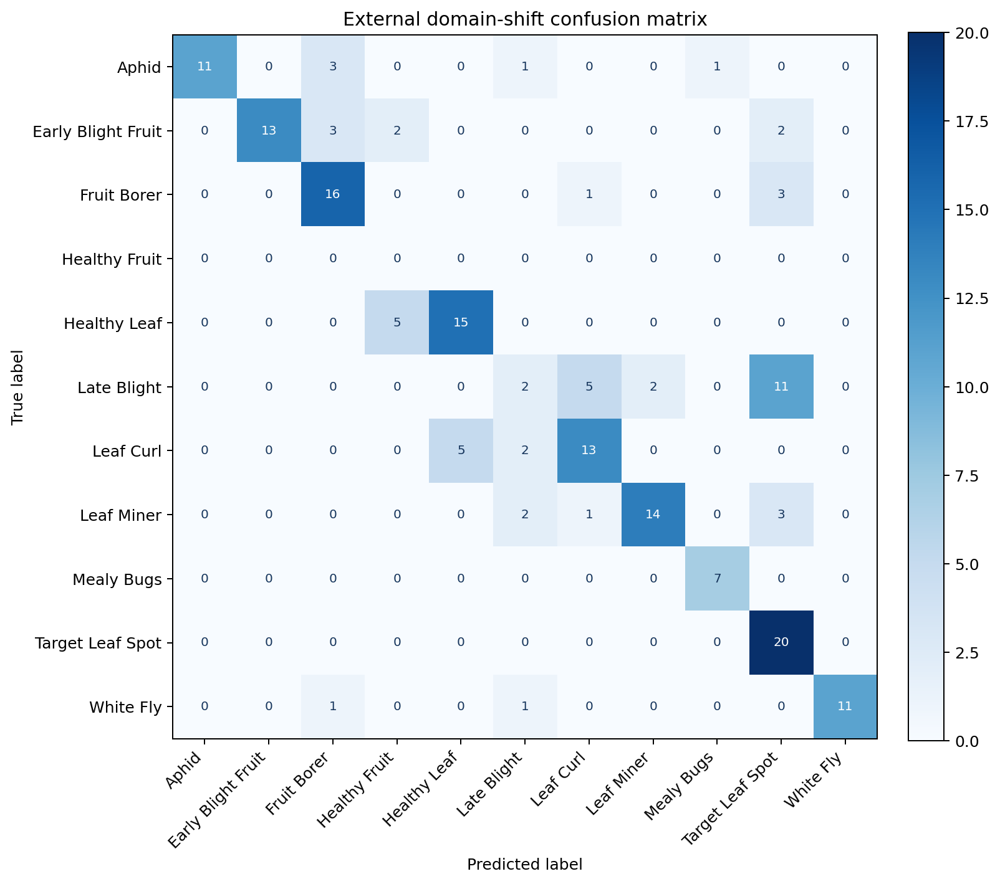
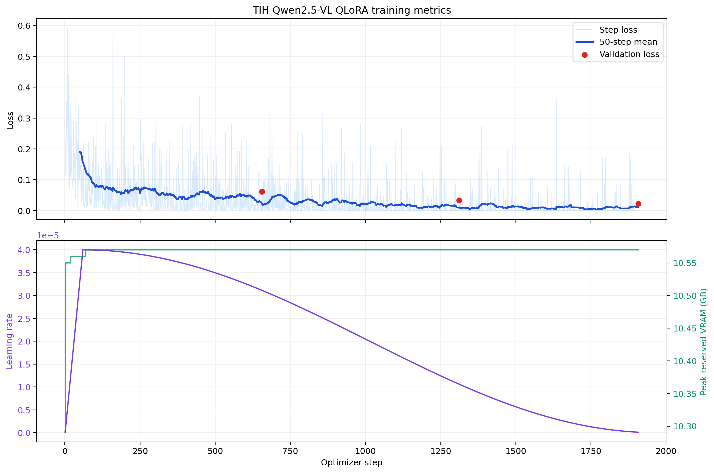
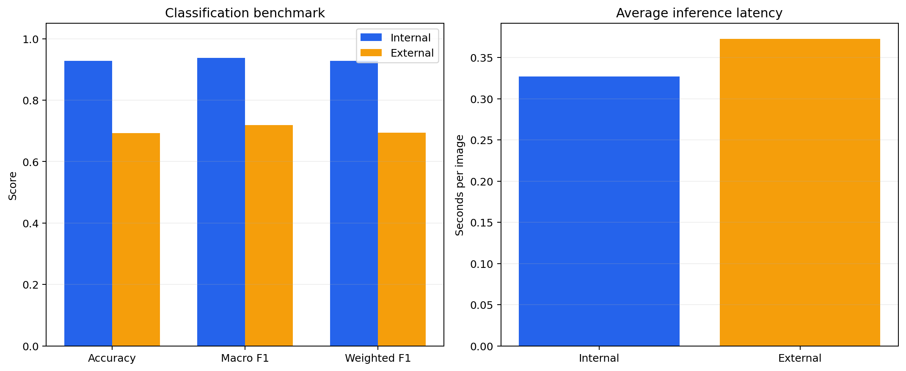

# Experiment Results

This document records the repository's research progression from baseline exploration to an
independent industrial-dataset robustness benchmark. The MLX studies and TIH tomato work are
separate experiment tracks with different hardware, data, configurations, and objectives.

## Experiment Timeline

1. **MLX Zero-shot Exploration**
2. **MLX Fine-tuning Experiments**
3. **TIH Tomato Qwen2.5-VL Benchmark**
4. **External Evaluation**

The first two stages established a general research pipeline. The TIH stages applied a dedicated
CUDA/QLoRA implementation to an industrial tomato dataset without merging its experiment state into
the MLX research track.

## 1. MLX zero-shot exploration

Initial zero-shot experiments measured the unadapted Qwen2.5-VL model on the tomato and mango
classification tasks. The low baseline accuracy established the need for task-specific adaptation.

| Dataset | Images | Zero-shot accuracy |
|---|---:|---:|
| Tomato | 910 | 7.3% |
| Mango | 200 | 17.5% |

Machine-readable results: [`research/zero_shot/results/baseline_summary.csv`](research/zero_shot/results/baseline_summary.csv).

## 2. MLX fine-tuning experiments

The independent MLX track used QLoRA on Apple Silicon to test the general training and evaluation
workflow. These experiments remain separate from the TIH dataset and NVIDIA implementation.

| Dataset | Fine-tuned accuracy | Macro F1 | Weighted F1 |
|---|---:|---:|---:|
| Tomato | 93.7% | 91.9% | 93.7% |
| Mango | 82.0% | 81.1% | 81.1% |

MLX result tables and historical figures are under
[`research/mlx_pipeline/`](research/mlx_pipeline/).

## 3. TIH Tomato Qwen2.5-VL benchmark

### Experiment setup

| Component | Configuration |
|---|---|
| Dataset | TIH `Tomato_12thAug26` |
| Model | Qwen2.5-VL-7B-Instruct |
| Adaptation | QLoRA, 4-bit NF4 |
| Hardware | NVIDIA RTX 4500 Ada Generation, 24 GB |
| Image maximum side | 532 px |
| LoRA | rank 64, alpha 128, dropout 0.05 |
| Optimizer | paged AdamW 8-bit, learning rate `4e-5` |
| Batch | micro-batch 1, accumulation 8, effective batch 8 |
| Training | 2.909 epochs completed, early stopping enabled |
| Vision tower | Frozen |

The internal benchmark uses the deterministic held-out test split created by the TIH pipeline.

| Internal test metric | Result |
|---|---:|
| Images | 649 |
| Classes | 11 |
| Accuracy | **92.76%** |
| Macro F1 | **93.78%** |
| Weighted F1 | **92.86%** |
| Average latency | 0.327 sec/image |

### Internal confusion matrix


Aggregate metrics: [`experiments/tih_tomato_qwen/results/internal/metrics.json`](experiments/tih_tomato_qwen/results/internal/metrics.json).

## 4. External evaluation

The external evaluation uses 176 labelled images from `Dataset/testing`. Its 10 mapped class folders
were detected by name through the TIH class profile; folder ordering was never used. The evaluation
loaded the completed QLoRA adapter in evaluation mode and ran every image under
`torch.inference_mode()`.

| External benchmark metric | Result |
|---|---:|
| Images | 176 |
| Classes | 10 |
| Accuracy | **69.32%** |
| Macro F1 | **71.95%** |
| Weighted F1 | **69.38%** |
| Average latency | 0.373 sec/image |

This benchmark is a **domain-shift robustness evaluation**. The images come from a different source
than the internal training and test data, so acquisition conditions, backgrounds, symptom framing,
class balance, and visual presentation can differ. The internal-to-external gap quantifies the
model's sensitivity to that distribution change. It is evidence about where robustness work should
focus, while the retained performance shows that much of the learned class signal transfers beyond
the internal split.

### External confusion matrix



Aggregate metrics: [`experiments/tih_tomato_qwen/results/external/metrics.json`](experiments/tih_tomato_qwen/results/external/metrics.json).

## Per-class performance

| Class | Internal F1 | External F1 |
|---|---:|---:|
| Aphid | 95.65% | 81.48% |
| Early Blight Fruit | 98.18% | 78.79% |
| Fruit Borer | 100.00% | 74.42% |
| Healthy Fruit | 100.00% | Not present |
| Healthy Leaf | 88.00% | 75.00% |
| Late Blight | 90.91% | 14.29% |
| Leaf Curl | 87.27% | 65.00% |
| Leaf Miner | 93.40% | 77.78% |
| Mealy Bugs | 98.77% | 93.33% |
| Target Leaf Spot | 81.48% | 67.80% |
| White Fly | 97.87% | 91.67% |


Late Blight accounts for the largest external generalization challenge, with many external images
classified as Target Leaf Spot. Mealy Bugs and White Fly retain the strongest external F1 scores.
The full precision, recall, F1, and support tables are available under
[`experiments/tih_tomato_qwen/results/`](experiments/tih_tomato_qwen/results/).

## Training metrics

The training trace covers 1,908 optimizer steps. Validation loss decreased across the three
evaluation points, and peak reserved GPU memory remained approximately 10.57 GB.



### Benchmark overview and latency



## Reproducibility

The canonical TIH configuration is
[`configs/train/qwen25vl_tih_tomato_moreaccurate.yaml`](configs/train/qwen25vl_tih_tomato_moreaccurate.yaml).
The frozen experiment snapshot is under
[`experiments/tih_tomato_qwen/configs/`](experiments/tih_tomato_qwen/configs/).

Run the external benchmark:

```bash
python -m plantdx.cli company evaluate-external \
  --config configs/train/qwen25vl_tih_tomato_moreaccurate.yaml \
  --dataset-root Dataset/testing
```

Regenerate the public aggregate artifacts from local run outputs:

```bash
python experiments/tih_tomato_qwen/evaluation/generate_public_artifacts.py
```

Raw datasets, checkpoints, and per-image private predictions are intentionally excluded from the
public release. The published JSON and CSV files contain aggregate benchmark information only.
